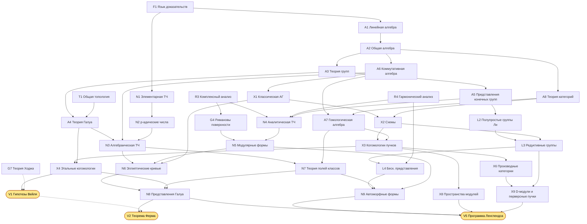
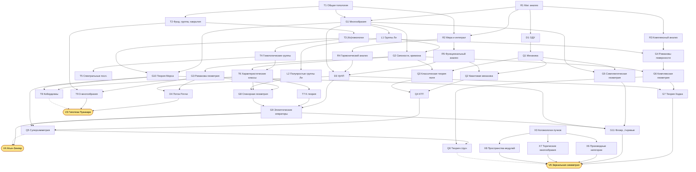

# Атлас современной математики: план изучения

От первых курсов до программы Ленглендса и зеркальной симметрии через четыре вершины прошлого: гипотезы Вейля, Великую теорему Ферма, гипотезу Пуанкаре и теорему Атьи–Зингера.

Документ вырос из `trajectory.txt`: все дисциплины оттуда сохранены, добавлены недостающие звенья, указаны зависимости и порядок изучения.

## Как пользоваться

| Часть | Что внутри | Когда открывать |
|---|---|---|
| [I. Краткий план](#part1) | Этапы с чекбоксами | Постоянно: здесь отмечается прогресс |
| [II. Карта связей](#part2) | Графы зависимостей, таблица «дисциплина → цель», сквозные идеи | Чтобы видеть, зачем изучается текущая тема |
| [III. Атлас](#part3) | Карточка на каждую дисциплину: что требует, для чего нужна, содержание, контрольные точки (банк ключевых доказательств), литература | Перед началом и в конце каждой дисциплины |
| [IV. Маршруты к вершинам](#part4) | Шесть целей: суть, минимальный путь, вехи, ключевые тексты | С этапа 4 |
| [V. Боковые ветви](#part5) | Дисциплины вне критического пути и их точки соприкосновения с ним | По интересу |
| [VI. Как учиться](#part6) | Метод работы | Один раз прочитать, потом возвращаться |
| [Reality Check](README.md) | Письменные трёхчасовые экзамены по каждой дисциплине с ключом и шкалой уровней | В конце каждой дисциплины: по результату ставится галочка |

**Правило отметки.** Дисциплина считается пройденной, когда её экзамен из [Reality Check](README.md) сдан на уровне «уверенно» (75 баллов и выше), а не когда дочитана книга. *Контрольные точки* в карточке (Часть III) — список ключевых теорем дисциплины, которые нужно уметь доказать без книги; из них составляется часть D экзамена, но отдельно на галочку они не влияют. Для тем «в процессе» удобно дописывать после пункта пометку `— в процессе (книга, глава)`.

**Коды.** У каждой дисциплины есть код (`A4`, `G9`, `X4` …); по нему она ищется в атласе и на графах.

| Буква | Область | Буква | Область |
|---|---|---|---|
| F | Фундамент | T | Топология |
| A | Алгебра | G | Геометрия |
| N | Теория чисел | L | Группы и алгебры Ли |
| R | Анализ | X | Алгебраическая геометрия |
| D | Дифференциальные уравнения | P | Вероятность |
| Q | Физика для математиков | V | Вершины (цели) |

**Сроки** в плане ориентировочные: при 20–25 часах сосредоточенной работы в неделю. Весь путь до этапа 6 по объёму соответствует бакалавриату, магистратуре и аспирантуре сильного математического факультета, то есть 8–12 годам. Это ориентир, а не норма: важен не темп, а то, что каждая контрольная точка действительно пройдена.

---

## Часть I. Краткий план (трекер прогресса)

Главный принцип порядка: **внутри этапа вести 2–3 трека параллельно** (алгебра и теория чисел; геометрия и топология; анализ), а не проходить области целиком одну за другой. Дисциплины одного этапа примерно независимы друг от друга. Дисциплины следующего этапа опираются на предыдущий.

### Этап 0. Вход: язык доказательств (1–3 месяца)

- [ ] [F1](#f1) Логика, множества, техника доказательств
- [ ] [N1](#n1) Элементарная теория чисел: начало (делимость, сравнения, малая теорема Ферма)

**Итог этапа:** вы свободно читаете и записываете строгие доказательства.

### Этап 1. Базовый курс (≈ 1,5–2 года)

- **Анализ**
  - [ ] [R1](#r1) Математический анализ (одной и нескольких переменных)
  - [ ] [D1](#d1) Обыкновенные дифференциальные уравнения
- **Алгебра и теория чисел**
  - [ ] [A1](#a1) Линейная алгебра
  - [ ] [A2](#a2) Общая алгебра
  - [ ] [N1](#n1) Элементарная теория чисел: до квадратичного закона взаимности
- **Геометрия и топология**
  - [ ] [T1](#t1) Общая топология

**Итог этапа:** стандартный материал первых двух курсов: теорема о неявной функции, жорданова форма, классификация конечнопорождённых абелевых групп, компактность.

### Этап 2. Ядро (≈ 1,5–2 года)

- **Анализ**
  - [ ] [R2](#r2) Действительный анализ (мера и интеграл Лебега)
  - [ ] [R3](#r3) Комплексный анализ
  - [ ] [R4](#r4) Гармонический анализ
  - [ ] [R5](#r5) Функциональный анализ
- **Алгебра и теория чисел**
  - [ ] [A3](#a3) Теория групп
  - [ ] [A4](#a4) Теория Галуа (включая бесконечную)
  - [ ] [A5](#a5) Представления конечных групп
  - [ ] [A6](#a6) Коммутативная алгебра
  - [ ] [A8](#a8) Теория категорий (язык)
  - [ ] [N2](#n2) p-адические числа и локальные поля
- **Геометрия и топология**
  - [ ] [G1](#g1) Гладкие многообразия и анализ на многообразиях
  - [ ] [T2](#t2) Фундаментальная группа и накрытия
  - [ ] [T3](#t3) Гомологии и когомологии
  - [ ] [L1](#l1) Группы и алгебры Ли: основы
- **Физика** (нужна для V6, можно отложить)
  - [ ] [Q1](#q1) Классическая механика
- **Боковые ветви** (необязательно)
  - [ ] [P1](#p1) Теория вероятностей
  - [ ] [R7](#r7) Вариационное исчисление

**Итог этапа:** вы понимаете три главных языка математики: алгебраические структуры, топологические инварианты и анализ в бесконечномерных пространствах.

### Этап 3. Продвинутое ядро (≈ 2 года)

- **Алгебра и теория чисел**
  - [ ] [A7](#a7) Гомологическая алгебра
  - [ ] [N3](#n3) Алгебраическая теория чисел
  - [ ] [N4](#n4) Аналитическая теория чисел
  - [ ] [N5](#n5) Модулярные формы
- **Геометрия**
  - [ ] [G2](#g2) Дифференциальная геометрия: расслоения, связности, кривизна
  - [ ] [G3](#g3) Риманова геометрия
  - [ ] [G4](#g4) Римановы поверхности и алгебраические кривые
  - [ ] [G5](#g5) Симплектическая геометрия
  - [ ] [X1](#x1) Классическая алгебраическая геометрия
- **Топология**
  - [ ] [T4](#t4) Гомотопические группы и расслоения
  - [ ] [T5](#t5) Спектральные последовательности
  - [ ] [T6](#t6) Характеристические классы
- **Группы Ли**
  - [ ] [L2](#l2) Структура и представления полупростых групп и алгебр Ли
- **Анализ**
  - [ ] [D3](#d3) Уравнения в частных производных
- **Боковые ветви** (необязательно)
  - [ ] [D2](#d2) Динамические системы
  - [ ] [R8](#r8) Выпуклый анализ
  - [ ] [P3](#p3) Случайные процессы

**Итог этапа:** вы можете читать учебники уровня Hartshorne, Milnor–Stasheff, Neukirch и Diamond–Shurman.

### Этап 4. Языки современной математики (≈ 2 года)

- **Алгебраическая геометрия**
  - [ ] [X2](#x2) Пучки, схемы, морфизмы схем
  - [ ] [X3](#x3) Когомологии когерентных пучков, Риман–Рох, теория пересечений
  - [ ] [X4](#x4) Этальные когомологии
  - [ ] [X7](#x7) Торические многообразия
- **Теория чисел**
  - [ ] [N6](#n6) Эллиптические кривые
  - [ ] [N7](#n7) Теория полей классов
- **Геометрия**
  - [ ] [G6](#g6) Комплексная геометрия
  - [ ] [G7](#g7) Теория Ходжа
  - [ ] [G8](#g8) Спинорная геометрия и операторы Дирака
  - [ ] [G10](#g10) Теория Морса
- **Топология**
  - [ ] [T7](#t7) Топологическая K-теория
  - [ ] [T8](#t8) Кобордизмы
- **Группы Ли**
  - [ ] [L3](#l3) Алгебраические и редуктивные группы
- **Физика**
  - [ ] [Q2](#q2) Квантовая механика для математиков
  - [ ] [Q3](#q3) Классическая теория поля
- **Боковые ветви** (необязательно)
  - [ ] [X5](#x5) Бирациональная геометрия
  - [ ] [A9](#a9) Алгебраическая K-теория
  - [ ] [P4](#p4) Стохастические дифференциальные уравнения
  - [ ] [R9](#r9) Оптимальное управление
  - [ ] [P2](#p2) Математическая статистика
  - [ ] [Q7](#q7) Общая теория относительности
  - [ ] [Q8](#q8) Механика сплошных сред
  - [ ] [Q9](#q9) Статистическая физика
  - [ ] [Q10](#q10) Физическая кинетика

**Итог этапа:** вы владеете языком, на котором написаны доказательства всех четырёх «вершин прошлого».

### Этап 5. Вершины прошлого (≈ 2–3 года, частично параллельно)

Рекомендуемый порядок: **V4 → V1 → V2**, а **V3** можно вести параллельно в любой момент: это самая обособленная ветка. V4 закрепляет геометрию, топологию и анализ, V1 — алгебраическую геометрию, V2 опирается на V1 и даёт всю арифметику, нужную для Ленглендса.

- [ ] [V4](#v4) **Теорема Атьи–Зингера об индексе**. Новое: [G9](#g9) Эллиптические операторы и индекс
- [ ] [V1](#v1) **Гипотезы Вейля**. Новое: доказательство Делиня на базе [X4](#x4)
- [ ] [V2](#v2) **Великая теорема Ферма**. Новое: [N8](#n8) Представления Галуа и теория деформаций
- [ ] [V3](#v3) **Гипотеза Пуанкаре**. Новое: [T9](#t9) Топология 3-многообразий, [D4](#d4) Геометрический анализ и поток Риччи

Подробные вехи по каждой вершине см. в [Части IV](#part4).

### Этап 6. Современные направления (открытый этап)

- [ ] [V5](#v5) **Программа Ленглендса**
  - [ ] [L4](#l4) Бесконечномерные представления редуктивных групп
  - [ ] [N9](#n9) Автоморфные формы и представления
  - [ ] [X8](#x8) Пространства модулей и стеки
  - [ ] [X9](#x9) D-модули и перверсные пучки
  - [ ] [X6](#x6) Производные категории
- [ ] [V6](#v6) **Зеркальная симметрия**
  - [ ] [X6](#x6) Производные категории когерентных пучков
  - [ ] [X8](#x8) Пространства модулей и стеки
  - [ ] [G11](#g11) Теория Флоера и псевдоголоморфные кривые
  - [ ] [Q4](#q4) Квантовая теория поля для математиков
  - [ ] [Q5](#q5) Суперсимметрия для математиков
  - [ ] [Q6](#q6) Теория струн для математиков

**Итог этапа:** вы читаете свежие статьи на arXiv по выбранному направлению и понимаете, какие в нём открытые вопросы.

---

## Часть II. Карта связей

### Граф 1. Алгебро-арифметическая ветвь (к V1, V2, V5)

Стрелка `X → Y` означает «X нужен для Y». Пунктир означает «полезно, но не обязательно».

### Граф 2. Геометро-аналитическая ветвь (к V3, V4, V6)

### Таблица: какие дисциплины питают какие цели

● — необходимо, ○ — полезно или нужно частично, пусто — практически не используется.

| Дисциплина | V1 Вейль | V2 Ферма | V3 Пуанкаре | V4 Атья–Зингер | V5 Ленглендс | V6 Зеркальная |
|---|:-:|:-:|:-:|:-:|:-:|:-:|
| Теория Галуа (A4) | ● | ● | | | ● | |
| Представления конечных групп (A5) | ○ | ○ | | ○ | ● | |
| Коммутативная алгебра (A6) | ● | ● | | | ● | ● |
| Гомологическая алгебра (A7) | ● | ● | ○ | ○ | ● | ● |
| Теория категорий (A8) | ○ | ○ | | | ● | ● |
| p-адические числа (N2) | ○ | ● | | | ● | |
| Алгебраическая ТЧ (N3) | ○ | ● | | | ● | |
| Аналитическая ТЧ (N4) | ○ | ○ | | | ● | |
| Модулярные формы (N5) | ○ | ● | | | ● | ○ |
| Эллиптические кривые (N6) | ○ | ● | | | ● | ○ |
| Теория полей классов (N7) | | ● | | | ● | |
| Комплексный анализ (R3) | ○ | ● | | ○ | ● | ● |
| Гармонический анализ (R4) | | ○ | ○ | ○ | ● | |
| Функциональный анализ (R5) | | | ● | ● | ● | ○ |
| УрЧП (D3) | | | ● | ● | ○ | ○ |
| Многообразия, связности (G1–G2) | ○ | | ● | ● | ○ | ● |
| Риманова геометрия (G3) | | | ● | ● | | ○ |
| Римановы поверхности (G4) | ● | ● | | ○ | ● | ● |
| Симплектическая геометрия, Флоер (G5, G11) | | | | | | ● |
| Комплексная геометрия, Ходж (G6–G7) | ○ | ○ | | ○ | ○ | ● |
| Алгебраическая топология (T2–T5) | ● | ○ | ● | ● | ○ | ● |
| Характеристические классы, K-теория (T6–T7) | ○ | | | ● | ○ | ● |
| Группы Ли и представления (L1–L2) | | ○ | ○ | ● | ● | ○ |
| Редуктивные группы (L3–L4) | | ○ | | | ● | |
| Схемы, когомологии пучков (X2–X3) | ● | ● | | ○ | ● | ● |
| Этальные когомологии (X4) | ● | ● | | | ● | |
| Производные категории (X6) | ○ | | | | ● | ● |
| Пространства модулей (X8) | | ○ | | | ● | ● |
| Физика: механика, теория поля, суперсимметрия, струны (Q1–Q6) | | | | ○ | ○ | ● |

Видно, что V1, V2 и V5 образуют одну большую арифметическую систему, V4 и V6 — геометрическую, а V3 стоит особняком: это геометрический анализ.

### Сквозные идеи: что связывает направления

Атлас удобнее держать в голове не как список предметов, а как несколько идей, которые повторяются в разных областях.

1. **Галуа ↔ накрытия ↔ фундаментальная группа.** Соответствие Галуа между подполями и подгруппами ([A4](#a4)) и соответствие между накрытиями и подгруппами π₁ ([T2](#t2)) — одна и та же теорема. Гротендик сделал это буквальным: этальная фундаментальная группа ([X4](#x4)) поля есть его абсолютная группа Галуа. Отсюда центральный объект V2 и V5: представления абсолютной группы Галуа.

2. **«Розеттский камень» Вейля.** Числовые поля, функциональные поля кривых над 𝔽_q и римановы поверхности — три версии одной теории. Арифметическая программа Ленглендса живёт в первой колонке, гипотезы Вейля и работы Дринфельда и Лафоргов — во второй, геометрическая программа Ленглендса — в третьей.

3. **Когомологии как универсальный язык.** Сингулярные, де Рама, Дольбо, когерентные, этальные, когомологии групп и Галуа — версии одной конструкции, связанные теоремами сравнения (де Рама, Ходжа, GAGA, теоремы сравнения Артина). Поэтому [A7](#a7) и [T3](#t3) надо проходить рано и основательно.

4. **Формулы следа и неподвижные точки.** Теорема Лефшеца о неподвижных точках ([T3](#t3)) → формула Атьи–Ботта ([G9](#g9)) → формула следа Гротендика–Лефшеца для Фробениуса ([V1](#v1)) → формула следа Сельберга–Артура ([V5](#v5)). Одна идея проходит через четыре вершины.

5. **Индекс: анализ = топология.** Гаусс–Бонне, Риман–Рох ([G4](#g4)), Риман–Рох–Хирцебрух ([X3](#x3)), сигнатурная теорема ([T8](#t8)) — частные случаи теоремы Атьи–Зингера ([V4](#v4)). Индекс же задаёт ожидаемую размерность пространств модулей в теориях Громова–Виттена и Флоера ([V6](#v6)).

6. **Двойственности.** Двойственность Пуанкаре, двойственность Понтрягина и преобразование Фурье ([R4](#r4)), преобразование Фурье–Мукаи ([X6](#x6)), дуальная группа Ленглендса ([L3](#l3)), зеркальная симметрия ([V6](#v6)). Геометрическая программа Ленглендса и зеркальная симметрия связаны напрямую: по Капустину–Виттену это два проявления одной S-дуальности.

7. **Локальное и глобальное.** p-адические числа и принцип Хассе ([N2](#n2)), адели ([N7](#n7)), пучки ([X2](#x2)): глобальный объект собирается из локальных данных, а препятствия к склейке измеряются когомологиями.

8. **Вариационные принципы и потоки.** Геодезические как критические точки длины ([R7](#r7), [G3](#g3)) → теория Морса ([G10](#g10)) → гомологии Флоера как теория Морса функционала действия ([G11](#g11)). Градиентные потоки ведут к потоку Риччи и энтропии Перельмана ([D4](#d4)).

---

## Часть III. Атлас дисциплин

Формат карточки:
- **Требует** — что нужно знать заранее;
- **Нужна для** — куда ведёт;
- **Содержание** — минимальный список тем;
- **Контрольные точки (КТ)** — ключевые теоремы и вычисления дисциплины, которые нужно уметь воспроизвести без книги. Это банк, из которого составляется часть D экзамена (ключевые доказательства); в него можно добавлять и другие доказательства дисциплины, важные для неё самой или для следующих дисциплин. Галочка ставится по итогу экзамена (75 баллов и выше), а не по отдельным КТ;
- **Литература** — сначала основной учебник, затем альтернативы.

### F. Фундамент

#### F1. Язык математики: логика, множества, доказательства
- **Требует:** школьную математику.
- **Нужна для:** всего.
- **Содержание:** высказывания и кванторы; индукция; множества, отображения, отношения эквивалентности, фактор-множества; мощность, счётность; аксиома выбора и лемма Цорна (формулировки и типичные применения).
- **КТ** (банк ключевых доказательств для части D экзамена):
  1. доказать несчётность ℝ диагональным методом и теорему Кантора |X| < |2^X|;
  2. доказать теорему Кантора–Бернштейна;
  3. доказать существование базиса в любом векторном пространстве через лемму Цорна; вывести лемму Цорна из аксиомы выбора (или обратно);
  4. доказать счётность ℚ и множества алгебраических чисел, вывести существование трансцендентных чисел;
  5. обосновать корректность операций на фактор-множестве (например, на ℤ/n и на ℚ как факторе ℤ × ℤ∖{0}) и универсальное свойство факторотображения;
  6. доказать равносильность принципа индукции и принципа наименьшего элемента; провести доказательство трансфинитной индукцией.
- **Литература:** Верещагин, Шень «Начала теории множеств»; Velleman «How to Prove It».

### A. Алгебра

#### A1. Линейная алгебра
- **Требует:** F1.
- **Нужна для:** почти всего; напрямую — A2, R1 (многомерный анализ), A5, G1, R5.
- **Содержание:** векторные пространства, линейные отображения, двойственность; определители; собственные значения, жорданова форма; билинейные и квадратичные формы; евклидовы и эрмитовы пространства, спектральная теорема; тензорное и внешнее произведения.
- **КТ** (банк ключевых доказательств для части D экзамена):
  1. доказать существование и единственность жордановой нормальной формы;
  2. доказать теорему о ранге (rk A = rk Aᵀ, dim Ker + dim Im = n) и теорему Кронекера–Капелли;
  3. доказать мультипликативность определителя и формулу разложения по строке; вывести формулу Крамера;
  4. доказать теорему Гамильтона–Кэли; доказать критерий диагонализуемости через минимальный многочлен;
  5. доказать спектральную теорему для самосопряжённых и нормальных операторов; получить полярное и сингулярное разложения;
  6. доказать закон инерции Сильвестра и критерий Сильвестра положительной определённости;
  7. вычислить exp(A) для жордановой клетки и решить линейную систему ОДУ с постоянными коэффициентами;
  8. доказать универсальное свойство тензорного произведения; найти базис и размерность Λᵏ V, объяснить det как Λⁿ.
- **Литература:** Винберг «Курс алгебры»; Кострикин «Введение в алгебру» (ч. II); Axler «Linear Algebra Done Right».

#### A2. Общая алгебра
- **Требует:** F1, A1 (можно параллельно).
- **Нужна для:** A3–A8, N3, X1.
- **Содержание:** группы, подгруппы, факторгруппы, гомоморфизмы, действия; кольца и идеалы; евклидовы кольца, кольца главных идеалов, факториальные кольца; поля и их расширения (начало); модули над кольцами главных идеалов и их классификация.
- **КТ** (банк ключевых доказательств для части D экзамена):
  1. классифицировать конечно порождённые модули над кольцом главных идеалов и вывести из этого классификацию абелевых групп и жорданову форму;
  2. доказать теорему Лагранжа, теоремы о гомоморфизме и об изоморфизмах, теорему о соответствии для факторгрупп;
  3. доказать цепочку «евклидово ⇒ главных идеалов ⇒ факториальное»; доказать лемму Гаусса и факториальность ℤ[x] и k[x₁,…,xₙ];
  4. доказать китайскую теорему об остатках для колец и описать строение (ℤ/n)^×;
  5. доказать критерий Эйзенштейна и неприводимость Φₚ; доказать неприводимость x^{p−1} + … + 1 через сдвиг;
  6. доказать существование и единственность поля разложения; построить 𝔽_q и доказать его единственность;
  7. доказать теорему о степени башни и критерий алгебраичности через конечномерность; доказать, что алгебраические элементы образуют поле;
  8. доказать цикличность конечной подгруппы мультипликативной группы поля; вывести теорему Вильсона.
- **Литература:** Винберг «Курс алгебры»; Dummit, Foote «Abstract Algebra»; Aluffi «Algebra: Chapter 0».

#### A3. Теория групп
- **Требует:** A2.
- **Нужна для:** A4, A5, L1, T2.
- **Содержание:** теоремы Силова; разрешимые и нильпотентные группы; простые группы, Sₙ и Aₙ; полупрямые произведения; свободные группы и копредставления; расширения групп (начало).
- **КТ** (банк ключевых доказательств для части D экзамена):
  1. классифицировать группы порядка ≤ 15;
  2. доказать простоту Aₙ при n ≥ 5;
  3. доказать теоремы Силова и применить их: группы порядка pq, непростота групп порядка p²q и 2p;
  4. доказать теорему Жордана–Гёльдера;
  5. доказать, что центр p-группы нетривиален и p-группы нильпотентны; доказать, что конечная группа нильпотентна ⇔ она прямое произведение своих силовских подгрупп;
  6. доказать, что подгруппы и факторы разрешимых групп разрешимы, S₄ разрешима, Sₙ не разрешима при n ≥ 5;
  7. доказать универсальное свойство свободной группы и единственность нормальной формы слова; сформулировать теорему Нильсена–Шрайера;
  8. описать полупрямые произведения и классифицировать с их помощью группы порядка 2p и диэдральные группы; построить неабелеву группу порядка p³.
- **Литература:** Каргаполов, Мерзляков «Основы теории групп»; Rotman «An Introduction to the Theory of Groups».

#### A4. Теория Галуа
- **Требует:** A2, A3; T1 (топология Крулля и проконечные группы в бесконечной теории Галуа).
- **Нужна для:** N3, N7, X4 (этальная фундаментальная группа обобщает группу Галуа), V1, V2, V5.
- **Содержание:** конечные, нормальные и сепарабельные расширения; основная теорема; конечные поля; круговые поля; нормы и следы; теорема Гильберта 90 и теория Куммера; разрешимость в радикалах; расширения Артина–Шрайера (повышенный уровень); **бесконечная теория Галуа**: проконечные группы, топология Крулля. Последнее обязательно: абсолютная группа Галуа Gal(ℚ̄/ℚ) — центральный объект V2 и V5.
- **КТ** (банк ключевых доказательств для части D экзамена):
  1. доказать неразрешимость в радикалах общего уравнения 5-й степени и привести конкретный пример (x⁵ − 4x + 2);
  2. доказать равносильность определений расширения Галуа (нормальное и сепарабельное; поле разложения сепарабельного многочлена; K = L^G) и теорему Артина |Aut(L/K)| ≤ [L:K];
  3. доказать основную теорему теории Галуа;
  4. доказать теорему о примитивном элементе, независимость характеров Дедекинда и критерий сепарабельности через производную;
  5. описать Gal(ℚ(ζₙ)/ℚ) ≅ (ℤ/n)^× и доказать неприводимость Φₙ над ℚ;
  6. доказать, что Gal(𝔽_{qⁿ}/𝔽_q) циклична и порождена Фробениусом; описать подполя 𝔽_{qⁿ};
  7. доказать теорему Гильберта 90 (мультипликативную и аддитивную) и построить соответствие Куммера; описать расширения Артина–Шрайера;
  8. доказать, что Gal(𝔽̄ₚ/𝔽ₚ) ≅ ℤ̂, и основную теорему бесконечной теории Галуа (замкнутые подгруппы ↔ промежуточные поля); описать Gal(ℚ(ζ_{p^∞})/ℚ) ≅ ℤₚ^×.
- **Литература:** Постников «Основы теории Галуа»; Artin «Galois Theory»; Stewart «Galois Theory»; Milne «Fields and Galois Theory» (конспекты).

#### A5. Представления конечных групп
- **Требует:** A1, A3.
- **Нужна для:** L2, L4, N4 (характеры Дирихле), N9, V5.
- **Содержание:** теорема Машке, лемма Шура; характеры и соотношения ортогональности; индуцированные представления и взаимность Фробениуса; представления Sₙ и диаграммы Юнга; преобразование Фурье на конечной группе.
- **КТ** (банк ключевых доказательств для части D экзамена):
  1. построить таблицы характеров S₄ и A₅ (а также Dₙ, Q₈, A₄);
  2. доказать теорему Машке и лемму Шура;
  3. доказать соотношения ортогональности характеров и то, что число неприводимых представлений равно числу классов сопряжённости; вывести Σ dᵢ² = |G|;
  4. доказать, что размерность неприводимого представления делит |G| (через целые алгебраические числа);
  5. доказать взаимность Фробениуса и формулу для индуцированного характера;
  6. доказать теорему Бернсайда о разрешимости групп порядка pᵃqᵇ через характеры;
  7. описать неприводимые представления Sₙ через разбиения (модули Шпехта) и доказать, что их число равно числу разбиений;
  8. вывести формулу обращения и равенство Планшереля для преобразования Фурье на конечной группе; разложить L²(G) по неприводимым.
- **Литература:** Серр «Линейные представления конечных групп»; Fulton, Harris «Representation Theory: A First Course» (ч. I).

#### A6. Коммутативная алгебра
- **Требует:** A2.
- **Нужна для:** X1, X2, N3, L3, N8 (полные пересечения в доказательстве Уайлса).
- **Содержание:** простые и максимальные идеалы; модули над кольцами (в объёме Атьи–Макдональда): конечно порождённые модули, лемма Накаямы, тензорное произведение, точные последовательности; локализация; нётеровы и артиновы кольца, теорема Гильберта о базисе; примарное разложение и ассоциированные простые идеалы; теорема Гильберта о нулях; целые расширения, нормализация Нётер; размерность Крулля; кольца дискретного нормирования и дедекиндовы кольца; пополнения и лемма Гензеля; плоские модули; регулярные кольца (начало).
- **КТ** (банк ключевых доказательств для части D экзамена):
  1. доказать теорему Гильберта о нулях (лемма Зарисского, слабая и сильная формы) через нормализацию Нётер;
  2. доказать, что кольцо целых числового поля дедекиндово; доказать эквивалентность характеризаций кольца дискретного нормирования;
  3. доказать лемму Накаямы и её следствия: локальный критерий свободности, минимальные системы порождающих;
  4. доказать теорему Гильберта о базисе и теорему Коэна (простые идеалы конечно порождены ⇒ кольцо нётерово);
  5. доказать lying over, going up и incomparability для целых расширений и сохранение размерности при целом расширении;
  6. доказать существование и единственность примарного разложения в нётеровом кольце (Ласкер–Нётер); доказать конечность Ass(M) и описать минимальные простые идеалы как изолированные компоненты;
  7. доказать теорему Крулля о главном идеале и равенство dim k[x₁,…,xₙ] = n; доказать теорему Крулля о пересечении степеней идеала;
  8. доказать лемму Гензеля; доказать точность локализации, локальность равенства нулю и критерий плоскости над кольцом главных идеалов (плоский ⇔ без кручения).
- **Литература:** Atiyah, Macdonald «Introduction to Commutative Algebra»; Eisenbud «Commutative Algebra with a View Toward Algebraic Geometry»; Matsumura «Commutative Ring Theory».

#### A7. Гомологическая алгебра
- **Требует:** A6, A8; T3 желательно параллельно, как источник примеров.
- **Нужна для:** X3, X4, X6, N7 (когомологии групп), T5, V1, V2, V5, V6.
- **Содержание:** абелевы категории; комплексы и точные последовательности; производные функторы, Ext и Tor; когомологии групп; спектральные последовательности Гротендика и Лере; триангулированные и производные категории (начало).
- **КТ** (банк ключевых доказательств для части D экзамена):
  1. вывести длинную точную последовательность гомологий из короткой точной последовательности комплексов (лемма о змее);
  2. доказать лемму о пяти и теорему о сравнении для проективных резольвент; вывести корректность определения производных функторов;
  3. объяснить, почему Ext¹ классифицирует расширения (соответствие Йонеды), и доказать это;
  4. вычислить H*(ℤ/n, ℤ), H*(ℤ, M), когомологии свободной группы и Tor^ℤ_i(A, B);
  5. доказать сбалансированность Tor и Ext (вычисление по любому аргументу);
  6. доказать критерий Бэра инъективности и существование достаточного запаса инъективных модулей;
  7. построить спектральную последовательность Гротендика для композиции функторов и вывести из неё точную последовательность ограничения-инфляции (Хохшильд–Серр);
  8. построить производную категорию (локализация по квазиизоморфизмам), доказать, что Hom_{D(A)}(X, Y[n]) = Extⁿ(X, Y) для модулей, и описать выделенные треугольники.
- **Литература:** Weibel «An Introduction to Homological Algebra»; Гельфанд, Манин «Методы гомологической алгебры».

#### A8. Теория категорий
- **Требует:** A2; T1 — для примеров.
- **Нужна для:** A7, X2, X6, V5, V6 (весь современный язык).
- **Содержание:** категории, функторы, естественные преобразования; универсальные свойства; пределы и копределы; сопряжённые функторы; лемма Йонеды; абелевы категории. Позже: моноидальные категории, 2-категории, идея ∞-категорий.
- **КТ** (банк ключевых доказательств для части D экзамена):
  1. доказать лемму Йонеды и вывести из неё единственность объекта, заданного универсальным свойством;
  2. найти левый сопряжённый к забывающему функтору Grp → Set (и Ab → Grp, Ring → Set), доказать сопряжённость;
  3. доказать равносильность определений сопряжённости (через биекцию Hom и через единицу/коединицу); доказать, что правый сопряжённый сохраняет пределы;
  4. построить пределы и копределы в Set, Grp, Top через произведения и уравнители; доказать, что категория с произведениями и уравнителями полна;
  5. доказать, что функтор — эквивалентность категорий ⇔ он полный, строгий и существенно сюръективный;
  6. доказать, что Hom(−, X) сохраняет пределы, и привести доказанный пример непредставимого функтора;
  7. доказать, что в абелевой категории всякий мономорфизм — ядро своего коядра, и вывести лемму о змее абстрактно;
  8. сформулировать теорему Фрейда о сопряжённых функторах и применить её; описать моноидальные категории и 2-категорию Cat на примерах.
- **Литература:** Leinster «Basic Category Theory»; Riehl «Category Theory in Context»; Mac Lane «Categories for the Working Mathematician».

#### A9. Алгебраическая K-теория (боковая ветвь)
- **Требует:** A6, A7; T7 — для сравнения.
- **Связь с целями:** символы норменного вычета и K₂ (теория полей классов); регуляторы и специальные значения L-функций (гипотезы Бейлинсона); мотивы. Для шести вершин это фон, а не опора.
- **Содержание:** K₀ (проективные модули), K₁ (определители, группа Уайтхеда), K₂ Милнора и символы Стейнберга, теорема Мацумото; +-конструкция и Q-конструкция Квиллена.
- **КТ** (банк ключевых доказательств для части D экзамена):
  1. доказать, что K₀ дедекиндова кольца R изоморфна ℤ ⊕ Cl(R);
  2. вычислить K₀ поля, локального кольца, кольца главных идеалов; доказать, что проективные модули над локальным кольцом свободны;
  3. доказать K₁(F) = F^× для поля и лемму Уайтхеда E(R) = [GL(R), GL(R)]; вычислить K₁(ℤ);
  4. сформулировать теорему Мацумото и доказать K₂(𝔽_q) = 0; описать символы Стейнберга и их соотношения;
  5. определить символ Гильберта и символ норменного вычета, доказать билинейность и связь с K₂;
  6. вывести точную последовательность локализации для дедекиндова кольца и получить из неё K₀;
  7. объяснить +-конструкцию Квиллена и доказать π₁(BGL(R)⁺) ≅ K₁(R); описать Q-конструкцию (обзор).
- **Литература:** Milnor «Introduction to Algebraic K-Theory»; Weibel «The K-book»; Rosenberg «Algebraic K-Theory and Its Applications».

### N. Теория чисел

#### N1. Элементарная теория чисел
- **Требует:** F1.
- **Нужна для:** A2 (примеры), N2, N3, N4.
- **Содержание:** делимость, основная теорема арифметики; сравнения, китайская теорема об остатках; первообразные корни; квадратичные вычеты и закон взаимности; суммы Гаусса; цепные дроби и уравнение Пелля; суммы двух и четырёх квадратов.
- **КТ** (банк ключевых доказательств для части D экзамена):
  1. доказать квадратичный закон взаимности двумя способами: через лемму Гаусса и через суммы Гаусса;
  2. доказать существование первообразных корней по модулю p, pᵏ и 2pᵏ и их отсутствие по остальным модулям;
  3. доказать теорему Ферма о сумме двух квадратов и теорему Лагранжа о четырёх квадратах;
  4. доказать китайскую теорему об остатках и критерий Эйлера; вычислять символы Лежандра и Якоби и доказать свойства символа Якоби;
  5. доказать бесконечность простых в прогрессиях 4k + 1, 4k + 3 и p ≡ 1 (mod n) (через Φₙ);
  6. доказать бесконечность решений уравнения Пелля и описать их структуру через фундаментальное решение;
  7. доказать оценки Чебышёва π(x) ≍ x / log x и постулат Бертрана;
  8. доказать формулу обращения Мёбиуса и мультипликативность φ, σ, μ; вывести Σ_{d|n} φ(d) = n.
- **Литература:** Виноградов «Основы теории чисел»; Айерлэнд, Роузен «Классическое введение в современную теорию чисел» (гл. 1–9). Последняя книга понадобится ещё раз в V1.

#### N2. p-адические числа и локальные поля
- **Требует:** N1, R1; A6 частично.
- **Нужна для:** N3, N7, N8, L4, V1 (доказательство рациональности по Дворку), V5.
- **Содержание:** абсолютные значения, теорема Островского; ℚₚ и ℤₚ; лемма Гензеля; принцип Хассе–Минковского для квадратичных форм; локальные поля, ветвление; неархимедов анализ (начало).
- **КТ** (банк ключевых доказательств для части D экзамена):
  1. доказать теорему Островского;
  2. доказать лемму Гензеля (обе формы); решить x² = 2 в ℤ₇ и описать ℚₚ^×/ℚₚ^{×2};
  3. доказать, что ℤₚ компактно и ℤₚ ≅ lim ℤ/pⁿ, а ℚₚ локально компактно;
  4. доказать теорему Хассе–Минковского для форм от трёх переменных через символ Гильберта и доказать формулу произведения для символа Гильберта;
  5. описать строение конечного расширения ℚₚ: ef = n, неразветвлённые расширения ↔ расширения поля вычетов, вполне разветвлённые ↔ многочлены Эйзенштейна;
  6. описать структуру ℚₚ^× и 1 + pℤₚ через p-адические логарифм и экспоненту (с областями сходимости);
  7. классифицировать квадратичные расширения ℚₚ и корни из единицы в ℚₚ;
  8. доказать критерий сходимости ряда в неархимедовом поле и теорему Малера о непрерывных функциях ℤₚ → ℚₚ (разложение по биномиальным многочленам).
- **Литература:** Серр «Курс арифметики» (ч. I); Gouvêa «p-adic Numbers: An Introduction»; Коблиц «p-адические числа, p-адический анализ и дзета-функции»; Боревич, Шафаревич «Теория чисел».

#### N3. Алгебраическая теория чисел
- **Требует:** A4, A6, N2.
- **Нужна для:** N6, N7, N8, V2, V5.
- **Содержание:** кольца целых, разложение простых идеалов, ветвление, дискриминант; группа классов и её конечность; теорема Дирихле о единицах (геометрия чисел Минковского); круговые поля; теорема Куммера о ВТФ для регулярных простых; дзета-функция Дедекинда (начало); адели и идели.
- **КТ** (банк ключевых доказательств для части D экзамена):
  1. вычислить группы классов ℚ(√−5), ℚ(√−23), ℚ(√−14) и ℚ(√2);
  2. доказать первый случай ВТФ для регулярных простых (Куммер);
  3. доказать, что 𝒪_K — свободный ℤ-модуль ранга n, и теорему о дискриминанте (ветвление ⇔ p | disc); сформулировать теорему Штикельбергера;
  4. доказать формулу Σ eᵢfᵢ = n и теорему Куммера–Дедекинда о разложении простых через факторизацию многочлена по модулю p;
  5. доказать конечность группы классов через границу Минковского;
  6. доказать теорему Дирихле о единицах и описать единицы вещественных квадратичных полей через уравнение Пелля;
  7. доказать, что кольцо целых ℚ(ζₙ) равно ℤ[ζₙ], описать разложение простых в круговых полях и вывести квадратичный закон взаимности через квадратичное подполе;
  8. доказать сходимость дзета-функции Дедекинда при Re s > 1 и эйлерово произведение; доказать дискретность K в 𝔸_K и компактность 𝔸_K/K, описать группу классов иделей.
- **Литература:** Neukirch «Algebraic Number Theory» (гл. I–II); Marcus «Number Fields»; Боревич, Шафаревич «Теория чисел»; Washington «Introduction to Cyclotomic Fields».

#### N4. Аналитическая теория чисел
- **Требует:** R3, R4, N1, A5 (характеры).
- **Нужна для:** N5, N9, V5 (L-функции).
- **Содержание:** дзета-функция Римана, аналитическое продолжение и функциональное уравнение через θ-функцию; асимптотический закон распределения простых; характеры Дирихле и простые в прогрессиях; L-функции Дирихле; явные формулы; решето (начало).
- **КТ** (банк ключевых доказательств для части D экзамена):
  1. доказать асимптотический закон распределения простых;
  2. доказать теорему Дирихле о простых в арифметических прогрессиях (включая L(1, χ) ≠ 0 для всех χ ≠ χ₀);
  3. доказать функциональное уравнение ζ(s) через θ-функцию и получить аналитическое продолжение; описать тривиальные нули и полюс;
  4. доказать ζ(1 + it) ≠ 0 (неравенство Мертенса) и получить область, свободную от нулей, с явной формулой фон Мангольдта (схема);
  5. доказать формулы Мертенса и теорему Мертенса Σ 1/p ∼ log log x;
  6. доказать функциональное уравнение L(s, χ) для примитивного характера через суммы Гаусса;
  7. доказать оценку числа простых-близнецов решетом Бруна или решетом Сельберга в простейшем виде;
  8. доказать теорему Чебышёва о порядке π(x) и тауберову теорему Винера–Икеары (или Ньюмана) и вывести из неё закон распределения простых.
- **Литература:** Davenport «Multiplicative Number Theory»; Карацуба «Основы аналитической теории чисел»; Apostol «Introduction to Analytic Number Theory»; Iwaniec, Kowalski «Analytic Number Theory» (дальше).

#### N5. Модулярные формы
- **Требует:** R3, N4; G4 частично; A3.
- **Нужна для:** N6, N8, N9, V2, V5; ○ V6 (квазимодулярные формы в инвариантах Громова–Виттена эллиптической кривой).
- **Содержание:** SL₂(ℤ) и фундаментальная область; ряды Эйзенштейна; Δ и τ-функция Рамануджана; размерности пространств форм; операторы Гекке, собственные формы и их L-функции; конгруэнц-подгруппы и модулярные кривые X₀(N); новые формы; соотношение Эйхлера–Шимуры (начало); тэта-функции.
- **КТ** (банк ключевых доказательств для части D экзамена):
  1. доказать, что кольцо модулярных форм уровня 1 порождается E₄ и E₆; вычислить размерности M_k и S_k;
  2. вывести мультипликативность τ(n) из теории Гекке (коммутативность Tₙ, собственные формы, эйлерово произведение);
  3. построить фундаментальную область SL₂(ℤ) и доказать, что S и T порождают группу;
  4. доказать формулу валентности (k/12) и вывести из неё конечномерность пространств форм;
  5. вывести q-разложение рядов Эйзенштейна через σ_{k−1} и получить тождества Рамануджана для σ;
  6. доказать функциональное уравнение L(f, s) через преобразование Меллина (Гекке);
  7. вычислить род X₀(N) и число каспов; доказать, что S₂(Γ₀(N)) ≅ H⁰(X₀(N), Ω¹);
  8. доказать формулу Якоби для r₄(n) через формы веса 2 на Γ₀(4); сформулировать соотношение Эйхлера–Шимуры.
- **Литература:** Серр «Курс арифметики» (гл. VII); Diamond, Shurman «A First Course in Modular Forms»; Koblitz «Introduction to Elliptic Curves and Modular Forms»; Zagier «Elliptic modular forms and their applications» (в сборнике «The 1-2-3 of Modular Forms»).

#### N6. Эллиптические кривые
- **Требует:** X1 (кривые), N3, N5, G4.
- **Нужна для:** V2, V5; ○ V1 (теорема Хассе — первый нетривиальный случай гипотезы Римана для кривых).
- **Содержание:** форма Вейерштрасса и групповой закон; изогении; модуль Тейта и спаривание Вейля; кривые над конечными полями; кривые над локальными полями (редукция, кондуктор, полустабильность); теорема Морделла–Вейля; кривые над ℂ (решётки, ℘-функция Вейерштрасса); комплексное умножение; гипотеза Бёрча–Свиннертон-Дайера (формулировка).
- **КТ** (банк ключевых доказательств для части D экзамена):
  1. доказать теорему Хассе |#E(𝔽_q) − q − 1| ≤ 2√q;
  2. доказать слабую теорему Морделла–Вейля и провести спуск; доказать теорему Морделла–Вейля через высоты;
  3. доказать ассоциативность группового закона через Pic⁰ и вывести явные формулы сложения;
  4. описать изогении: степень, двойственная изогения, E[m] ≅ (ℤ/m)²; построить спаривание Вейля и доказать его свойства;
  5. доказать теорему Лутц–Нагелля и инъективность E(ℚ)_tors → E(𝔽_p) при хорошей редукции;
  6. доказать униформизацию ℂ/Λ ≅ E через ℘-функцию (включая дифференциальное уравнение ℘);
  7. доказать, что j-инвариант классифицирует кривые над алгебраически замкнутым полем; классифицировать типы редукции;
  8. описать End(E) для кривых с комплексным умножением и действие Фробениуса; сформулировать гипотезу Бёрча–Свиннертон-Дайера.
- **Литература:** Silverman «The Arithmetic of Elliptic Curves»; Silverman, Tate «Rational Points on Elliptic Curves»; Husemöller «Elliptic Curves».

#### N7. Теория полей классов
- **Требует:** N3, N2, A7 (когомологии групп).
- **Нужна для:** N8, N9, V2, V5. Теория полей классов — это программа Ленглендса для GL₁.
- **Содержание:** локальная и глобальная теории полей классов; закон взаимности Артина и теорема существования; идели; когомологии Галуа и когомологии Тейта; теорема Кронекера–Вебера; локальная теория по Любину–Тейту; **тезис Тейта**: Фурье-анализ на аделях и функциональное уравнение L-функций Гекке.
- **КТ** (банк ключевых доказательств для части D экзамена):
  1. вывести квадратичный закон взаимности из закона взаимности Артина;
  2. вывести теорему Кронекера–Вебера из глобальной теории полей классов;
  3. самостоятельно воспроизвести тезис Тейта для ℚ: преобразование Фурье на 𝔸, формула Пуассона, функциональное уравнение ζ и L(s, χ);
  4. сформулировать локальную теорию полей классов (отображение взаимности, норменные группы, теорема существования) и вычислить отображение взаимности для неразветвлённых расширений;
  5. доказать теорему Гильберта 90 как H¹(G, L^×) = 0, периодичность когомологий Тейта циклических групп и свойства индекса Эрбрана;
  6. вычислить H²(G, L^×) ≅ ℤ/n для циклического расширения локальных полей и построить фундаментальный класс; сформулировать теорему Тейта–Накаямы;
  7. описать формальные группы Любина–Тейта и построение максимального вполне разветвлённого абелева расширения;
  8. доказать первое неравенство и вывести теорему Чеботарёва из закона Артина (схема).
- **Литература:** Касселс, Фрёлих (ред.) «Алгебраическая теория чисел» (содержит и тезис Тейта); Milne «Class Field Theory» (конспекты); Neukirch (гл. IV–VI); Artin, Tate «Class Field Theory».

#### N8. Представления Галуа и теория деформаций
- **Требует:** N5, N6, N7, X4, A6.
- **Нужна для:** V2, V5.
- **Содержание:** ℓ-адические представления; модуль Тейта эллиптической кривой; представления, ассоциированные с модулярными формами (Эйхлер–Шимура, Делинь); гипотеза Серра о модулярности mod p; теорема Рибета о понижении уровня; конечные плоские групповые схемы; деформации по Мазуру, теорема Шлессингера; алгебры Гекке; R = T и метод Тейлора–Уайлса; основы p-адической теории Ходжа (Фонтен).
- **КТ** (банк ключевых доказательств для части D экзамена):
  1. объяснить, почему модулярность кривой Фрея противоречит теореме Рибета, и вывести ВТФ;
  2. построить универсальное деформационное кольцо для абсолютно неприводимого ρ̄ (критерий Шлессингера);
  3. доказать, что касательное пространство к функтору деформаций равно H¹(G, ad ρ̄), и оценить число образующих и соотношений через H¹ и H²;
  4. описать модуль Тейта эллиптической кривой как представление Галуа и доказать критерий Нерона–Огга–Шафаревича в одну сторону;
  5. доказать равенство следа Фробениуса и aₚ для представления, ассоциированного с формой веса 2 (Эйхлер–Шимура, схема);
  6. сформулировать числовой критерий Уайлса–Ленстры (R = T) и объяснить его роль в методе Тейлора–Уайлса;
  7. описать конечные плоские групповые схемы и E[p] над ℤₚ; сформулировать классификацию Рейно;
  8. определить кольца периодов Фонтена и кристаллические представления; показать, что ℚₚ(1) и модуль Тейта кривой с хорошей редукцией кристаллические (схема).
- **Литература:** Cornell, Silverman, Stevens (ред.) «Modular Forms and Fermat's Last Theorem»; Darmon, Diamond, Taylor «Fermat's Last Theorem»; Brinon, Conrad «CMI Summer School Notes on p-adic Hodge Theory».

#### N9. Автоморфные формы и представления
- **Требует:** N5, N7, L4, R4.
- **Нужна для:** V5.
- **Содержание:** аделические группы; переход от модулярных форм к автоморфным представлениям GL₂(𝔸); тензорное разложение Флата; L-функции автоморфных представлений; обратные теоремы; изоморфизм Сатаке и неразветвлённые компоненты; L-группы и функториальность; формула следа Сельберга (начало); GLₙ.
- **КТ** (банк ключевых доказательств для части D экзамена):
  1. объяснить, как собственная форма Гекке задаёт автоморфное представление GL₂(𝔸_ℚ), и описать его локальные компоненты;
  2. доказать сильную аппроксимацию для GL₂ и изоморфизм GL₂(ℚ)∖GL₂(𝔸)/K ≅ Γ∖ℍ;
  3. доказать изоморфизм Сатаке для GL₂ и описать неразветвлённые главные серии через параметры Сатаке;
  4. сформулировать тензорное разложение Флата и доказать его для допустимых представлений (схема);
  5. определить L-функцию автоморфного представления, вычислить неразветвлённые локальные множители и сформулировать функциональное уравнение Жаке–Ленглендса;
  6. вывести формулу следа Сельберга для компактного фактора;
  7. сформулировать функториальность Ленглендса и вывести из неё гипотезу Рамануджана через симметрические степени (схема);
  8. сформулировать обратные теоремы Вейля и Жаке–Ленглендса и теорему Ленглендса о спектральном разложении для GLₙ.
- **Литература:** Bump «Automorphic Forms and Representations»; Getz, Hahn «An Introduction to Automorphic Representations»; Gelbart «Automorphic Forms on Adele Groups»; Gelbart «An elementary introduction to the Langlands program» (Bull. AMS, 1984).

### R. Анализ

#### R1. Математический анализ
- **Требует:** F1; A1 — для многомерной части (можно параллельно).
- **Нужна для:** всего.
- **Содержание:** вещественные числа, пределы, непрерывность; дифференцирование, интеграл Римана; ряды, равномерная сходимость; теоремы о перестановке предельных переходов (предел и интеграл, сумма ряда и интеграл, дифференцирование ряда, повторные пределы); многомерный анализ: дифференциал, теоремы об обратной и неявной функциях, кратные интегралы, дифференциальные формы, формула Стокса.
- **КТ** (банк ключевых доказательств для части D экзамена):
  1. доказать теорему о неявной функции и теорему об обратной функции;
  2. доказать общую формулу Стокса для форм на кубах или цепях и вывести из неё формулы Грина, Гаусса–Остроградского и классическую формулу Стокса;
  3. доказать теоремы о перестановке предельных переходов: предел и интеграл, дифференцирование и интегрирование функционального ряда при равномерной сходимости, теорему о повторных пределах; привести контрпримеры без равномерности;
  4. доказать критерий интегрируемости по Риману через суммы Дарбу, интегрируемость непрерывной функции и формулу Ньютона–Лейбница;
  5. доказать теорему Лагранжа о среднем и формулу Тейлора с остаточными членами в формах Лагранжа и Пеано; доказать достаточное условие экстремума через гессиан;
  6. доказать теоремы Больцано–Вейерштрасса и Гейне–Бореля в ℝⁿ и теорему Вейерштрасса о непрерывной функции на компакте;
  7. доказать формулу замены переменных в кратном интеграле;
  8. доказать аппроксимационную теорему Вейерштрасса и теорему Арцела–Асколи.
- **Литература:** Зорич «Математический анализ» (т. 1–2); Фихтенгольц «Курс дифференциального и интегрального исчисления»; Rudin «Principles of Mathematical Analysis»; Spivak «Calculus on Manifolds».

#### R2. Действительный анализ (мера и интеграл)
- **Требует:** R1, T1.
- **Нужна для:** R4, R5, P1, D3.
- **Содержание:** σ-алгебры, мера и интеграл Лебега; теоремы о предельном переходе; теорема Фубини; пространства Lᵖ; теорема Радона–Никодима; меры на локально компактных пространствах (теорема Рисса); мера Хаара.
- **КТ** (банк ключевых доказательств для части D экзамена):
  1. доказать теорему о мажорированной сходимости (через лемму Фату и теорему о монотонной сходимости);
  2. доказать полноту Lᵖ (Рисс–Фишер), неравенства Гёльдера и Минковского;
  3. доказать теорему Каратеодори о продолжении меры и построить меру Лебега; построить неизмеримое множество;
  4. доказать теорему Фубини–Тонелли и привести контрпримеры без σ-конечности и без интегрируемости;
  5. доказать теорему Радона–Никодима и разложение Лебега;
  6. доказать теорему Рисса о представлении положительных функционалов на C_c(X) (схема) и двойственность (Lᵖ)* = L^q при 1 ≤ p < ∞;
  7. построить меру Хаара на ℚₚ; доказать единственность меры Хаара на компактной группе;
  8. доказать теорему Лебега о дифференцировании через максимальную функцию Харди–Литтлвуда.
- **Литература:** Колмогоров, Фомин «Элементы теории функций и функционального анализа»; Folland «Real Analysis»; Stein, Shakarchi «Real Analysis»; Богачёв «Основы теории меры».

#### R3. Комплексный анализ
- **Требует:** R1.
- **Нужна для:** N4, N5, G4, G6, V2, V5, V6.
- **Содержание:** голоморфные функции, теорема и формула Коши, вычеты, принцип аргумента; конформные отображения и теорема Римана; аналитическое продолжение; целые и мероморфные функции (Вейерштрасс, Адамар); эллиптические функции; Γ- и ζ-функции.
- **КТ** (банк ключевых доказательств для части D экзамена):
  1. доказать теорему Римана об отображении;
  2. аналитически продолжить Γ(s) и доказать формулу дополнения; вывести формулу Стирлинга;
  3. доказать теорему Коши в гомотопической форме и теорему Гурса (без непрерывности производной);
  4. доказать теорему Лиувилля, принцип максимума, лемму Шварца и описать автоморфизмы круга и верхней полуплоскости;
  5. доказать теорему о вычетах, принцип аргумента и теорему Руше; вычислять классические интегралы вычетами;
  6. доказать теоремы Миттаг-Леффлера и Вейерштрасса о целых функциях; сформулировать теорему Адамара и определить порядок целой функции;
  7. построить ℘-функцию Вейерштрасса, доказать её дифференциальное уравнение и равенство поля эллиптических функций ℂ(℘, ℘′);
  8. доказать теорему Монтеля о нормальных семействах и вывести малую теорему Пикара (через модулярную функцию, схема).
- **Литература:** Шабат «Введение в комплексный анализ»; Ahlfors «Complex Analysis»; Stein, Shakarchi «Complex Analysis».

#### R4. Гармонический анализ
- **Требует:** R2, R3.
- **Нужна для:** N4, N7 (тезис Тейта), N9, L4, D3, Q4.
- **Содержание:** ряды и интеграл Фурье; формула суммирования Пуассона; теорема Планшереля; распределения (начало); анализ на локально компактных абелевых группах, двойственность Понтрягина; представления компактных групп, теорема Петера–Вейля.
- **КТ** (банк ключевых доказательств для части D экзамена):
  1. вывести функциональное уравнение θ-функции из формулы суммирования Пуассона;
  2. доказать самодвойственность ℚₚ (и 𝔸); вычислить двойственные группы ℤ, ℝ, 𝕋, ℤ/n и сформулировать двойственность Понтрягина;
  3. доказать теорему Планшереля и формулу обращения Фурье в S(ℝⁿ) и L¹ ∩ L²;
  4. доказать сходимость рядов Фурье в L², теорему Фейера и существование непрерывной функции с расходящимся рядом Фурье (принцип равномерной ограниченности);
  5. доказать теорему Петера–Вейля для компактных групп (схема) и разложить L²(S²) по сферическим гармоникам;
  6. доказать интерполяционную теорему Рисса–Торина и неравенство Хаусдорфа–Юнга;
  7. найти преобразование Фурье основных распределений и фундаментальные решения уравнений Лапласа и волнового;
  8. доказать принцип неопределённости Гейзенберга; сформулировать теорему Пэли–Винера.
- **Литература:** Stein, Shakarchi «Fourier Analysis»; Katznelson «An Introduction to Harmonic Analysis»; Deitmar «A First Course in Harmonic Analysis».

#### R5. Функциональный анализ
- **Требует:** R2, A1, T1.
- **Нужна для:** D3, G9, L4, D4, Q2, Q4.
- **Содержание:** банаховы и гильбертовы пространства; теоремы Хана–Банаха, Банаха–Штейнгауза, об открытом отображении; слабые топологии; компактные операторы; теория Фредгольма и индекс; спектральная теорема для самосопряжённых операторов, ограниченных и неограниченных; C*-алгебры (начало).
- **КТ** (банк ключевых доказательств для части D экзамена):
  1. доказать, что индекс фредгольмова оператора локально постоянен и не меняется при компактных возмущениях; вычислить индекс оператора сдвига;
  2. доказать спектральную теорему для компактных самосопряжённых операторов и альтернативу Фредгольма;
  3. доказать теорему Хана–Банаха в аналитической и геометрической формах и вывести следствия (отделяющие функционалы, вложение в бидуальное);
  4. доказать теоремы Банаха–Штейнгауза, об открытом отображении и о замкнутом графике из теоремы Бэра;
  5. доказать теорему Банаха–Алаоглу и теорему Рисса о представлении функционалов на гильбертовом пространстве; доказать слабую секвенциальную компактность шара в рефлексивном пространстве;
  6. доказать спектральную теорему для ограниченных самосопряжённых операторов (функциональное исчисление и спектральная мера); сформулировать её для неограниченных и описать критерий самосопряжённости;
  7. доказать формулу Гельфанда для спектрального радиуса и теорему Гельфанда–Мазура; сформулировать теорему Гельфанда–Наймарка для коммутативных C*-алгебр;
  8. доказать теорему Стоуна–Вейерштрасса и эквивалентность норм в конечной размерности; доказать некомпактность шара в бесконечномерном пространстве.
- **Литература:** Колмогоров, Фомин; Рид, Саймон «Методы современной математической физики» (т. 1); Brezis «Functional Analysis, Sobolev Spaces and Partial Differential Equations»; Хелемский «Лекции по функциональному анализу».

#### R7. Вариационное исчисление (боковая ветвь с выходом в геометрию)
- **Требует:** R1, D1; R5 желательно.
- **Связь с целями:** геодезические и поля Якоби ([G3](#g3)), теория Морса ([G10](#g10)), функционалы Дирихле и Янга–Миллса ([Q3](#q3)), вариационные принципы механики сплошных сред ([Q8](#q8)), энтропия Перельмана ([V3](#v3)), функционал действия в гомологиях Флоера ([G11](#g11)).
- **Содержание:** уравнения Эйлера–Лагранжа; вторая вариация; условия Лежандра и Якоби; задачи со связями; прямые методы и полунепрерывность; теорема Нётер.
- **КТ** (банк ключевых доказательств для части D экзамена):
  1. вывести уравнение геодезических и формулу второй вариации длины (поля Якоби);
  2. вывести уравнения Эйлера–Лагранжа и необходимое условие Лежандра; доказать достаточное условие минимума через поле экстремалей и отсутствие сопряжённых точек;
  3. доказать теорему Нётер и получить законы сохранения энергии, импульса и момента;
  4. решить задачи со связями методом множителей Лагранжа: изопериметрическую задачу и цепную линию;
  5. доказать теорему Тонелли о существовании минимума для выпуклых интегрантов (полунепрерывность снизу) и построить пример Вейерштрасса отсутствия минимума;
  6. доказать лемму дю Буа-Реймона и принцип Дирихле; определить слабое решение уравнения Лапласа;
  7. провести преобразование Лежандра и получить гамильтонов формализм; вывести уравнение Гамильтона–Якоби;
  8. решить задачу о брахистохроне и о минимальной поверхности вращения.
- **Литература:** Гельфанд, Фомин «Вариационное исчисление»; Jost, Li-Jost «Calculus of Variations»; Struwe «Variational Methods».

#### R8. Выпуклый анализ (боковая ветвь)
- **Требует:** R1, A1.
- **Связь с целями:** многогранники в торической геометрии ([X7](#x7)); преобразование Лежандра в механике ([Q1](#q1)) и в зеркальной симметрии торических многообразий; оптимальный транспорт и синтетическая кривизна Риччи (Лотт–Вилани–Штурм).
- **Содержание:** выпуклые множества и функции; отделимость; сопряжённые функции и преобразование Лежандра–Фенхеля; субдифференциалы; двойственность в выпуклой оптимизации; многогранники.
- **КТ** (банк ключевых доказательств для части D экзамена):
  1. доказать теорему Фенхеля–Моро;
  2. доказать теоремы отделимости в ℝⁿ и теорему Каратеодори;
  3. доказать существование субдифференциала во внутренних точках, теорему Моро–Рокафеллара о субдифференциале суммы и критерий минимума 0 ∈ ∂f;
  4. доказать теорему двойственности Лагранжа при условии Слейтера и теорему Куна–Таккера;
  5. вычислить преобразование Лежандра для норм, квадратичных и lᵖ-функций; доказать инволютивность для гладких строго выпуклых функций;
  6. доказать теорему Минковского о крайних точках и теорему Минковского–Вейля о многогранниках;
  7. доказать непрерывность выпуклой функции на открытом множестве и её дифференцируемость почти всюду (схема);
  8. доказать неравенство Брунна–Минковского для параллелепипедов и вывести изопериметрическое неравенство.
- **Литература:** Rockafellar «Convex Analysis»; Магарил-Ильяев, Тихомиров «Выпуклый анализ и его приложения»; Boyd, Vandenberghe «Convex Optimization».

#### R9. Оптимальное управление (боковая ветвь)
- **Требует:** R7, R8, D1.
- **Связь с целями:** принцип максимума Понтрягина формулируется на языке симплектической геометрии ([G5](#g5)); субриманова геометрия.
- **Содержание:** постановки задач, управляемость; принцип максимума Понтрягина; динамическое программирование и уравнение Беллмана; линейно-квадратичная задача; геометрическая теория управления.
- **КТ** (банк ключевых доказательств для части D экзамена):
  1. решить задачу быстродействия для линейной системы с помощью принципа максимума (двойной интегратор, линейный осциллятор);
  2. сформулировать принцип максимума Понтрягина и доказать его для задачи с закреплённым временем через игольчатые вариации (схема);
  3. доказать критерий Калмана управляемости линейных систем;
  4. вывести уравнение Гамильтона–Якоби–Беллмана и доказать теорему верификации; показать связь с принципом максимума;
  5. решить линейно-квадратичную задачу через уравнение Риккати;
  6. сформулировать теорему Филиппова о существовании и объяснить роль релаксации (выпуклости множества скоростей);
  7. доказать выпуклость и компактность множеств достижимости линейной системы и принцип банг-банг;
  8. сформулировать теорему Рашевского–Чжоу и описать субриманову структуру на группе Гейзенберга.
- **Литература:** Понтрягин, Болтянский, Гамкрелидзе, Мищенко «Математическая теория оптимальных процессов»; Алексеев, Тихомиров, Фомин «Оптимальное управление»; Аграчёв, Сачков «Геометрическая теория управления».

### D. Дифференциальные уравнения

#### D1. Обыкновенные дифференциальные уравнения
- **Требует:** R1, A1.
- **Нужна для:** D2, G1 (потоки векторных полей), Q1, R7.
- **Содержание:** существование, единственность, зависимость от параметров; линейные системы; устойчивость по Ляпунову; фазовые портреты; первые интегралы; векторные поля на многообразиях.
- **КТ** (банк ключевых доказательств для части D экзамена):
  1. доказать теорему существования и единственности (Пикара–Линделёфа) и теорему о продолжении решений; построить пример неединственности;
  2. полностью исследовать фазовый портрет маятника (включая сепаратрисы и период как эллиптический интеграл);
  3. доказать теорему о гладкой зависимости решения от начальных условий и параметров; вывести уравнение в вариациях;
  4. построить фундаментальную матрицу линейной системы, доказать формулу Лиувилля–Остроградского и метод вариации постоянных; классифицировать линейные системы на плоскости;
  5. доказать теорему Ляпунова об устойчивости по первому приближению и теорему об устойчивости через функцию Ляпунова;
  6. доказать теорему о выпрямлении векторного поля; сформулировать теорему Гробмана–Хартмана;
  7. доказать критерий Дюлака отсутствия замкнутых орбит и сформулировать теорему Пуанкаре–Бендиксона с примером применения;
  8. доказать теорему Флоке и теорему Штурма о сравнении для уравнений второго порядка.
- **Литература:** Арнольд «Обыкновенные дифференциальные уравнения»; Понтрягин «Обыкновенные дифференциальные уравнения»; Hirsch, Smale, Devaney «Differential Equations, Dynamical Systems, and an Introduction to Chaos».

#### D2. Динамические системы (боковая ветвь)
- **Требует:** D1, G1.
- **Связь с целями:** гамильтонова динамика → [G5](#g5); гипотеза Арнольда о неподвижных точках симплектоморфизмов мотивировала гомологии Флоера ([G11](#g11)); эргодические методы в теории чисел (теорема Маргулиса о гипотезе Оппенгейма, равнораспределение).
- **Содержание:** гиперболичность, устойчивые многообразия; структурная устойчивость; символическая динамика, подкова Смейла; эргодическая теория и энтропия; КАМ-теория (обзор).
- **КТ** (банк ключевых доказательств для части D экзамена):
  1. доказать эргодичность иррационального поворота окружности и его единственную эргодичность;
  2. построить подкову Смейла и доказать сопряжённость её инвариантного множества с полным сдвигом;
  3. доказать эргодическую теорему Биркгофа и теорему Пуанкаре о возвращении;
  4. доказать теорему Адамара–Перрона об устойчивом многообразии для гиперболической неподвижной точки (схема);
  5. доказать структурную устойчивость гиперболического автоморфизма тора (схема) и сформулировать лемму о замыкании Аносова;
  6. вычислить топологическую и метрическую энтропию для сдвигов и гиперболических автоморфизмов тора; сформулировать вариационный принцип;
  7. сформулировать теорему КАМ и теорему Пуанкаре–Биркгофа о неподвижных точках закручивающих отображений;
  8. вывести нормальные формы бифуркаций седло-узел и Андронова–Хопфа; описать удвоение периода и ренормализацию (обзор).
- **Литература:** Katok, Hasselblatt «Introduction to the Modern Theory of Dynamical Systems»; Арнольд «Геометрические методы в теории обыкновенных дифференциальных уравнений».

#### D3. Уравнения в частных производных
- **Требует:** R5, R4, G1.
- **Нужна для:** G7 (теорема Ходжа), G9, G11, D4, V3, V4; боковые ветви Q8, Q10.
- **Содержание:** уравнения Лапласа, теплопроводности, волновое; распределения; пространства Соболева и теоремы вложения; эллиптическая регулярность, оценки Шаудера; принцип максимума; параболические уравнения; псевдодифференциальные операторы (начало).
- **КТ** (банк ключевых доказательств для части D экзамена):
  1. доказать эллиптическую регулярность для лапласиана на торе с помощью рядов Фурье;
  2. доказать сильный принцип максимума для уравнения теплопроводности; доказать слабый и сильный принципы максимума (лемма Хопфа) для эллиптических уравнений;
  3. доказать теоремы вложения Соболева (Гальярдо–Ниренберга–Соболев, Морри) и теорему Реллиха–Кондрашова о компактности; доказать неравенство Пуанкаре;
  4. доказать существование слабого решения задачи Дирихле (Лакс–Мильграм) и альтернативу Фредгольма для эллиптических операторов;
  5. построить фундаментальные решения уравнений Лапласа, теплопроводности и волнового (Даламбер, Кирхгоф); доказать принцип Гюйгенса в размерности 3;
  6. доказать формулу Пуассона, теорему о среднем, неравенство Гарнака и теорему Лиувилля для гармонических функций;
  7. определить пространства D′ и S′, свёртку распределений; сформулировать теорему Шварца о ядре и теорему Мальгранжа–Эренпрайса;
  8. построить параметрикс эллиптического оператора в исчислении псевдодифференциальных операторов и вывести эллиптическую регулярность.
- **Литература:** Evans «Partial Differential Equations»; Владимиров «Уравнения математической физики»; Taylor «Partial Differential Equations I–III»; Gilbarg, Trudinger «Elliptic Partial Differential Equations of Second Order» (продвинуто).

#### D4. Геометрический анализ и поток Риччи
- **Требует:** D3, G3.
- **Нужна для:** V3.
- **Содержание:** геометрические эволюционные уравнения, поток средней кривизны; поток Риччи: кратковременное существование и трюк ДеТурка; принцип максимума для тензоров; оценки Ши; солитоны Риччи; теорема Гамильтона о 3-многообразиях с положительной кривизной Риччи.
- **КТ** (банк ключевых доказательств для части D экзамена):
  1. разобрать доказательство теоремы Гамильтона (1982) о 3-многообразиях положительной кривизны Риччи;
  2. доказать кратковременное существование потока Риччи с помощью трюка ДеТурка;
  3. доказать принцип максимума для скалярных функций и для тензоров (Гамильтон); вывести сохранение положительности скалярной кривизны;
  4. вывести уравнения эволюции R, Ric и Rm под потоком Риччи;
  5. сформулировать оценки Ши и теорему о продолжении потока при ограниченной кривизне; объяснить схему доказательства;
  6. описать солитоны Риччи (сигара Гамильтона, солитон Брайанта) и классифицировать градиентные солитоны в размерности 2;
  7. вывести монотонность функционала F Перельмана и сформулировать монотонность W-энтропии;
  8. доказать кратковременное существование потока средней кривизны и принцип избегания; сформулировать теорему Хьюскена.
- **Литература:** Chow, Knopf «The Ricci Flow: An Introduction»; Topping «Lectures on the Ricci Flow»; Morgan, Tian «Ricci Flow and the Poincaré Conjecture».

### T. Топология

#### T1. Общая топология
- **Требует:** F1, R1.
- **Нужна для:** R2, R5, G1, T2; A4 (бесконечная теория Галуа), A8 (примеры), X1.
- **Содержание:** топологические и метрические пространства; непрерывность; компактность и теорема Тихонова; связность; аксиомы отделимости, лемма Урысона; фактор-пространства; полнота и теорема Бэра.
- **КТ** (банк ключевых доказательств для части D экзамена):
  1. доказать теорему Тихонова;
  2. доказать, что ℝP² хаусдорфово и компактно как фактор S²; доказать критерий хаусдорфовости фактора по действию компактной группы;
  3. доказать лемму Урысона и теорему Титце о продолжении; доказать метризационную теорему Урысона;
  4. доказать теорему Бэра о категории и следствия из неё;
  5. доказать равносильность компактности, секвенциальной компактности и полноты с вполне ограниченностью в метрических пространствах; доказать теорему Гейне–Бореля;
  6. доказать, что непрерывная биекция компакта на хаусдорфово пространство — гомеоморфизм, и теорему о замкнутости отображения компакта;
  7. описать компоненты связности и линейной связности, доказать связность произведения и построить связное, но не линейно связное пространство;
  8. доказать, что проконечная группа компактна, хаусдорфова и вполне несвязна, и обратно (компактная вполне несвязная группа проконечна); описать топологию Крулля.
- **Литература:** Виро, Иванов, Нецветаев, Харламов «Элементарная топология»; Munkres «Topology»; Энгелькинг «Общая топология» (как справочник).

#### T2. Фундаментальная группа и накрытия
- **Требует:** T1, A3.
- **Нужна для:** T3, G4, T9, X4 (этальная фундаментальная группа).
- **Содержание:** гомотопии; π₁; теорема Зейферта–ван Кампена; накрытия и их классификация (соответствие Галуа!); действия групп; графы и свободные группы.
- **КТ** (банк ключевых доказательств для части D экзамена):
  1. вычислить π₁ замкнутых поверхностей и дополнения трилистника; доказать π₁(S¹) ≅ ℤ через поднятие путей;
  2. доказать теорему Нильсена–Шрайера через накрытия графов и формулу Шрайера для индекса;
  3. доказать классификацию накрытий (соответствие Галуа): существование универсального накрытия, подгруппы ↔ накрытия, Deck(p) ≅ N(H)/H;
  4. доказать теорему Зейферта–ван Кампена для покрытия двумя открытыми множествами;
  5. доказать теорему Брауэра о неподвижной точке для диска и основную теорему алгебры через π₁;
  6. доказать теорему Борсука–Улама для S² и теорему о причёсывании ежа для S²;
  7. доказать гомотопическую инвариантность π₁, формулу для π₁ произведения и коммутативность π₁ топологической группы;
  8. доказать π₁(SO(3)) ≅ ℤ/2 через SU(2) → SO(3) и вычислить π₁ линзовых пространств через накрытия.
- **Литература:** Hatcher «Algebraic Topology» (гл. 1); Виро и др. «Элементарная топология»; Прасолов «Элементы комбинаторной и дифференциальной топологии».

#### T3. Гомологии и когомологии
- **Требует:** T2, A2.
- **Нужна для:** T4–T8, G4, G7, G10, A7, X3, X4 (как образец).
- **Содержание:** симплициальные, сингулярные и клеточные гомологии; аксиомы Эйленберга–Стинрода; Майер–Вьеторис; кольцо когомологий; формула универсальных коэффициентов, Кюннет; двойственность Пуанкаре; теорема Лефшеца о неподвижных точках; когомологии де Рама и теорема де Рама.
- **КТ** (банк ключевых доказательств для части D экзамена):
  1. вычислить кольцо H*(ℂPⁿ), а также H*(ℝPⁿ; 𝔽₂), H*(Tⁿ) и кольца когомологий поверхностей;
  2. доказать теорему Лефшеца о неподвижных точках (прообраз формулы следа в V1);
  3. доказать гомотопическую инвариантность гомологий и точную последовательность пары; вывести последовательность Майера–Вьеториса и применить её к Sⁿ, инвариантности размерности и теореме Брауэра;
  4. вычислить гомологии через клеточную структуру и доказать совпадение клеточных и сингулярных гомологий (схема);
  5. доказать формулу универсальных коэффициентов и формулу Кюннета для свободных комплексов;
  6. доказать двойственность Пуанкаре для триангулированных многообразий через двойственное разбиение; определить сигнатуру и кольцо пересечений;
  7. доказать теорему де Рама (через Майера–Вьеториса, схема);
  8. доказать Σ(−1)ⁱbᵢ = Σ(−1)ⁱcᵢ и мультипликативность χ при накрытиях; сформулировать теорему Хопфа об индексе векторного поля.
- **Литература:** Hatcher (гл. 2–3); Bott, Tu «Differential Forms in Algebraic Topology»; Прасолов «Элементы теории гомологий».

#### T4. Гомотопические группы и расслоения
- **Требует:** T3.
- **Нужна для:** T5, T6, T7, T8.
- **Содержание:** высшие гомотопические группы; точная последовательность расслоения; CW-комплексы; теоремы Уайтхеда и Гуревича; пространства Эйленберга–Маклейна; расслоение Хопфа; главные расслоения и классифицирующие пространства BG.
- **КТ** (банк ключевых доказательств для части D экзамена):
  1. вычислить π₃(S²) с помощью расслоения Хопфа; вывести длинную точную последовательность расслоения;
  2. доказать, что πₙ(Sⁿ) ≅ ℤ и πₖ(Sⁿ) = 0 при k < n;
  3. доказать теорему Уайтхеда и теорему Гуревича (схема; полное доказательство для n = 1);
  4. доказать теорему о клеточной аппроксимации и свойство продолжения гомотопии для CW-пар; доказать, что расслоение Серра обладает свойством поднятия гомотопий;
  5. доказать существование и единственность K(G, n) и сформулировать [X, K(G, n)] ≅ Hⁿ(X; G) с идеей доказательства;
  6. сформулировать теорему Фрейденталя о надстройке и описать стабильные гомотопические группы; доказать π₃(S²) ≅ π₄(S³) ≅ ℤ/2 (схема);
  7. построить BG и универсальное расслоение; доказать классификацию главных G-расслоений для дискретной G через накрытия;
  8. описать башню Постникова и действие π₁ на πₙ; сформулировать основы теории препятствий.
- **Литература:** Hatcher (гл. 4); Фоменко, Фукс «Гомотопическая топология»; May «A Concise Course in Algebraic Topology».

#### T5. Спектральные последовательности
- **Требует:** T4, A7.
- **Нужна для:** T6, T7, X3, X4, N7 (спектральная последовательность Хохшильда–Серра).
- **Содержание:** спектральная последовательность фильтрованного комплекса; спектральные последовательности Серра, Лере, Гротендика, Атьи–Хирцебруха; Адамса (обзор).
- **КТ** (банк ключевых доказательств для части D экзамена):
  1. вычислить H*(ΩSⁿ) и H*(K(ℤ, 2)) по спектральной последовательности Серра;
  2. построить спектральную последовательность фильтрованного комплекса и доказать её сходимость для ограниченных фильтраций;
  3. построить спектральную последовательность Серра через фильтрацию по остовам базы; описать мультипликативную структуру и трансгрессию;
  4. вычислить H*(U(n)), H*(SU(n)) и H*(ℂPⁿ) через спектральную последовательность Серра (расслоение S¹ → S²ⁿ⁺¹ → ℂPⁿ);
  5. построить спектральную последовательность Гротендика для композиции функторов и спектральную последовательность Хохшильда–Серра; вывести точную последовательность инфляции-ограничения;
  6. сформулировать спектральную последовательность Лере и применить её к когомологиям пучков на простом примере;
  7. вывести из спектральной последовательности Серра теорему Серра о конечности πᵢ(Sⁿ) (схема через C-теорию);
  8. сформулировать спектральную последовательность Атьи–Хирцебруха и вычислить с её помощью K(ℂPⁿ) или K(Sⁿ).
- **Литература:** McCleary «A User's Guide to Spectral Sequences»; Bott, Tu (гл. III); Фоменко, Фукс.

#### T6. Характеристические классы
- **Требует:** T4; G2 (для подхода Черна–Вейля); T5 желательно.
- **Нужна для:** G6, G8, G9, T7, T8, X3 (Риман–Рох–Хирцебрух), V4, V6.
- **Содержание:** векторные расслоения; классы Штифеля–Уитни, Черна, Понтрягина, класс Эйлера; изоморфизм Тома; грассманианы как классифицирующие пространства; теория Черна–Вейля; род Тодда, Â-род, L-род; сигнатурная теорема Хирцебруха (формулировка).
- **КТ** (банк ключевых доказательств для части D экзамена):
  1. вычислить полный класс Черна касательного расслоения ℂPⁿ; проверить сигнатурную формулу для ℂP²;
  2. доказать единственность классов Штифеля–Уитни и Черна из аксиом и построить их через изоморфизм Тома или проективизацию (Гротендик);
  3. доказать изоморфизм Тома; определить класс Эйлера как препятствие к сечению и доказать e(TM)[M] = χ(M) (схема);
  4. доказать, что w₁ = 0 ⇔ ориентируемость и w₂ = 0 ⇔ существование Spin-структуры; доказать независимость классов Черна–Вейля от связности;
  5. доказать, что грассманиан классифицирует векторные расслоения над компактными базами; вычислить H*(BU(n)) = ℤ[c₁, …, cₙ];
  6. доказать теоремы о непогружаемости ℝPⁿ через двойственные классы Штифеля–Уитни и инвариантность чисел Штифеля–Уитни при кобордизме;
  7. доказать принцип расщепления и формулу Уитни; вычислить классы Черна тензорного произведения и двойственного расслоения;
  8. определить мультипликативные последовательности, род Тодда, L-род, Â-род; проверить сигнатурную теорему Хирцебруха для ℂP² и ℂP⁴.
- **Литература:** Milnor, Stasheff «Characteristic Classes»; Bott, Tu; Дубровин, Новиков, Фоменко «Современная геометрия» (т. 2–3).

#### T7. Топологическая K-теория
- **Требует:** T6, T4; R5 — для связи с фредгольмовыми операторами.
- **Нужна для:** G9, V4; ○ V6 (заряды D-бран), A9.
- **Содержание:** K⁰ через векторные расслоения; периодичность Ботта; K-теория как обобщённая теория когомологий; изоморфизм Тома в K-теории; характер Черна; операции Адамса и задача об инварианте Хопфа (обзор); теорема Атьи–Яниха.
- **КТ** (банк ключевых доказательств для части D экзамена):
  1. доказать комплексную периодичность Ботта (по Атье–Ботту); вычислить K(S²ⁿ);
  2. вычислить K(S¹), K(S²) через функции склейки и K(ℂPⁿ) = ℤ[H]/(H − 1)ⁿ⁺¹;
  3. доказать, что K-теория — обобщённая теория когомологий: точная последовательность пары и Майера–Вьеториса;
  4. сформулировать изоморфизм Тома в K-теории и построить элемент Ботта; вывести K(ℂPⁿ) из него;
  5. доказать, что характер Черна — кольцевой гомоморфизм, задающий изоморфизм K(X) ⊗ ℚ ≅ H^{even}(X; ℚ);
  6. построить операции Адамса ψᵏ и вывести отсутствие элементов инварианта Хопфа один вне размерностей 1, 2, 4, 8 (схема);
  7. доказать теорему Атьи–Яниха K(X) ≅ [X, Fred(H)] (схема) и описать индекс семейства как класс в K;
  8. сформулировать вещественную периодичность Ботта; вычислить KO(S¹) и K̃O(ℝPⁱ) для малых i.
- **Литература:** Atiyah «K-Theory»; Hatcher «Vector Bundles and K-Theory» (рукопись в открытом доступе); Karoubi «K-Theory: An Introduction».

#### T8. Кобордизмы
- **Требует:** T6, G1; G10 желательно.
- **Нужна для:** V3 (h-кобордизм и многомерная гипотеза Пуанкаре), V4 (кобордизмное доказательство теоремы об индексе), Q4 (TQFT).
- **Содержание:** трансверсальность; конструкция Понтрягина–Тома; кольца ориентированных и комплексных кобордизмов, теорема Тома; характеристические числа; мультипликативные роды; сигнатурная теорема Хирцебруха; теорема об h-кобордизме (Смейл); экзотические сферы (Милнор, Кервер–Милнор); аксиомы TQFT по Атье (обзор).
- **КТ** (банк ключевых доказательств для части D экзамена):
  1. вычислить Ω^SO_* ⊗ ℚ в размерностях до 8 и доказать, что числа Понтрягина — инварианты кобордизма;
  2. провести доказательство сигнатурной теоремы через кобордизмы;
  3. построить конструкцию Понтрягина–Тома и доказать Ω^fr_n ≅ π^s_n и Ω^SO_n ≅ π_{n+k}(MSO(k));
  4. доказать Ω^SO_n ⊗ ℚ ≅ H_n(BSO; ℚ) (Том) и сформулировать описание Ω^O_* = 𝔽₂[xᵢ : i ≠ 2ᵏ − 1];
  5. разобрать теорему об h-кобордизме (перестройки, сокращение ручек, трюк Уитни) и вывести многомерную гипотезу Пуанкаре;
  6. построить экзотические сферы Милнора как S³-расслоения над S⁴ и доказать, что они не диффеоморфны S⁷ (схема через сигнатуру и p₁);
  7. доказать теорему Тома о трансверсальности через лемму Сарда и инвариантность класса кобордизма прообраза;
  8. сформулировать аксиомы TQFT по Атье и доказать классификацию двумерных TQFT через коммутативные фробениусовы алгебры.
- **Литература:** Milnor «Lectures on the h-cobordism theorem»; Stong «Notes on Cobordism Theory»; Hirzebruch «Topological Methods in Algebraic Geometry».

#### T9. Топология трёхмерных многообразий
- **Требует:** T2, T3, G3.
- **Нужна для:** V3.
- **Содержание:** разбиения Хегора; разложение на простые множители (Кнезер–Милнор); несжимаемые поверхности, JSJ-разложение; расслоения Зейферта; гиперболическая геометрия; восемь геометрий Тёрстона и гипотеза геометризации.
- **КТ** (банк ключевых доказательств для части D экзамена):
  1. описать восемь геометрий Тёрстона и привести пример многообразия каждого типа;
  2. вычислить π₁ линзовых пространств L(p, q) и доказать их классификацию с точностью до гомотопической эквивалентности; сформулировать классификацию Райдемайстера;
  3. доказать существование разбиения Хегора; построить диаграммы Хегора S³, L(p, q), S¹ × S²;
  4. доказать теорему Кнезера–Милнора о разложении на простые (схема: существование по Кнезеру, единственность по Милнору);
  5. сформулировать лемму Дена и теоремы о петле и о сфере; вывести, что узел тривиален ⇔ π₁ дополнения ≅ ℤ;
  6. описать расслоения Зейферта (инварианты, π₁) и сформулировать JSJ-разложение;
  7. построить дополнение узла-восьмёрки из двух идеальных тетраэдров; сформулировать жёсткость Мостова;
  8. сформулировать гипотезу геометризации и вывести из неё гипотезу Пуанкаре; доказать теорему Александера о сферах в S³ (схема).
- **Литература:** Thurston «Three-Dimensional Geometry and Topology»; Hatcher «Notes on Basic 3-Manifold Topology»; Hempel «3-Manifolds»; Scott «The geometries of 3-manifolds» (обзор, Bull. LMS, 1983).

### G. Геометрия

#### G1. Гладкие многообразия и анализ на многообразиях
- **Требует:** R1, T1, A1.
- **Нужна для:** всей геометрии; L1, D3, T6, T8, G10.
- **Содержание:** многообразия и гладкие отображения; касательное расслоение; векторные поля и потоки; теорема Сарда; вложения Уитни; трансверсальность; дифференциальные формы и интегрирование; теорема Стокса; когомологии де Рама; производная Ли; теорема Фробениуса.
- **КТ** (банк ключевых доказательств для части D экзамена):
  1. доказать теорему Стокса на многообразиях с краем;
  2. вычислить когомологии де Рама Tⁿ и Sⁿ (Майер–Вьеторис, лемма Пуанкаре); доказать гомотопическую инвариантность;
  3. доказать теорему Сарда и теорему Уитни о вложении компактного многообразия в ℝᴺ;
  4. доказать теорему Фробениуса об интегрируемости распределений;
  5. доказать теорему о выпрямлении, формулу Картана L_X = d i_X + i_X d и формулу L_X Y = [X, Y];
  6. доказать корректность степени отображения через трансверсальность; вывести теорему Брауэра и теорему о причёсывании ежа;
  7. доказать существование разбиения единицы и применить его: риманова метрика, вложение в ℝᴺ, глобализация локальных конструкций;
  8. доказать лемму Пуанкаре через гомотопический оператор и формулу замены переменных для интеграла форм.
- **Литература:** Lee «Introduction to Smooth Manifolds»; Мищенко, Фоменко «Курс дифференциальной геометрии и топологии»; Milnor «Topology from the Differentiable Viewpoint».

#### G2. Дифференциальная геометрия: расслоения, связности, кривизна
- **Требует:** G1, L1.
- **Нужна для:** G3, G6, G8, T6 (Черн–Вейль), Q3 (калибровочные теории), X9.
- **Содержание:** кривые и поверхности (классика); векторные и главные расслоения; связности, параллельный перенос, кривизна, голономия; теорема Гаусса–Бонне; уравнения Янга–Миллса (обзор).
- **КТ** (банк ключевых доказательств для части D экзамена):
  1. доказать теорему Гаусса–Бонне для поверхностей (локальную и глобальную);
  2. вычислить кривизну связности Леви-Чивиты на S² и на поверхностях вращения; доказать theorema egregium;
  3. доказать существование и единственность связности Леви-Чивиты;
  4. вывести структурные уравнения Картана и тождества Бьянки; доказать, что F_A = d_A² и F_{A^g} = g⁻¹F_A g;
  5. сформулировать теорему Амброза–Зингера; доказать, что голономия плоской связности задаётся представлением π₁;
  6. доказать эквивалентность форм связности на главном расслоении и ковариантных производных на ассоциированном; доказать замкнутость форм Черна–Вейля и независимость их классов от связности;
  7. вывести формулы Френе и уравнения Гаусса–Кодацци; доказать основную теорему теории поверхностей (схема);
  8. вывести уравнения Янга–Миллса как уравнения Эйлера–Лагранжа и показать, что для U(1) они совпадают с уравнениями Максвелла.
- **Литература:** Дубровин, Новиков, Фоменко «Современная геометрия» (т. 1–2); do Carmo «Differential Geometry of Curves and Surfaces»; Morita «Geometry of Differential Forms»; Kobayashi, Nomizu «Foundations of Differential Geometry» (справочник).

#### G3. Риманова геометрия
- **Требует:** G2.
- **Нужна для:** D4, T9, G8, G9, V3; Q7 (лоренцева геометрия).
- **Содержание:** метрики, геодезические, экспоненциальное отображение; теорема Хопфа–Ринова; секционная, риччиева и скалярная кривизны; поля Якоби; теоремы сравнения (Раух, Бишоп–Громов, Майерс); теорема Картана–Адамара; сходимость Громова–Хаусдорфа (начало); лапласиан Ходжа.
- **КТ** (банк ключевых доказательств для части D экзамена):
  1. доказать теоремы Майерса и Картана–Адамара;
  2. доказать теорему Хопфа–Ринова;
  3. вывести первую и вторую вариации энергии; определить поля Якоби и сопряжённые точки; сформулировать теорему об индексе Морса;
  4. доказать теорему Рауха о сравнении и теорему Бишопа–Громова об объёме;
  5. доказать формулу Бохнера и теорему Бохнера об обращении в нуль гармонических 1-форм при Ric > 0;
  6. классифицировать односвязные полные многообразия постоянной кривизны (Киллинг–Хопф);
  7. вывести формулу Гаусса для подмногообразий; доказать, что геодезические вполне геодезического подмногообразия — геодезические объемлющего;
  8. сформулировать теорему Громова о предкомпактности и теорему Чигера–Громолла о расщеплении; определить сходимость Громова–Хаусдорфа.
- **Литература:** do Carmo «Riemannian Geometry»; Petersen «Riemannian Geometry»; Lee «Introduction to Riemannian Manifolds».

#### G4. Римановы поверхности и алгебраические кривые
- **Требует:** R3, T2, T3.
- **Нужна для:** G6, X1, N5, N6, X8, V5 (геометрическая программа Ленглендса живёт на кривой), Q6 (мировые поверхности струн), V6.
- **Содержание:** римановы поверхности; мероморфные функции и формы; формула Римана–Гурвица; дивизоры; теорема Римана–Роха; якобиан и теорема Абеля–Якоби; униформизация (формулировка); эквивалентность компактных римановых поверхностей и гладких проективных кривых над ℂ.
- **КТ** (банк ключевых доказательств для части D экзамена):
  1. доказать теорему Римана–Роха (через когомологии пучков, как у Форстера) и двойственность Серра для кривых;
  2. вычислить род гладкой плоской кривой степени d; доказать формулу Римана–Гурвица;
  3. доказать, что мероморфные функции на компактной римановой поверхности разделяют точки, и построить вложение в ℙᴺ (схема);
  4. доказать теоремы Абеля и Якоби; построить якобиан как комплексный тор через билинейные соотношения Римана;
  5. доказать конечномерность H¹(X, 𝒪) и теорему Римана о существовании мероморфных функций с заданными полюсами (схема);
  6. сформулировать теорему униформизации и вывести классификацию по роду; описать эллиптические кривые как ℂ/Λ;
  7. описать гиперэллиптические кривые, их род и каноническое отображение; сформулировать теорему о каноническом вложении негиперэллиптических кривых;
  8. доказать, что степень главного дивизора равна 0 и deg K = 2g − 2; описать Pic и Pic⁰.
- **Литература:** Forster «Lectures on Riemann Surfaces»; Miranda «Algebraic Curves and Riemann Surfaces»; Donaldson «Riemann Surfaces»; Спрингер «Введение в теорию римановых поверхностей».

#### G5. Симплектическая геометрия
- **Требует:** G1, D1; Q1 как мотивация.
- **Нужна для:** G11, V6, L4 (метод орбит).
- **Содержание:** симплектические пространства и многообразия; теорема Дарбу; гамильтоновы векторные поля, скобка Пуассона; лагранжевы подмногообразия; отображение моментов и симплектическая редукция; теорема о выпуклости Атьи–Гийемина–Стернберга; кэлеровы многообразия; теорема Громова о несжимаемости (формулировка).
- **КТ** (банк ключевых доказательств для части D экзамена):
  1. доказать теорему Дарбу методом Мозера;
  2. получить ℂPⁿ симплектической редукцией ℂⁿ⁺¹; доказать теорему Марсдена–Вайнштейна;
  3. доказать тождество Якоби для скобки Пуассона, сохранение формы гамильтоновым потоком и теорему Нётер;
  4. доказать теорему Вайнштейна о лагранжевой окрестности; описать график симплектоморфизма как лагранжево подмногообразие;
  5. сформулировать теорему о выпуклости Атьи–Гийемина–Стернберга и доказать её для торических действий на ℂPⁿ;
  6. построить форму Фубини–Штуди и доказать совместимость кэлеровых троек; определить кэлеров потенциал;
  7. сформулировать теорему Громова о несжимаемости и теорему Элиашберга–Громова о C⁰-замкнутости; доказать теорему Лиувилля и теорему Пуанкаре о возвращении;
  8. построить форму Кириллова–Костанта–Сурьё на коприсоединённой орбите и симплектизацию контактного многообразия.
- **Литература:** Арнольд «Математические методы классической механики»; Cannas da Silva «Lectures on Symplectic Geometry»; McDuff, Salamon «Introduction to Symplectic Topology».

#### G6. Комплексная геометрия
- **Требует:** G2, G4, R3.
- **Нужна для:** G7, X6, Q6, V6.
- **Содержание:** функции многих комплексных переменных (начало); комплексные многообразия, голоморфные расслоения; когомологии Дольбо; кэлеровы многообразия; линейные расслоения и дивизоры; теоремы Кодаиры об исчезновении и о вложении; многообразия Калаби–Яу и теорема Яу (формулировка); деформации комплексных структур (Кодаира–Спенсер).
- **КТ** (банк ключевых доказательств для части D экзамена):
  1. доказать, что проективные многообразия кэлеровы;
  2. разобрать доказательство теоремы Кодаиры о вложении;
  3. доказать теорему Кодаиры об исчезновении через тождества Бохнера–Кодаиры–Накано;
  4. доказать соответствие дивизоров, линейных расслоений и H¹(X, 𝒪*); вывести c₁ из экспоненциальной последовательности и доказать теорему Лефшеца о (1,1)-классах;
  5. доказать ∂̄-лемму Пуанкаре и изоморфизм Дольбо; вычислить H^{p,q}(ℙⁿ);
  6. построить связность Черна на голоморфном эрмитовом расслоении и вычислить кривизну 𝒪(1);
  7. доказать теорему Хартогса и лемму Римана о продолжении; сформулировать теорему Леви;
  8. определить отображение Кодаиры–Спенсера и доказать, что касательное пространство к деформациям есть H¹(X, T_X); сформулировать теорему Яу и описать многообразия Калаби–Яу.
- **Литература:** Huybrechts «Complex Geometry: An Introduction»; Griffiths, Harris «Principles of Algebraic Geometry»; Wells «Differential Analysis on Complex Manifolds».

#### G7. Теория Ходжа
- **Требует:** G6, D3, T3.
- **Нужна для:** ○ V1 (мотивация: жёсткая теорема Лефшеца, индексная теорема Ходжа, веса Делиня), V6 (вариации структур Ходжа, B-модель).
- **Содержание:** гармонические формы и теорема Ходжа; разложение Ходжа на кэлеровых многообразиях; жёсткая теорема Лефшеца, соотношения Ходжа–Римана; структуры Ходжа; вариации структур Ходжа, отображение периодов, уравнения Пикара–Фукса; смешанные структуры Ходжа (обзор); гипотеза Ходжа (формулировка).
- **КТ** (банк ключевых доказательств для части D экзамена):
  1. вывести из разложения Ходжа чётность нечётных чисел Бетти кэлерова многообразия и симметрии h^{p,q};
  2. найти уравнение Пикара–Фукса для семейства Лежандра y² = x(x − 1)(x − λ);
  3. доказать теорему Ходжа о гармонических представителях (схема через эллиптическую регулярность) и независимость разложения Ходжа от кэлеровой метрики;
  4. доказать кэлеровы тождества и жёсткую теорему Лефшеца через sl₂-действие; вывести соотношения Ходжа–Римана;
  5. определить структуры Ходжа и поляризации; сформулировать теорему Лефшеца о гиперплоских сечениях;
  6. доказать трансверсальность Гриффитса и вычислить отображение периодов для эллиптических кривых (λ ↦ τ);
  7. определить смешанные структуры Ходжа и построить её на H¹ проколотой кривой; сформулировать гипотезу Ходжа;
  8. сформулировать теорему Делиня о вырождении спектральной последовательности Лере для гладких проективных морфизмов и объяснить её следствия.
- **Литература:** Voisin «Hodge Theory and Complex Algebraic Geometry I, II»; Huybrechts; Carlson, Müller-Stach, Peters «Period Mappings and Period Domains».

#### G8. Спинорная геометрия и операторы Дирака
- **Требует:** G3, T6, L2.
- **Нужна для:** G9, V4, Q5.
- **Содержание:** алгебры Клиффорда и их классификация (периодичность 8); группы Spin и Spinᶜ; спинорные расслоения; оператор Дирака; формула Вайценбёка–Лихнеровича; теорема Лихнеровича о скалярной кривизне; Â-род.
- **КТ** (банк ключевых доказательств для части D экзамена):
  1. построить двулистное накрытие Spin(n) → SO(n); доказать Spin(3) ≅ SU(2) и Spin(4) ≅ SU(2) × SU(2);
  2. доказать формулу Лихнеровича D² = ∇*∇ + R/4 и теорему Лихнеровича об обращении в нуль Â-рода при R > 0;
  3. классифицировать алгебры Клиффорда Cl_{p,q} и доказать периодичность 8; описать спинорные представления и их размерности;
  4. доказать, что w₂ — препятствие к Spin-структуре, и классифицировать Spin-структуры через H¹(M; ℤ/2); описать Spinᶜ-структуры почти комплексных многообразий;
  5. доказать самосопряжённость оператора Дирака и вычислить его символ; сформулировать теорему об индексе Дирака и вывести делимость Â-рода и сигнатуры Spin-многообразий размерности 4 на 16 (Рохлин, схема);
  6. вычислить спектр оператора Дирака на S¹, T² и S²;
  7. вывести формулу Вайценбёка для твистованного оператора Дирака; показать, что оператор Дольбо и сигнатурный оператор — операторы Дирака;
  8. доказать оценку Фридриха первого собственного значения оператора Дирака.
- **Литература:** Lawson, Michelsohn «Spin Geometry»; Friedrich «Dirac Operators in Riemannian Geometry»; Roe «Elliptic Operators, Topology and Asymptotic Methods».

#### G9. Эллиптические операторы и теорема об индексе
- **Требует:** D3, R5, T6, T7, G8.
- **Нужна для:** V4; дальше G11, X8, Q3, Q6 (индекс задаёт ожидаемую размерность пространств модулей: инстантонов, псевдоголоморфных кривых), Q5.
- **Содержание:** псевдодифференциальные операторы, символ, эллиптичность; фредгольмовость на компактных многообразиях; классические эллиптические комплексы (де Рама, Дольбо, сигнатурный, Дирака); формула Атьи–Зингера; K-теоретическое доказательство; доказательство через тепловое ядро (Патоди, Гетцлер); формула Атьи–Ботта о неподвижных точках.
- **КТ** (банк ключевых доказательств для части D экзамена):
  1. вывести из формулы индекса теорему Гаусса–Бонне–Черна, сигнатурную теорему Хирцебруха и теорему Римана–Роха–Хирцебруха;
  2. доказать фредгольмовость эллиптического оператора на компактном многообразии (параметрикс, компактность вложений Соболева);
  3. доказать гомотопическую инвариантность индекса и зависимость только от символа; описать индекс как гомоморфизм K(T*M) → ℤ (схема K-теоретического доказательства);
  4. доказать формулу Маккина–Зингера и описать асимптотику теплового ядра; объяснить локальную формулу индекса (идея Гетцлера);
  5. сформулировать формулу Атьи–Ботта о неподвижных точках и применить её к ℂPⁿ; вывести теорему Лефшеца как частный случай;
  6. построить символическое исчисление псевдодифференциальных операторов и параметрикс эллиптического оператора;
  7. вычислить индекс оператора Дольбо на римановой поверхности (Риман–Рох) и оператора Дирака на Spin-многообразии (Â-род);
  8. сформулировать теорему об индексе для семейств и теорему Атьи–Патоди–Зингера; определить η-инвариант.
- **Литература:** Roe «Elliptic Operators, Topology and Asymptotic Methods»; Lawson, Michelsohn (гл. III); Berline, Getzler, Vergne «Heat Kernels and Dirac Operators»; Palais (ред.) «Seminar on the Atiyah–Singer Index Theorem».

#### G10. Теория Морса
- **Требует:** G1, T3.
- **Нужна для:** G11, T8 (h-кобордизм), L2 (топология групп Ли), V3 (многомерная гипотеза Пуанкаре), Q5 (Морс–Виттен), V6.
- **Содержание:** невырожденные критические точки, лемма Морса; клеточное разбиение по функции Морса; неравенства Морса; комплекс Морса–Смейла–Виттена; теория Морса на пространстве путей; периодичность Ботта через теорию Морса.
- **КТ** (банк ключевых доказательств для части D экзамена):
  1. вычислить гомологии ℂPⁿ через функцию Морса (а также Sⁿ, Tⁿ, SO(3));
  2. доказать неравенства Морса (слабые и сильные);
  3. доказать лемму Морса и плотность функций Морса;
  4. доказать основные теоремы теории Морса: неизменность гомотопического типа M^a без критических значений и приклеивание ручки при прохождении критической точки;
  5. построить комплекс Морса–Смейла–Виттена и доказать ∂² = 0 (схема через компактность пространств траекторий); сформулировать изоморфизм с сингулярными гомологиями;
  6. доказать теорему об индексе Морса для геодезических (индекс = число сопряжённых точек с кратностями) и вычислить гомологии ΩSⁿ;
  7. разобрать доказательство периодичности Ботта через теорию Морса на пространстве путей (схема);
  8. доказать теорему Риба о сфере; описать функции Морса–Ботта и сокращение критических точек в h-кобордизме (обзор).
- **Литература:** Milnor «Morse Theory»; Milnor «Lectures on the h-cobordism theorem»; Audin, Damian «Morse Theory and Floer Homology».

#### G11. Теория Флоера и псевдоголоморфные кривые
- **Требует:** G5, G10, D3, G9, A7.
- **Нужна для:** V6 (категория Фукаи — A-сторона гомологической зеркальной симметрии).
- **Содержание:** J-голоморфные кривые Громова, компактность; гамильтоновы гомологии Флоера и гипотеза Арнольда; лагранжевы гомологии Флоера; A∞-структуры; категория Фукаи (определение и примеры); гомологии Хегора–Флоера (обзор).
- **КТ** (банк ключевых доказательств для части D экзамена):
  1. разобрать доказательство теоремы Громова о несжимаемости через J-голоморфные кривые;
  2. вычислить лагранжевы гомологии Флоера пары кривых на T²; доказать HF ≅ H_Morse для C¹-малого гамильтониана;
  3. доказать монотонность энергии и неравенство площади для J-голоморфных кривых; описать компактность Громова и пузыри; сформулировать теорему об удалении особенностей;
  4. построить гамильтоновы гомологии Флоера (функционал действия, уравнение Флоера, трансверсальность и склейка — обзор); сформулировать гипотезу Арнольда и доказать её для C²-малых гамильтонианов;
  5. определить индекс Маслова и индекс Конли–Цендера; вывести формулу размерности пространств модулей через индекс;
  6. определить A∞-алгебры и A∞-категории; описать категорию Фукаи T² и сформулировать гомологическую зеркальную симметрию для эллиптической кривой;
  7. определить гомологии Хегора–Флоера по диаграмме Хегора (обзор);
  8. вычислить простейшие инварианты Громова–Виттена ℙ² (число прямых через две точки) и квантовые когомологии ℙ¹.
- **Литература:** McDuff, Salamon «J-holomorphic Curves and Symplectic Topology»; Audin, Damian; Auroux «A beginner's introduction to Fukaya categories»; Seidel «Fukaya Categories and Picard–Lefschetz Theory».

### L. Группы и алгебры Ли

#### L1. Группы и алгебры Ли: основы
- **Требует:** G1, A2, A1.
- **Нужна для:** L2, G2, T4 (примеры).
- **Содержание:** матричные группы; экспоненциальное отображение; соответствие между группами и алгебрами Ли; формула Бейкера–Кэмпбелла–Хаусдорфа; накрытия, однородные пространства; разрешимые и нильпотентные алгебры, теоремы Ли и Энгеля; форма Киллинга, критерии Картана.
- **КТ** (банк ключевых доказательств для части D экзамена):
  1. доказать, что SU(2) ≅ S³ и SU(2) → SO(3) — двулистное накрытие; вычислить алгебры Ли классических групп;
  2. доказать теорему Картана о замкнутой подгруппе и соответствие подалгебр и связных подгрупп; доказать, что гомоморфизм алгебр Ли поднимается до гомоморфизма односвязных групп;
  3. доказать теоремы Ли и Энгеля;
  4. доказать критерии Картана разрешимости и полупростоты; доказать невырожденность формы Киллинга полупростой алгебры;
  5. вывести первые члены формулы Бейкера–Кэмпбелла–Хаусдорфа и доказать её локальную сходимость (схема);
  6. доказать, что универсальная накрывающая группы Ли — группа Ли, а ядро накрытия дискретно и центрально;
  7. доказать, что G/H — многообразие для замкнутой H, и описать сферы, грассманианы и флаговые многообразия как однородные пространства;
  8. доказать теорему Ли о верхнетреугольном виде разрешимых алгебр; сформулировать теоремы Адо и Леви.
- **Литература:** Винберг, Онищик «Семинар по группам Ли и алгебраическим группам»; Hall «Lie Groups, Lie Algebras, and Representations»; Кириллов «Элементы теории представлений».

#### L2. Структура и представления полупростых групп и алгебр Ли
- **Требует:** L1, A5.
- **Нужна для:** L3, L4, G8, V4, V5.
- **Содержание:** корневые системы и диаграммы Дынкина; классификация полупростых алгебр Ли над ℂ; теория старшего веса; формула характеров Вейля; компактные группы Ли: максимальные торы, группа Вейля; теорема Бореля–Вейля–Ботта; двойственные корневые системы — прообраз дуальной группы Ленглендса.
- **КТ** (банк ключевых доказательств для части D экзамена):
  1. классифицировать неприводимые представления sl₂(ℂ) и sl₃(ℂ); доказать формулу Клебша–Гордана;
  2. вывести формулу размерностей Вейля из формулы характеров Вейля;
  3. доказать свойства корневого разложения (одномерность корневых пространств, sl₂-тройки, целочисленность) и вывести аксиомы системы корней; классифицировать системы корней через диаграммы Дынкина (схема);
  4. доказать теорему о старшем весе: существование и единственность неприводимого V(λ) и его конечномерность для доминантных целых λ;
  5. доказать формулу характеров Вейля (одним из способов: Фрейденталь, резольвента БГГ или интегрирование по компактной группе);
  6. доказать сопряжённость максимальных торов компактной группы и интегральную формулу Вейля; описать группу Вейля;
  7. доказать теорему Бореля–Вейля для SL₂ и сформулировать теорему Бореля–Вейля–Ботта;
  8. доказать полную приводимость конечномерных представлений полупростых алгебр (унитарный трюк Вейля); описать двойственные системы корней и привести примеры дуальных групп.
- **Литература:** Humphreys «Introduction to Lie Algebras and Representation Theory»; Fulton, Harris; Serre «Complex Semisimple Lie Algebras»; Bump «Lie Groups».

#### L3. Алгебраические и редуктивные группы
- **Требует:** L2, A6; X2 желательно.
- **Нужна для:** L4, N9, X9, V5.
- **Содержание:** аффинные алгебраические группы; борелевские и параболические подгруппы, флаговые многообразия; классификация редуктивных групп через корневые данные; группы над незамкнутыми полями: формы, ранг; дуальная группа Ленглендса и L-группа ᴸG; здания Брюа–Титса (обзор).
- **КТ** (банк ключевых доказательств для части D экзамена):
  1. выписать корневые данные GLₙ, SLₙ, PGLₙ и проверить, что SLₙ и PGLₙ дуальны; показать дуальность Sp_{2n} и SO_{2n+1};
  2. доказать теорему Бореля о неподвижной точке, сопряжённость борелевских подгрупп и B = N_G(B); доказать проективность G/B;
  3. сформулировать классификацию редуктивных групп через корневые данные (теоремы существования и изоморфизма); вычислить центр и фундаментальную группу по решёткам;
  4. доказать разложение Брюа для GLₙ и описать клетки Шуберта; вычислить когомологии G/B (обзор);
  5. доказать жорданово разложение в GLₙ и его согласованность с гомоморфизмами (Шевалле); доказать разрешимость связной унипотентной группы;
  6. описать формы групп через H¹(k, G): SLₙ и SL₁(D), ортогональные группы квадратичных форм; определить квазирасщепимые группы;
  7. определить L-группу и привести примеры для GLₙ, Spₙ, унитарных групп;
  8. построить дерево Брюа–Титса для SL₂(ℚₚ) и доказать разложения Ивасавы и Картана для GL₂(ℚₚ).
- **Литература:** Springer «Linear Algebraic Groups»; Milne «Algebraic Groups»; Humphreys «Linear Algebraic Groups».

#### L4. Бесконечномерные представления редуктивных групп
- **Требует:** L3, R5, R4, N2.
- **Нужна для:** N9, V5.
- **Содержание:** унитарные представления; (𝔤,K)-модули; представления SL₂(ℝ) (Баргманн); гладкие представления p-адических групп; индуцированные и суперкаспидальные представления; представления GL₂(ℚₚ); алгебры Гекке и изоморфизм Сатаке; метод орбит Кириллова (обзор).
- **КТ** (банк ключевых доказательств для части D экзамена):
  1. классифицировать неприводимые унитарные представления SL₂(ℝ) (Баргманн) через (𝔤, K)-модули;
  2. описать неразветвлённые представления GL₂(ℚₚ) через параметры Сатаке; доказать изоморфизм Сатаке;
  3. доказать критерий неприводимости главных серий GL₂(ℚₚ) и сформулировать классификацию неприводимых гладких представлений GL₂(ℚₚ);
  4. сформулировать теоремы Хариш-Чандры о допустимости и конечности K-типов; определить инфинитезимальный характер;
  5. доказать унитарность представлений, индуцированных с унитарных; разобрать теорему Стоуна–фон Неймана для группы Гейзенберга как пример теории Макки;
  6. описать метод орбит Кириллова для группы Гейзенберга и коприсоединённые орбиты SL₂(ℝ), сопоставить их сериям представлений;
  7. доказать лемму Шура для унитарных представлений; сформулировать формулу Планшереля для SL₂(ℝ);
  8. определить алгебру Гекке H(G, K) и доказать эквивалентность категорий K-сферических представлений и H(G, K)-модулей; описать представление Стейнберга через функции на дереве.
- **Литература:** Bump «Automorphic Forms and Representations» (гл. 2, 4); Bushnell, Henniart «The Local Langlands Conjecture for GL(2)»; Knapp «Representation Theory of Semisimple Groups: An Overview Based on Examples»; Кириллов «Лекции по методу орбит».

### X. Алгебраическая геометрия

#### X1. Классическая алгебраическая геометрия
- **Требует:** A6, T1; G4 желательно.
- **Нужна для:** X2, N6, X7.
- **Содержание:** аффинные и проективные многообразия; Nullstellensatz; морфизмы и рациональные отображения; размерность; гладкость; плоские кривые и теорема Безу; раздутия; кубические поверхности и 27 прямых; грассманианы.
- **КТ** (банк ключевых доказательств для части D экзамена):
  1. доказать теорему Безу;
  2. найти все 27 прямых на поверхности Ферма x³ + y³ + z³ + w³ = 0 и описать их конфигурацию;
  3. доказать соответствие идеалов и многообразий (Nullstellensatz) и разложение на неприводимые компоненты;
  4. доказать теорему о размерности слоёв и полунепрерывность размерности слоя; доказать dim(X ∩ Y) ≥ dim X + dim Y − n в ℙⁿ;
  5. доказать, что образ проективного многообразия замкнут, и что регулярные функции на связном проективном многообразии постоянны;
  6. доказать критерий Якоби гладкости и замкнутость множества особых точек; определить касательное пространство Зарисского;
  7. разрешить раздутиями особенности узла и каспа; описать раздутие ℙ² в точке как ℙ¹-расслоение;
  8. построить вложение Плюккера и доказать, что G(2, 4) — квадрика в ℙ⁵; описать клетки Шуберта.
- **Литература:** Шафаревич «Основы алгебраической геометрии» (т. 1); Reid «Undergraduate Algebraic Geometry»; Fulton «Algebraic Curves»; Harris «Algebraic Geometry: A First Course».

#### X2. Пучки, схемы, морфизмы схем
- **Требует:** X1, A6, A8.
- **Нужна для:** X3–X9, L3, N6–N8, V1, V2, V5, V6.
- **Содержание:** пучки, окольцованные пространства; Spec, схемы, склейка; функтор точек; отделимые, собственные, плоские, гладкие и этальные морфизмы; проективные схемы; квазикогерентные пучки; расслоённые произведения; Spec ℤ как «кривая»; групповые схемы.
- **КТ** (банк ключевых доказательств для части D экзамена):
  1. доказать антиэквивалентность категорий аффинных схем и колец;
  2. описать Spec ℤ[x]: точки, слои над p и над (0), замкнутые точки, топология;
  3. доказать универсальное свойство пучкизации; доказать, что точность последовательности пучков проверяется на ростках; доказать сопряжённость f⁻¹ ⊣ f_*;
  4. построить ℙⁿ_A склейкой и как Proj; доказать описание функтора точек ℙⁿ через линейные расслоения с сюръекцией (схема);
  5. доказать критерии отделимости и собственности через диагональ и замену базы; доказать собственность ℙⁿ (валюативный критерий или исключение);
  6. доказать Γ(Spec A, M̃) = M и эквивалентность квазикогерентных пучков на Spec A и A-модулей; доказать соответствие локально свободных пучков и векторных расслоений;
  7. определить плоские, гладкие и этальные морфизмы и доказать критерий гладкости через якобиан; доказать, что конечные морфизмы замкнуты и имеют конечные слои;
  8. доказать существование расслоённых произведений; описать групповые схемы 𝔾ₘ, 𝔾ₐ, μₙ и показать нередуцированность μₚ над 𝔽ₚ.
- **Литература:** Vakil «The Rising Sea: Foundations of Algebraic Geometry»; Hartshorne «Algebraic Geometry» (гл. II); Görtz, Wedhorn «Algebraic Geometry I»; Eisenbud, Harris «The Geometry of Schemes»; Шафаревич (т. 2).

#### X3. Когомологии когерентных пучков, Риман–Рох, теория пересечений
- **Требует:** X2, A7.
- **Нужна для:** X4–X8, G6, V1, V6.
- **Содержание:** когомологии Чеха и производные функторы; когомологии проективного пространства; двойственность Серра; Риман–Рох для кривых и поверхностей; индексная теорема Ходжа на поверхности; теорема Гротендика–Римана–Роха (формулировка); кольцо Чжоу и теория пересечений; GAGA.
- **КТ** (банк ключевых доказательств для части D экзамена):
  1. вычислить Hⁱ(ℙⁿ, 𝒪(d)) и доказать теорему Серра об обращении в нуль на аффинных схемах;
  2. решить упражнение Hartshorne V.1.10: вывести гипотезу Римана для кривых над 𝔽_q из индексной теоремы Ходжа на C × C;
  3. доказать совпадение когомологий Чеха и производных функторов для квазикогерентных пучков на отделимых схемах (схема);
  4. доказать двойственность Серра для кривых и сформулировать её для гладких проективных многообразий;
  5. доказать теорему Римана–Роха для кривых и для поверхностей; вывести формулу присоединения и сформулировать формулу Нётера;
  6. доказать теорему Серра об обильности (порождённость F(n) и Hⁱ(F(n)) = 0 при n ≫ 0) и сформулировать теорему конечности;
  7. вычислить A*(ℙⁿ) и доказать теорему Безу через кольцо Чжоу; сформулировать Гротендика–Римана–Роха и проверить для кривых;
  8. сформулировать GAGA и теорему Чжоу; доказать постоянство эйлеровой характеристики в плоских семействах (схема) и сформулировать полунепрерывность.
- **Литература:** Hartshorne (гл. III, V); Vakil; Fulton «Intersection Theory»; Eisenbud, Harris «3264 and All That».

#### X4. Этальные когомологии
- **Требует:** X3, A7, A4, T5.
- **Нужна для:** V1, N8, V2, V5.
- **Содержание:** этальные морфизмы; этальная фундаментальная группа (общий предок теории Галуа и теории накрытий); сайты и топосы; этальные пучки; когомологии кривых; теоремы сравнения с сингулярными когомологиями; теоремы о собственной и гладкой замене базы; двойственность Пуанкаре; ℓ-адические когомологии; морфизм Фробениуса и формула следа Гротендика–Лефшеца.
- **КТ** (банк ключевых доказательств для части D экзамена):
  1. вычислить π₁ᵉᵗ(Spec 𝔽_q) ≅ ℤ̂ и π₁ᵉᵗ(Spec k) = Gal(k̄/k); сформулировать теорему Гротендика о соответствии Галуа для π₁ᵉᵗ;
  2. вывести рациональность и функциональное уравнение дзета-функции из формулы следа и двойственности Пуанкаре;
  3. доказать эквивалентность определений этального морфизма (плоский и неразветвлённый ↔ локально стандартный этальный); описать строгую локализацию;
  4. вычислить H¹(X, μₙ) ≅ Pic(X)[n] и H²(X, μₙ) ≅ ℤ/n для гладкой проективной кривой над алгебраически замкнутым полем через последовательность Куммера;
  5. сформулировать теоремы сравнения с сингулярными когомологиями и свойства ℓ-адических когомологий (конечномерность, обращение в нуль выше 2 dim);
  6. сформулировать теоремы о собственной и гладкой замене базы и объяснить их роль в построении действия Фробениуса и в доказательстве конечности;
  7. сформулировать двойственность Пуанкаре для гладких собственных многообразий и определить когомологии с компактными носителями;
  8. доказать формулу следа Гротендика–Лефшеца для нульмерных схем и кривых (схема); сформулировать гипотезы Вейля и теорему Делиня о чистоте.
- **Литература:** Milne «Lectures on Étale Cohomology» (конспекты) и «Étale Cohomology»; Freitag, Kiehl «Etale Cohomology and the Weil Conjecture»; Fu «Etale Cohomology Theory»; Deligne «SGA 4½».

#### X5. Бирациональная геометрия (боковая ветвь, выход в V6)
- **Требует:** X3.
- **Связь с целями:** флопы и производные эквивалентности (Бондал–Орлов, Бриджленд) → [X6](#x6), [V6](#v6).
- **Содержание:** раздутия и рациональные отображения; классификация поверхностей Энриквеса–Кодаиры; конус кривых и теорема о конусе; программа минимальных моделей; флипы и флопы; канонические и терминальные особенности.
- **КТ** (банк ключевых доказательств для части D экзамена):
  1. найти все (−1)-кривые на раздутии ℙ² в 6 точках общего положения;
  2. разобрать теорему Кастельнуово о стягивании;
  3. доказать свойства раздутия: формулу K_Y = π*K_X + E, E² = −1 для точки на поверхности, разрешение неопределённостей рациональных отображений поверхностей;
  4. сформулировать классификацию Энриквеса–Кодаиры по размерности Кодаиры с примерами каждого типа; сформулировать критерий рациональности Кастельнуово;
  5. доказать существование минимальной модели поверхности стягиванием (−1)-кривых; сформулировать теорему о конусе и теорему о стягивании;
  6. сформулировать программу минимальных моделей (терминальные и канонические особенности, флипы, флопы) и разобрать флоп Атьи;
  7. доказать теорему Ходжа об индексе на поверхностях и вывести из неё следствия; сформулировать неравенство Богомолова–Мияоки–Яу;
  8. доказать теорему Зариского о факторизации бирациональных отображений поверхностей через раздутия; сформулировать теорему Нётера–Кастельнуово о группе Кремоны.
- **Литература:** Kollár, Mori «Birational Geometry of Algebraic Varieties»; Beauville «Complex Algebraic Surfaces»; Debarre «Higher-Dimensional Algebraic Geometry».

#### X6. Производные категории когерентных пучков
- **Требует:** X3, A7, A8.
- **Нужна для:** V6 (B-сторона гомологической зеркальной симметрии), V5 (геометрическая программа Ленглендса как эквивалентность категорий).
- **Содержание:** триангулированные категории; производные функторы; преобразования Фурье–Мукаи; исключительные наборы и теорема Бейлинсона для ℙⁿ; теорема восстановления Бондала–Орлова; эквивалентность Мукаи для абелевых многообразий; K3-поверхности; условия стабильности Бриджленда; dg-категории (обзор).
- **КТ** (банк ключевых доказательств для части D экзамена):
  1. доказать, что 𝒪, 𝒪(1), …, 𝒪(n) — полный исключительный набор на ℙⁿ (Бейлинсон);
  2. разобрать эквивалентность Мукаи для эллиптической кривой; определить преобразование Фурье–Мукаи и проверить критерий Бондала–Орлова;
  3. доказать аксиомы триангулированной категории для D(A) (схема); построить локализацию Вердье и доказать Hom_{D^b(Coh X)}(F, G[i]) = Extⁱ(F, G);
  4. определить производные функторы Rf_*, Lf*, ⊗^L, RHom и доказать их сопряжённости; сформулировать формулу проекции, замену базы и двойственность Гротендика;
  5. разобрать теорему восстановления Бондала–Орлова (точечные и обратимые объекты);
  6. определить полуортогональные разложения; сформулировать теоремы Орлова о раздутии и о проективизации;
  7. определить условия стабильности Бриджленда и построить их для кривых через стабильность Мамфорда; сформулировать теорему о пространстве стабильностей;
  8. сформулировать эквивалентность Мукаи для абелевых многообразий и описать решётку Мукаи K3-поверхности; описать dg-категории и мотивацию гомологической зеркальной симметрии.
- **Литература:** Huybrechts «Fourier–Mukai Transforms in Algebraic Geometry»; Гельфанд, Манин «Методы гомологической алгебры»; Bridgeland «Stability conditions on triangulated categories» (Annals of Math., 2007).

#### X7. Торические многообразия
- **Требует:** X2 (или X1 и G6); R8 полезен.
- **Нужна для:** V6 (конструкция Батырева, модели Ландау–Гинзбурга), X5 (примеры).
- **Содержание:** веера и многогранники; торические многообразия; дивизоры и линейные расслоения; когомологии; отображение моментов (связь с G5); гладкость и полнота; рефлексивные многогранники.
- **КТ** (банк ключевых доказательств для части D экзамена):
  1. вычислить кольцо когомологий торического многообразия по вееру (Данилов–Юркевич): ℙⁿ, ℙ¹ × ℙ¹, поверхности Хирцебруха;
  2. найти двойственный многогранник к многограннику ℙ⁴ с антиканонической поляризацией (основа зеркала квинтики по Батыреву);
  3. построить U_σ = Spec ℂ[σ^∨ ∩ M], склейку по вееру и доказать соответствие орбит и конусов;
  4. доказать: гладкость ⇔ унимодулярность конусов, полнота ⇔ полнота веера; сформулировать критерий проективности через нормальный веер многогранника;
  5. доказать точную последовательность M → ℤ^{Σ(1)} → Cl(X) → 0 и описать сечения линейных расслоений точками многогранника;
  6. построить отображение моментов торического многообразия и доказать, что его образ — многогранник;
  7. разрешить особенности торических поверхностей подразделением веера; разобрать ℂ²/μₙ и цепные дроби Хирцебруха–Юнга;
  8. доказать теорему Эрхарта о многочлене решёточных точек и связь с χ(𝒪(D)); сформулировать теорему Кушниренко–Бернштейна.
- **Литература:** Fulton «Introduction to Toric Varieties»; Cox, Little, Schenck «Toric Varieties».

#### X8. Пространства модулей и стеки
- **Требует:** X3, L3; X6 частично.
- **Нужна для:** V5 (Bun_G, система Хитчина), V6 (стабильные отображения, M̄_{g,n}).
- **Содержание:** функторы модулей; тонкие и грубые пространства модулей; M_g и M̄_{g,n}; теория геометрических инвариантов (GIT); стабильные векторные расслоения; алгебраические стеки (основы); Bun_G; система Хитчина; виртуальный фундаментальный класс (обзор).
- **КТ** (банк ключевых доказательств для части D экзамена):
  1. объяснить, почему M₁,₁ — стек, а не схема, и найти грубое пространство модулей; описать Bun_{GL₁} через многообразие Пикара;
  2. определить тонкие и грубые пространства модулей; описать ℙⁿ и грассманиан как модули через функтор точек; сформулировать существование схемы Гильберта;
  3. доказать критерий Гильберта–Мамфорда и построить фактор ℙⁿ // G в GIT; разобрать пример бинарных форм или точек на ℙ¹;
  4. доказать существование и единственность фильтрации Хардера–Нарасимхана; доказать простоту стабильных расслоений; вычислить размерность пространства модулей стабильных расслоений на кривой;
  5. определить алгебраические стеки, стек фактора [X/G] и BG; сформулировать теорему Кила–Мори;
  6. описать стабильные кривые и граничные дивизоры M̄_{g,n}; вычислить размерность 3g − 3 + n через деформации; сформулировать теорему о стабильной редукции;
  7. описать пространство модулей Хиггса, отображение Хитчина и Bun_G (определение, размерность);
  8. определить виртуальный фундаментальный класс (обзор) и вычислить простейшие инварианты Громова–Виттена ℙ².
- **Литература:** Harris, Morrison «Moduli of Curves»; Mumford, Fogarty, Kirwan «Geometric Invariant Theory»; Olsson «Algebraic Spaces and Stacks»; Huybrechts, Lehn «The Geometry of Moduli Spaces of Sheaves».

#### X9. D-модули и перверсные пучки
- **Требует:** X3, X6, L3; G7 желательно.
- **Нужна для:** V5 (геометрическая программа Ленглендса, геометрическая теорема Сатаке).
- **Содержание:** D-модули, голономность, регулярность; соответствие Римана–Гильберта; конструктивные и перверсные пучки; когомологии пересечений; теорема о разложении (Бейлинсон–Бернштейн–Делинь–Габбер); локализация Бейлинсона–Бернштейна; аффинный грассманиан; геометрическая теорема Сатаке.
- **КТ** (банк ключевых доказательств для части D экзамена):
  1. разобрать локализацию Бейлинсона–Бернштейна для sl₂ (D-модули на ℙ¹);
  2. вычислить IC-комплекс конуса над гладкой проективной кривой;
  3. доказать неравенство Бернштейна для модулей над алгеброй Вейля (схема) и определить голономные D-модули; вычислить характеристическое многообразие на примерах;
  4. сформулировать соответствие Римана–Гильберта; разобрать D-модуль ℂ[x, x⁻¹]x^λ и его локальную систему; описать гипергеометрические D-модули;
  5. определить конструктивные пучки, шесть функторов и перверсную t-структуру; построить IC как минимальное продолжение;
  6. сформулировать теорему о разложении БББД и вывести жёсткую теорему Лефшеца для когомологий пересечений (схема);
  7. построить аффинный грассманиан GL₂, описать G(𝒪)-орбиты и их замыкания; сформулировать геометрическую теорему Сатаке;
  8. доказать теорему Касивары об эквивалентности для замкнутого вложения; определить преобразование Фурье для D-модулей на 𝔸ⁱ.
- **Литература:** Hotta, Takeuchi, Tanisaki «D-Modules, Perverse Sheaves, and Representation Theory»; Achar «Perverse Sheaves and Applications to Representation Theory»; Kirwan, Woolf «An Introduction to Intersection Homology Theory»; Mirković, Vilonen «Geometric Langlands duality and representations of algebraic groups over commutative rings» (Annals of Math., 2007).

### P. Вероятность (боковые ветви)

#### P1. Теория вероятностей
- **Требует:** R2.
- **Связь с целями:** случайные блуждания и тепловое ядро ([D3](#d3), [G9](#g9)); вероятностная теория чисел (теорема Эрдёша–Каца); случайные матрицы и нули ζ-функции (Монтгомери–Дайсон); статистическая физика ([Q9](#q9)).
- **Содержание:** вероятностные пространства; независимость; условное математическое ожидание; законы больших чисел; характеристические функции; центральная предельная теорема; закон 0–1.
- **КТ** (банк ключевых доказательств для части D экзамена):
  1. доказать усиленный закон больших чисел и ЦПТ через характеристические функции;
  2. доказать лемму Бореля–Кантелли (обе части) и закон 0–1 Колмогорова;
  3. доказать теорему Колмогорова о существовании последовательности независимых величин с заданными распределениями (схема);
  4. доказать неравенство Колмогорова и одну из частей теоремы о трёх рядах;
  5. доказать теорему Леви о непрерывности и теорему Хелли; доказать формулу обращения для характеристических функций;
  6. доказать существование и свойства условного математического ожидания (через Радона–Никодима или проекцию в L²);
  7. доказать неравенства Чебышёва, Хёфдинга и Йенсена; доказать теорему Крамера о больших уклонениях для бернуллиевских сумм;
  8. доказать локальную теорему Муавра–Лапласа через формулу Стирлинга; сформулировать закон повторного логарифма.
- **Литература:** Ширяев «Вероятность»; Durrett «Probability: Theory and Examples».

#### P2. Математическая статистика
- **Требует:** P1.
- **Связь с целями:** на шесть вершин почти не работает; ценна сама по себе и для приложений (анализ данных, машинное обучение).
- **Содержание:** оценки и их свойства; метод максимального правдоподобия; неравенство Рао–Крамера; доверительные интервалы; проверка гипотез, лемма Неймана–Пирсона; байесовский подход; линейная регрессия.
- **КТ** (банк ключевых доказательств для части D экзамена):
  1. доказать неравенство Рао–Крамера и асимптотическую нормальность оценки максимального правдоподобия;
  2. доказать лемму Неймана–Пирсона и построить равномерно наиболее мощный критерий для монотонного отношения правдоподобия;
  3. доказать теорему факторизации, теорему Рао–Блэкуэлла и теорему Лемана–Шеффе;
  4. описать экспоненциальные семейства: достаточные статистики, оценки максимального правдоподобия, сопряжённые априорные распределения;
  5. доказать теорему Гаусса–Маркова и найти распределения оценок в нормальной линейной регрессии; построить F-критерий;
  6. доказать асимптотику критерия χ² Пирсона; сформулировать критерий Колмогорова;
  7. доказать, что байесовская оценка минимизирует средний риск; сформулировать связь минимаксности и допустимости (пример Джеймса–Стейна, обзор);
  8. доказать теорему Фишера о независимости X̄ и S² и построить доверительные интервалы для нормальной выборки через двойственность с критериями.
- **Литература:** Боровков «Математическая статистика»; Wasserman «All of Statistics».

#### P3. Случайные процессы
- **Требует:** P1, R5.
- **Связь с целями:** подготовка к [P4](#p4); марковские полугруппы и УрЧП; физическая кинетика ([Q10](#q10)).
- **Содержание:** марковские цепи; мартингалы; броуновское движение; пуассоновские процессы; стационарные процессы; марковские процессы и их генераторы.
- **КТ** (банк ключевых доказательств для части D экзамена):
  1. построить броуновское движение (Леви–Чисельский) и доказать непрерывность траекторий; доказать нигде недифференцируемость (схема);
  2. доказать теорему Дуба о сходимости мартингалов через неравенство о числе пересечений;
  3. доказать неравенства Дуба и теорему об остановке; решить задачу о разорении игрока;
  4. классифицировать состояния марковской цепи, доказать эргодическую теорему для конечных цепей и теорему Пойа о возвратности блуждания в ℤ^d;
  5. доказать эквивалентность определений пуассоновского процесса и распределение моментов скачков;
  6. доказать сильное марковское свойство броуновского движения, принцип отражения и закон 0–1 Блюменталя; найти распределение максимума;
  7. вывести уравнения Колмогорова и показать, что генератор броуновского движения равен ½Δ; сформулировать теорему Хилле–Иосиды;
  8. доказать теорему Хинчина о спектральном представлении и эргодическую теорему фон Неймана в L².
- **Литература:** Ширяев «Вероятность» (т. 2); Булинский, Ширяев «Теория случайных процессов»; Le Gall «Brownian Motion, Martingales, and Stochastic Calculus».

#### P4. Стохастические дифференциальные уравнения
- **Требует:** P3, D3.
- **Связь с целями:** формула Фейнмана–Каца связывает их с УрЧП; вероятностное доказательство теоремы об индексе (Бисмут, исчисление Маллявэна) → [V4](#v4); броуновское движение на многообразиях и тепловое ядро.
- **Содержание:** стохастический интеграл Ито; формула Ито; существование и единственность решений СДУ; теорема Гирсанова; формула Фейнмана–Каца; диффузии на многообразиях (обзор).
- **КТ** (банк ключевых доказательств для части D экзамена):
  1. вывести формулу Ито;
  2. доказать формулу Фейнмана–Каца для уравнения теплопроводности с потенциалом;
  3. построить стохастический интеграл Ито: простые процессы, изометрия Ито, продолжение, мартингальность; определить квадратичную вариацию;
  4. доказать существование и единственность сильного решения СДУ при липшицевых коэффициентах;
  5. доказать теорему Гирсанова для постоянного сдвига и сформулировать общую; сформулировать условие Новикова;
  6. вывести прямое и обратное уравнения Колмогорова и вероятностное представление решения задачи Дирихле;
  7. доказать марковское свойство решений СДУ и найти генератор; решить уравнение Орнштейна–Уленбека и найти стационарное распределение;
  8. сформулировать теорему о мартингальном представлении; описать броуновское движение на многообразии через горизонтальный лифт (обзор).
- **Литература:** Øksendal «Stochastic Differential Equations»; Karatzas, Shreve «Brownian Motion and Stochastic Calculus»; Hsu «Stochastic Analysis on Manifolds».

### Q. Физика для математиков

#### Q1. Классическая механика
- **Требует:** D1, G1.
- **Нужна для:** G5, Q2, Q3; боковые ветви Q8, Q9.
- **Содержание:** лагранжев и гамильтонов формализмы; вариационный принцип; теорема Нётер; канонические преобразования; интегрируемые системы и переменные действие–угол.
- **КТ** (банк ключевых доказательств для части D экзамена):
  1. проинтегрировать задачу Кеплера, используя вектор Лапласа–Рунге–Ленца;
  2. вывести уравнения Эйлера–Лагранжа из вариационного принципа; доказать теорему Нётер и получить законы сохранения;
  3. провести преобразование Лежандра, вывести уравнения Гамильтона; доказать теорему Лиувилля о фазовом объёме и тождество Якоби для скобки Пуассона;
  4. описать канонические преобразования через производящие функции; вывести уравнение Гамильтона–Якоби и решить его разделением переменных;
  5. сформулировать теорему Лиувилля–Арнольда и доказать её компактную часть (торы); построить переменные действие–угол для осциллятора и маятника;
  6. решить задачу о малых колебаниях (нормальные моды) и доказать теорему Лагранжа–Дирихле об устойчивости;
  7. вывести уравнения Эйлера для твёрдого тела и исследовать устойчивость вращений вокруг главных осей;
  8. доказать симплектичность фазового потока и теорему Пуанкаре о возвращении; определить адиабатические инварианты.
- **Литература:** Арнольд «Математические методы классической механики»; Ландау, Лифшиц «Механика» (т. 1).

#### Q2. Квантовая механика для математиков
- **Требует:** Q1, R5; L2 желательно.
- **Нужна для:** Q4, V6; квантовая часть Q9.
- **Содержание:** гильбертово пространство состояний, наблюдаемые; квантование; гармонический осциллятор; атом водорода и представления SO(3), SO(4); спин; интеграл по траекториям (эвристически).
- **КТ** (банк ключевых доказательств для части D экзамена):
  1. вычислить спектр атома водорода через скрытую симметрию SO(4);
  2. решить гармонический осциллятор операторами рождения-уничтожения; построить когерентные состояния;
  3. сформулировать теорему Стоуна–фон Неймана и доказать единственность представления Шрёдингера (схема);
  4. сформулировать теорему Стоуна; доказать самосопряжённость операторов импульса и свободного гамильтониана;
  5. классифицировать неприводимые представления su(2), описать спин и сложение моментов (Клебш–Гордан); разложить L²(S²) по сферическим гармоникам;
  6. доказать соотношение неопределённостей и теорему Эренфеста;
  7. вывести формулы теории возмущений первого и второго порядков и вариационный принцип Рэлея–Ритца;
  8. вывести формулу Фейнмана–Каца для свободной частицы и осциллятора (гауссов интеграл по траекториям, эвристически).
- **Литература:** Фаддеев, Якубовский «Лекции по квантовой механике для студентов-математиков»; Takhtajan «Quantum Mechanics for Mathematicians»; Hall «Quantum Theory for Mathematicians».

#### Q3. Классическая теория поля
- **Требует:** Q1, G2; R7 желательно.
- **Нужна для:** Q4, Q7; калибровочные теории и инстантоны → G9, V6.
- **Содержание:** лагранжева теория поля на пространстве-времени, уравнения Эйлера–Лагранжа; теорема Нётер, тензор энергии-импульса; уравнения Клейна–Гордона и Дирака как классические поля; электродинамика как теория U(1)-связности, калибровочная инвариантность, эффект Ааронова–Бома; уравнения Янга–Миллса; инстантоны: автодуальные связности, топологический заряд, оценка Богомольного, инстантон BPST; солитоны (кинки, вихри, монополи); функционал Черна–Саймонса; пространство решений как симплектическое многообразие (обзор).
- **КТ** (банк ключевых доказательств для части D экзамена):
  1. вывести уравнения Янга–Миллса; доказать оценку S_YM ≥ 8π²|k| с равенством ровно на (анти)автодуальных связностях; проверить, что инстантон BPST автодуален и имеет заряд k = 1;
  2. доказать теорему Нётер для полей и вывести тензор энергии-импульса скалярного и электромагнитного полей;
  3. записать уравнения Максвелла как dF = 0, d*F = J; доказать калибровочную инвариантность и объяснить эффект Ааронова–Бома через голономию;
  4. вывести уравнения Клейна–Гордона и Дирака из действий, доказать лоренц-инвариантность и сохранение тока; построить γ-матрицы из алгебры Клиффорда;
  5. доказать целочисленность топологического заряда через Черна–Вейля и формулу dCS = tr F ∧ F; связать калибровочные преобразования со степенью отображения S³ → SU(2);
  6. построить кинк модели φ⁴ и вихрь Абрикосова–Нильсена–Олесена с оценкой Богомольного; описать монополь 'т Хоофта–Полякова и его топологический заряд;
  7. построить симплектическую форму на пространстве решений и скобки Пуассона полей; найти канонические импульсы;
  8. вычислить размерность пространства модулей SU(2)-инстантонов на S⁴ (8k − 3) через индекс (схема).
- **Литература:** Рубаков «Классические калибровочные поля»; Ландау, Лифшиц «Теория поля» (т. 2); Deligne, Freed «Classical field theory» в сборнике Deligne et al. (ред.) «Quantum Fields and Strings», т. 1; Bleecker «Gauge Theory and Variational Principles».

#### Q4. Квантовая теория поля для математиков
- **Требует:** Q2, Q3, R4, R5; P1 желательно.
- **Нужна для:** Q5, Q6, V6.
- **Содержание:** нульмерная КТП: гауссовы интегралы, теорема Вика, фейнмановские диаграммы, связные графы, асимптотические ряды; свободное скалярное поле: фоковское пространство, представление группы Пуанкаре; аксиомы Вайтмана, теоремы CPT и о связи спина со статистикой (формулировки); евклидова теория: гауссова мера свободного поля на S′(ℝᵈ), аксиомы Остервальдера–Шрадера, теорема реконструкции; производящие функционалы, 1PI-графы, эффективное действие; регуляризация, перенормировка и ренормгруппа (обзор); фермионы и интеграл Березина; функториальная КТП по Атье–Сигалу; двумерные TQFT и фробениусовы алгебры.
- **КТ** (банк ключевых доказательств для части D экзамена):
  1. доказать теорему Вика и то, что логарифм статсуммы — сумма по связным фейнмановским графам;
  2. построить свободное скалярное поле на фоковском пространстве и проверить локальность (коммутативность на пространственноподобных расстояниях) и спектральное условие;
  3. сформулировать аксиомы Вайтмана и теорему реконструкции (схема); сформулировать теоремы CPT и о связи спина со статистикой;
  4. построить гауссову меру свободного поля на S′(ℝᵈ) (теорема Минлоса) и доказать отражательную положительность; сформулировать аксиомы Остервальдера–Шрадера;
  5. вывести связь Z[J], W[J], Γ[φ] (преобразование Лежандра) и описать 1PI-графы; получить древесное приближение;
  6. вывести правила Фейнмана для теории φ⁴ и подсчитать степень расходимости диаграмм по размерности;
  7. провести однопетлевую перенормировку φ⁴ в d = 4 (схема) и вывести уравнение ренормгруппы для константы связи;
  8. вычислить гауссов интеграл Березина и детерминант; доказать классификацию двумерных TQFT через коммутативные фробениусовы алгебры.
- **Литература:** Folland «Quantum Field Theory: A Tourist Guide for Mathematicians»; Глимм, Джаффе «Математические методы квантовой физики. Подход с использованием функциональных интегралов»; Боголюбов, Логунов, Оксак, Тодоров «Общие принципы квантовой теории поля»; Hori et al. «Mirror Symmetry», гл. «QFT in d = 0»; Kock «Frobenius Algebras and 2D Topological Quantum Field Theories».

#### Q5. Суперсимметрия для математиков
- **Требует:** Q4, G8, G10; G9 желательно.
- **Нужна для:** Q6, V6; ○ V4 (суперсимметричное доказательство теоремы об индексе).
- **Содержание:** супервекторные пространства и правило знаков, супералгебры Ли, интеграл Березина, супермногообразия (обзор); суперсимметричная квантовая механика, индекс Виттена; Виттен «Суперсимметрия и теория Морса», комплекс Морса–Смейла–Виттена; суперсимметричное доказательство теоремы об индексе (Альварес-Гоме, Фридан–Виндей, Гетцлер); эквивариантные когомологии и локализация, формула Дёйстермаата–Хекмана; суперсимметричные модели Ландау–Гинзбурга, киральное кольцо, индекс Виттена и число Милнора; алгебра суперсимметрии Пуанкаре и BPS-оценки (обзор).
- **КТ** (банк ключевых доказательств для части D экзамена):
  1. воспроизвести вывод комплекса Морса–Смейла–Виттена из суперсимметричной квантовой механики;
  2. доказать инвариантность индекса Виттена при деформациях и вычислить его для N = 2 модели с потенциалом;
  3. построить супералгебру Пуанкаре N = 1 в d = 4 и вывести BPS-оценку из алгебры;
  4. доказать формулу Дёйстермаата–Хекмана через локализацию; построить модель Картана эквивариантных когомологий;
  5. разобрать суперсимметричное доказательство теоремы об индексе (индекс как Tr(−1)^F e^{−βH}, локализация на постоянных путях, Â-род);
  6. доказать правило знаков для супервекторных пространств, определить супералгебры Ли и березиниан; вычислить березиниан и интеграл Березина;
  7. доказать, что киральное кольцо модели Ландау–Гинзбурга — якобиево кольцо, а индекс Виттена равен числу Милнора;
  8. применить формулу локализации Атьи–Ботта к торическим действиям: объём ℂPⁿ и многочлен Эрхарта.
- **Литература:** Hori et al. «Mirror Symmetry» (ч. 2, главы о размерностях 0 и 1); Witten «Supersymmetry and Morse theory» (J. Diff. Geom., 1982); Deligne et al. (ред.) «Quantum Fields and Strings», т. 1 (Deligne, Morgan «Notes on supersymmetry»; Freed «Five lectures on supersymmetry»); Berline, Getzler, Vergne «Heat Kernels and Dirac Operators»; Varadarajan «Supersymmetry for Mathematicians».

#### Q6. Теория струн для математиков
- **Требует:** Q5, G4, G6; X8 желательно.
- **Нужна для:** V6; ○ V5 (Капустин–Виттен).
- **Содержание:** действия Намбу–Гото и Полякова, их симметрии; двумерная конформная симметрия, алгебры Витта и Вирасоро, центральный заряд; квантование бозонной струны, критическая размерность, спектр (обзор); тор и T-дуальность; основы двумерной конформной теории поля: тензор энергии-импульса, операторное разложение, свободный бозон; нелинейные сигма-модели, условие Риччи-плоскости (обзор); A- и B-модели, топологические струны, инварианты Громова–Виттена, квантовые когомологии; D-браны и гомологическая зеркальная симметрия; зеркальная симметрия для ℙ¹ и эллиптической кривой.
- **КТ** (банк ключевых доказательств для части D экзамена):
  1. доказать, что центральные расширения алгебры Витта исчерпываются алгеброй Вирасоро (коцикл (m³ − m)/12 · δ_{m+n,0});
  2. вычислить малые квантовые когомологии ℙⁿ и сравнить их с якобиевым кольцом зеркальной модели Ландау–Гинзбурга;
  3. доказать классическую эквивалентность действий Намбу–Гото и Полякова; вывести уравнения движения и связи Вирасоро;
  4. провести квантование бозонной струны и получить критическую размерность 26 (через центральный заряд духов);
  5. построить свободный бозон как конформную теорию поля (OPE, тензор энергии-импульса, c = 1); вывести спектр на окружности и T-дуальность;
  6. вывести конформные тождества Уорда и показать, что 2- и 3-точечные функции первичных полей фиксируются конформной симметрией;
  7. сформулировать однопетлевую β-функцию нелинейной сигма-модели и условие Риччи-плоскости; описать A- и B-модели и вычислить простейшие инварианты Громова–Виттена ℙ¹;
  8. сформулировать гомологическую зеркальную симметрию Концевича; разобрать зеркальную симметрию для ℙ¹ (W = z + q/z) и для T² (обзор).
- **Литература:** Polchinski «String Theory» (т. 1); Hori et al. «Mirror Symmetry» (ч. 2–3); Schottenloher «A Mathematical Introduction to Conformal Field Theory»; Deligne et al. (ред.) «Quantum Fields and Strings», т. 2 (D'Hoker «String theory»; Gawędzki «Lectures on conformal field theory»); Cox, Katz «Mirror Symmetry and Algebraic Geometry»; Aspinwall et al. «Dirichlet Branes and Mirror Symmetry».

#### Q7. Общая теория относительности (боковая ветвь)
- **Требует:** G3, Q3; D3 желательно.
- **Связь с целями:** лоренцева геометрия и уравнения Эйнштейна как геометрический анализ: гиперболическая задача Коши (Шоке-Брюа), теорема о положительной массе (Шён–Яу; доказательство Виттена через спиноры → [G8](#g8)), неравенство Пенроуза; методы близки к [D4](#d4).
- **Содержание:** лоренцевы многообразия, причинная структура, глобальная гиперболичность; геодезические и уравнение Якоби; тензор энергии-импульса, энергетические условия, уравнения Эйнштейна и действие Гильберта–Эйнштейна; решение Шварцшильда, теорема Биркгофа, орбиты, смещение перигелия, отклонение света, координаты Крускала; космологии Фридмана–Леметра–Робертсона–Уокера; линеаризованная гравитация и гравитационные волны; задача Коши и уравнения связей, теорема Шоке-Брюа (формулировка); уравнение Райчаудхури, теоремы о сингулярностях Хокинга и Пенроуза; масса АДМ и теорема о положительной массе (формулировка).
- **КТ** (банк ключевых доказательств для части D экзамена):
  1. вывести решение Шварцшильда из сферической симметрии (теорема Биркгофа);
  2. доказать теорему Хокинга о сингулярностях через уравнение Райчаудхури; сформулировать теорему Пенроуза;
  3. вывести уравнения Эйнштейна из действия Гильберта–Эйнштейна; вывести сохранение T_{μν} из тождества Бьянки;
  4. исследовать геодезические Шварцшильда: эффективный потенциал, смещение перигелия, отклонение света; построить координаты Крускала;
  5. вывести линеаризованные уравнения Эйнштейна, калибровку и поляризации гравитационных волн;
  6. вывести уравнения Фридмана и решить их для пыли, излучения и Λ; вывести красное смещение;
  7. вывести уравнения связей и эволюции в 3+1-разложении; доказать гиперболичность уравнений Эйнштейна в гармонических координатах; сформулировать теорему Шоке-Брюа;
  8. определить массу АДМ и сформулировать теорему о положительной массе; изложить схему доказательства Виттена через спиноры; определить глобальную гиперболичность.
- **Литература:** O'Neill «Semi-Riemannian Geometry with Applications to Relativity»; Wald «General Relativity»; Hawking, Ellis «The Large Scale Structure of Space-Time»; Ландау, Лифшиц «Теория поля» (т. 2); Choquet-Bruhat «General Relativity and the Einstein Equations».

#### Q8. Механика сплошных сред (боковая ветвь)
- **Требует:** Q1, D3, G1; R7 желательно.
- **Связь с целями:** геометрическая гидродинамика Арнольда: уравнения Эйлера — геодезические на группе диффеоморфизмов, сохраняющих объём ([G5](#g5), [R7](#r7)); теория упругости — образцовая эллиптическая система ([D3](#d3)); уравнения Навье–Стокса — одна из задач тысячелетия.
- **Содержание:** лагранжево и эйлерово описание, градиент деформации, тензоры деформаций и скоростей деформаций, теорема переноса Рейнольдса; законы сохранения массы, импульса, момента импульса и энергии; теорема Коши о тензоре напряжений и его симметрия; определяющие соотношения и принцип материальной индифферентности; линейная упругость: уравнения Ламе, неравенство Корна, существование слабого решения; идеальная жидкость: уравнения Эйлера, теоремы Кельвина и Гельмгольца, интеграл Бернулли; плоские потенциальные течения и комплексный анализ, теорема Кутты–Жуковского; вязкая жидкость: уравнения Навье–Стокса, энергетическое неравенство, слабые решения Лерэ (формулировка); геометрическая гидродинамика Арнольда; законы сохранения и ударные волны: условия Рэнкина–Гюгонио, энтропийное условие.
- **КТ** (банк ключевых доказательств для части D экзамена):
  1. доказать теорему Коши о существовании тензора напряжений и вывести уравнения движения сплошной среды; доказать симметрию тензора напряжений;
  2. доказать теорему Кельвина о сохранении циркуляции для идеальной баротропной жидкости и теоремы Гельмгольца о вихрях;
  3. доказать теорему переноса Рейнольдса и вывести законы сохранения в дифференциальной форме;
  4. вывести уравнения Ламе; доказать неравенство Корна в простейшем случае и существование слабого решения (Лакс–Мильграм); найти P- и S-волны;
  5. вывести уравнения Эйлера как геодезические на группе диффеоморфизмов, сохраняющих объём (Арнольд); сформулировать теорему Юдовича;
  6. доказать теорему Кутты–Жуковского через вычеты и парадокс Даламбера для потенциальных течений;
  7. вывести уравнения Навье–Стокса и энергетическое неравенство; найти течения Пуазёйля и Куэтта; сформулировать теорему Лерэ о слабых решениях;
  8. вывести условия Рэнкина–Гюгонио и энтропийное условие Лакса; решить задачу Римана для уравнения Бюргерса.
- **Литература:** Gurtin «An Introduction to Continuum Mechanics»; Chorin, Marsden «A Mathematical Introduction to Fluid Mechanics»; Седов «Механика сплошной среды»; Ландау, Лифшиц «Гидродинамика» (т. 6) и «Теория упругости» (т. 7); Arnold, Khesin «Topological Methods in Hydrodynamics»; Ciarlet «Mathematical Elasticity» (т. 1).

#### Q9. Статистическая физика (боковая ветвь)
- **Требует:** Q1, P1, R2; Q2 для квантовой части.
- **Связь с целями:** гиббсовские меры и большие уклонения ([P1](#p1)); модель Изинга — простейшая решёточная КТП ([Q4](#q4)), её критический предел — конформная теория поля и SLE; подготовка к [Q10](#q10).
- **Содержание:** микроканонический, канонический и большой канонический ансамбли; энтропия, свободная энергия, вариационный принцип Гиббса; термодинамический предел и существование удельной свободной энергии, эквивалентность ансамблей; идеальный газ, теорема о равнораспределении; квантовые идеальные газы Бозе и Ферми, бозе-эйнштейновская конденсация; модель Изинга: трансфер-матрица в размерности 1, аргумент Пайерлса, двойственность Крамерса–Ванье, решение Онсагера (формулировка); теорема Ли–Янга; теория среднего поля (модель Кюри–Вейсса), критические показатели; меры Гиббса на решётке, условия DLR, фазовый переход как неединственность меры Гиббса; корреляционные неравенства Гриффитса и FKG (обзор); ренормгруппа (обзор).
- **КТ** (банк ключевых доказательств для части D экзамена):
  1. решить одномерную модель Изинга трансфер-матрицей;
  2. доказать существование фазового перехода в двумерной модели Изинга аргументом Пайерлса;
  3. вывести канонический ансамбль из микроканонического через максимум энтропии; доказать существование удельной свободной энергии в термодинамическом пределе (субаддитивность);
  4. вывести уравнение состояния идеального газа и теорему о равнораспределении; вывести распределения Бозе и Ферми и температуру бозе-конденсации в d = 3;
  5. вывести двойственность Крамерса–Ванье и критическую температуру; сформулировать решение Онсагера и теорему Ли–Янга;
  6. решить модель Кюри–Вейсса и вычислить критические показатели среднего поля; сформулировать неравенства Гриффитса и FKG;
  7. определить меры Гиббса через условия DLR и доказать их существование; доказать единственность меры Гиббса в размерности 1; сформулировать теорему Добрушина;
  8. изложить ренормгруппу на блочных спинах (обзор) и связать статистическую механику с большими уклонениями Крамера.
- **Литература:** Friedli, Velenik «Statistical Mechanics of Lattice Systems: A Concrete Mathematical Introduction»; Ландау, Лифшиц «Статистическая физика», ч. 1 (т. 5); Минлос «Введение в математическую статистическую физику»; Ruelle «Statistical Mechanics: Rigorous Results»; Baxter «Exactly Solved Models in Statistical Mechanics».

#### Q10. Физическая кинетика (боковая ветвь)
- **Требует:** Q9, D3, P3; R5 желательно.
- **Связь с целями:** вывод макроскопических уравнений из микроскопических — шестая проблема Гильберта (теорема Ланфорда, гидродинамические пределы); затухание Ландау (Муо–Виллани); энтропийные методы и гипокоэрцитивность связывают кинетику с [D3](#d3) и [P4](#p4).
- **Содержание:** функция распределения, иерархия ББГКИ, приближения среднего поля (уравнение Власова) и Больцмана–Грэда; уравнение Больцмана, интеграл столкновений, инварианты столкновений, H-теорема, максвелловские распределения; гидродинамический предел: уравнения Эйлера и Навье–Стокса по Гильберту и Чепмену–Энскогу, коэффициенты переноса; линеаризованный оператор Больцмана и модель BGK; теорема Ланфорда (формулировка); уравнение Власова–Пуассона, линейное затухание Ландау; броуновское движение: уравнения Ланжевена и Фоккера–Планка, соотношение Эйнштейна, флуктуационно-диссипационная теорема; уравнение Крамерса и гипокоэрцитивность (обзор).
- **КТ** (банк ключевых доказательств для части D экзамена):
  1. доказать H-теорему и описать все равновесные решения уравнения Больцмана (инварианты столкновений ⇒ максвелловские распределения);
  2. вывести дисперсионное соотношение и линейное затухание Ландау для уравнения Власова–Пуассона с максвелловским фоном;
  3. вывести иерархию ББГКИ и получить из неё уравнение Власова (среднее поле); объяснить предел Больцмана–Грэда и сформулировать теорему Ланфорда;
  4. вывести уравнения Эйлера из моментов уравнения Больцмана; провести разложение Чепмена–Энскога до уравнений Навье–Стокса (схема) и вычислить вязкость в модели BGK;
  5. доказать самосопряжённость линеаризованного оператора Больцмана и описать его ядро; сформулировать спектральную щель для жёстких сфер; решить модель BGK;
  6. вывести уравнение Фоккера–Планка из уравнения Ланжевена, найти стационарное решение, соотношение Эйнштейна и флуктуационно-диссипационную теорему;
  7. вывести интеграл столкновений для жёстких сфер, доказать его симметрии и законы сохранения;
  8. изложить гипокоэрцитивность уравнения Крамерса и энтропийные методы (производство энтропии, неравенство Чезаро–Карлена, обзор).
- **Литература:** Лифшиц, Питаевский «Физическая кинетика» (т. 10); Cercignani «The Boltzmann Equation and Its Applications»; Villani «A review of mathematical topics in collisional kinetic theory» (Handbook of Mathematical Fluid Dynamics, т. 1, 2002); Golse «The Boltzmann equation and its hydrodynamic limits»; Saint-Raymond «Hydrodynamic Limits of the Boltzmann Equation»; Gallagher, Saint-Raymond, Texier «From Newton to Boltzmann: Hard Spheres and Short-range Potentials».

---

## Часть IV. Маршруты к вершинам

Для каждой вершины указаны суть, минимальный путь по кодам, вехи для отметки прогресса и ключевые тексты. Вехи идут в рекомендуемом порядке: от доступного к центральному.

### V1. Гипотезы Вейля

**Суть.** Для гладкого проективного многообразия X размерности n над 𝔽_q дзета-функция Z(X, t), собирающая числа точек над 𝔽_{qᵐ}:
1. рациональна;
2. удовлетворяет функциональному уравнению;
3. раскладывается на множители, степени которых — числа Бетти «комплексного подъёма» X;
4. все корни множителя степени i имеют абсолютную величину q^{−i/2}. Это аналог гипотезы Римана.

**История.** Вейль доказал гипотезы для кривых и абелевых многообразий (1948) и сформулировал их в общем виде (1949). Дворк доказал рациональность p-адическими методами (1960). Гротендик и его школа построили этальные когомологии и получили рациональность и функциональное уравнение (1960-е). Делинь доказал аналог гипотезы Римана (1974).

**Минимальный путь:** N1 → A4 → N2 → X1 → X2 → X3 → (T3, T5, A7) → X4 → V1. G7 ○ — для понимания мотивации.

**Вехи:**
- [ ] Подсчитать точки на диагональных гиперповерхностях через суммы Гаусса и Якоби и проверить для них гипотезы Вейля (Айерлэнд–Роузен, гл. 8 и 11). Именно на этих примерах Вейль пришёл к своим гипотезам.
- [ ] Теорема Хассе для эллиптических кривых ([N6](#n6)).
- [ ] Гипотеза Римана для кривых: элементарное доказательство Степанова–Бомбьери или доказательство через индексную теорему Ходжа ([X3](#x3)).
- [ ] Рациональность по Дворку: p-адический анализ (Коблиц, гл. V).
- [ ] Формула следа Гротендика–Лефшеца ⇒ рациональность; двойственность Пуанкаре ⇒ функциональное уравнение.
- [ ] Доказательство Делиня («Weil I»): пучки Лефшеца, монодромия, трюк Рэнкина.
- [ ] Следствие: гипотеза Рамануджана–Петерссона |τ(p)| ≤ 2p^{11/2}. Это мост к V2 и V5. Обзор «Weil II» и теории весов.

**Ключевые тексты:** Weil «Numbers of solutions of equations in finite fields» (Bull. AMS, 1949); Deligne «La conjecture de Weil. I» (Publ. Math. IHÉS, 1974); Katz «An overview of Deligne's proof of the Riemann hypothesis for varieties over finite fields» (Proc. Symp. Pure Math. 28, 1976); Freitag, Kiehl; Milne «Lectures on Étale Cohomology».

### V2. Великая теорема Ферма

**Суть.** Уравнение xⁿ + yⁿ = zⁿ не имеет решений в натуральных числах при n ≥ 3.

**Логика доказательства.**
- Фрей (1984): решению aᵖ + bᵖ = cᵖ отвечает эллиптическая кривая y² = x(x − aᵖ)(x + bᵖ).
- Серр сформулировал гипотезу ε, Рибет (1986) доказал её: модулярность этой кривой противоречила бы понижению уровня.
- Уайлс и Тейлор–Уайлс (1995): полустабильные эллиптические кривые над ℚ модулярны. Значит, кривой Фрея не существует.
- Брёй, Конрад, Даймонд и Тейлор (2001) доказали модулярность всех эллиптических кривых над ℚ.

**Минимальный путь:** N1 → A4 → N3 → N5 → X2 → N6 → N7 → X4 → N8 → V2.

**Вехи:**
- [ ] n = 4 бесконечным спуском и n = 3 через кольцо ℤ[ω].
- [ ] Теорема Куммера для регулярных простых: круговые поля и группы классов ([N3](#n3)).
- [ ] Эллиптические кривые: теорема Морделла–Вейля, редукция, кондуктор, полустабильность ([N6](#n6)).
- [ ] Модулярные формы, операторы Гекке, модулярные кривые X₀(N); конструкция Эйхлера–Шимуры: ℓ-адическое представление, ассоциированное с собственной формой веса 2.
- [ ] Кривая Фрея: вычислить её дискриминант и кондуктор; понять, почему её представление mod p «слишком мало разветвлено».
- [ ] Теорема Рибета: формулировка и идея доказательства.
- [ ] Деформации Мазура, R = T, критерий полного пересечения, метод Тейлора–Уайлса, переключение 3–5.

**Ключевые тексты:** Cornell, Silverman, Stevens (ред.) «Modular Forms and Fermat's Last Theorem»; Darmon, Diamond, Taylor «Fermat's Last Theorem»; Wiles «Modular elliptic curves and Fermat's Last Theorem» (Annals of Math., 1995); Taylor, Wiles «Ring-theoretic properties of certain Hecke algebras» (Annals of Math., 1995).

### V3. Гипотеза Пуанкаре

**Суть.** Всякое односвязное замкнутое 3-многообразие гомеоморфно S³.

**История.**
- Смейл (1961) доказал многомерный аналог для n ≥ 5 через теорему об h-кобордизме.
- Фридман (1982) доказал случай n = 4.
- Перельман (2002–2003) доказал случай n = 3 потоком Риччи с хирургиями. Тем же методом доказана и гипотеза геометризации Тёрстона.

**Минимальный путь:** T1 → T2 → T3 → G1 → G2 → G3 → T9 и (R5 → D3) → D4 → V3. Отдельная ветка G10 → T8 ведёт к многомерному случаю.

**Вехи:**
- [ ] Многомерный случай: теорема об h-кобордизме по книге Милнора.
- [ ] Топология 3-многообразий и программа геометризации Тёрстона ([T9](#t9)).
- [ ] Теоремы сравнения, сходимость Громова–Хаусдорфа, пространства Александрова (обзор).
- [ ] Поток Риччи: существование, принцип максимума, теорема Гамильтона 1982 года, оценка Гамильтона–Айви ([D4](#d4)).
- [ ] Перельман, статья I: W-энтропия и её монотонность, отсутствие локального коллапса, κ-решения.
- [ ] Перельман, статья II: канонические окрестности, хирургия.
- [ ] Перельман, статья III (или Колдинг–Миникоцци): конечное время вымирания для односвязных многообразий.

**Ключевые тексты:** Perelman, arXiv: math/0211159, math/0303109, math/0307245; Kleiner, Lott «Notes on Perelman's papers» (Geom. Topol., 2008); Morgan, Tian «Ricci Flow and the Poincaré Conjecture»; Hamilton «Three-manifolds with positive Ricci curvature» (J. Diff. Geom., 1982).

### V4. Теорема Атьи–Зингера об индексе

**Суть.** Аналитический индекс эллиптического оператора на компактном многообразии (dim ker − dim coker) равен топологическому индексу, который выражается через характеристические классы. Теорема обобщает формулу Гаусса–Бонне–Черна, теорему Римана–Роха–Хирцебруха и сигнатурную теорему.

**Минимальный путь:** (R5, D3) → псевдодифференциальные операторы; T4 → T6 → T7; G3 → G8 → G9 → V4.

**Вехи:**
- [ ] Частные случаи «вручную»: Гаусс–Бонне для поверхностей ([G2](#g2)), Риман–Рох для кривых ([G4](#g4)), сигнатурная теорема Хирцебруха ([T8](#t8)).
- [ ] Теория Фредгольма, индекс, теорема Атьи–Яниха ([R5](#r5), [T7](#t7)).
- [ ] Периодичность Ботта и изоморфизм Тома в K-теории.
- [ ] Псевдодифференциальные операторы и эллиптическая регулярность.
- [ ] K-теоретическое доказательство (Atiyah–Singer I, 1968).
- [ ] Доказательство через тепловое ядро и масштабирование Гетцлера (Berline–Getzler–Vergne, Roe).
- [ ] Формула Атьи–Ботта о неподвижных точках, аналог формулы следа из V1.
- [ ] Дальше: индекс семейств; η-инвариант и теорема Атьи–Патоди–Зингера; суперсимметричное доказательство ([Q5](#q5)); вероятностное доказательство Бисмута ([P4](#p4)).

**Ключевые тексты:** Atiyah, Singer «The index of elliptic operators I» (Annals of Math., 1968); Roe; Berline, Getzler, Vergne; Lawson, Michelsohn; Palais (ред.).

### V5. Программа Ленглендса

**Суть.** Гипотетическое соответствие между автоморфными представлениями редуктивной группы G и представлениями группы Галуа (или её аналогов) со значениями в дуальной группе ᴸG, а также принцип функториальности. Частные случаи:
- теория полей классов (G = GL₁);
- модулярность эллиптических кривых (V2);
- гипотеза Сато–Тейта.

**Разделы:**
1. глобальная арифметическая программа;
2. локальная программа;
3. программа над функциональными полями;
4. геометрическая программа;
5. p-адическая программа и геометризация локального соответствия (Фаргу–Шольце);
6. относительная программа.

**Минимальный путь.** Арифметика: (N5, N8) → N7 → L3 → L4 → N9 → V5. Геометрия: G4 → X8 → (X6, X9) → V5.

**Вехи: арифметическая часть**
- [ ] Теория полей классов как Ленглендс для GL₁; тезис Тейта ([N7](#n7)).
- [ ] От модулярных форм к автоморфным представлениям GL₂(𝔸_ℚ); L-функции и обратные теоремы ([N9](#n9)).
- [ ] Представления GL₂(ℚₚ) и локальное соответствие для GL₂ (Bushnell–Henniart).
- [ ] L-группа, изоморфизм Сатаке, формулировка функториальности.
- [ ] Формула следа Сельберга, затем обзор формулы следа Артура.
- [ ] Многообразия Шимуры: модулярная кривая как простейший пример; их когомологии реализуют соответствие.
- [ ] Локальное соответствие для GLₙ (Харрис–Тейлор, Энньяр, 2000–2001), обзорно.
- [ ] p-адическая теория Ходжа, перфектоидные пространства, работа Фаргу–Шольце (обзор).

**Вехи: функциональные поля и геометрия**
- [ ] «Розеттский камень» Вейля (см. [сквозные идеи](#ideas)).
- [ ] Геометрическая теория полей классов: отображение Абеля–Якоби, якобиан, обобщённые якобианы Розенлихта (Серр «Алгебраические группы и поля классов»).
- [ ] Дринфельд (GL₂), Л. Лафорг (GLₙ, 2002), В. Лафорг (общее G): обзор.
- [ ] Bun_G, операторы Гекке, собственные пучки Гекке; геометрическая теорема Сатаке ([X9](#x9)).
- [ ] Бейлинсон–Дринфельд: система Хитчина и оперы (обзор).
- [ ] Капустин–Виттен: S-дуальность и связь с зеркальной симметрией (обзор).
- [ ] Доказательство геометрической гипотезы Ленглендса Гайцгори, Раскиным и соавторами (2024): обзорно.

**Ключевые тексты:** Gelbart «An elementary introduction to the Langlands program» (Bull. AMS, 1984); Bump «Automorphic Forms and Representations»; Frenkel «Lectures on the Langlands Program and Conformal Field Theory» (arXiv: hep-th/0512172); Френкель «Любовь и математика» (популярно, для мотивации); Fargues, Scholze «Geometrization of the local Langlands correspondence» (arXiv: 2102.13459); Scholze, Weinstein «Berkeley Lectures on p-adic Geometry»; Serre «Algebraic Groups and Class Fields».

### V6. Зеркальная симметрия

**Суть.** Многообразия Калаби–Яу разбиваются на пары (X, X̌): комплексная геометрия одного многообразия отвечает симплектической геометрии другого, а числа Ходжа меняются местами, h^{1,1}(X) = h^{2,1}(X̌). Основные этапы:
- Канделас, де ла Осса, Грин и Паркс (1991) предсказали числа рациональных кривых на квинтике;
- Гивенталь и Лиан–Лю–Яу (1996–1997) доказали эти предсказания;
- Концевич (ICM 1994) предложил гомологическую зеркальную симметрию: D^b Coh(X) ≃ D^π Fuk(X̌);
- Строминджер, Яу и Заслов (1996): зеркальные пары — двойственные лагранжевы расслоения на торы.

**Минимальный путь:** G6 → G7; X3 → (X6, X7, X8); G5 → G10 → G11; Q1 → (Q2, Q3) → Q4 → Q5 → Q6; всё вместе → V6.

**Вехи:**
- [ ] Многообразия Калаби–Яу: определения, теорема Яу (формулировка); ромб Ходжа квинтики (h^{1,1} = 1, h^{2,1} = 101) и его зеркальное отражение.
- [ ] Вариации структур Ходжа, уравнение Пикара–Фукса для зеркальной квинтики, B-модель ([G7](#g7)).
- [ ] Конструкция Батырева через рефлексивные многогранники ([X7](#x7)).
- [ ] Классический подсчёт 2875 прямых на квинтике через классы Черна ([T6](#t6), [X3](#x3)).
- [ ] M̄_{g,n}, стабильные отображения, инварианты Громова–Виттена, квантовые когомологии, уравнения WDVV ([X8](#x8)).
- [ ] Теорема Гивенталя / Лиана–Лю–Яу (обзор): 609 250 коник и далее.
- [ ] Гомологическая зеркальная симметрия для эллиптической кривой (Полищук–Заслов, 1998).
- [ ] A∞-категории и категория Фукаи ([G11](#g11)); гомологическая зеркальная симметрия для квартики (Зейдель) и для гиперповерхностей Калаби–Яу в проективном пространстве (Шеридан, 2015): обзор.
- [ ] SYZ, тропическая геометрия, программа Гросса–Зиберта (обзор).
- [ ] Условия стабильности Бриджленда ([X6](#x6)).
- [ ] Модели Ландау–Гинзбурга: зеркала многообразий Фано, например ℙⁿ ↔ W = x₁ + … + xₙ + 1/(x₁⋯xₙ).

**Ключевые тексты:** Hori et al. «Mirror Symmetry» (Clay Mathematics Monographs, vol. 1, 2003); Cox, Katz «Mirror Symmetry and Algebraic Geometry»; Kontsevich «Homological algebra of mirror symmetry» (ICM 1994, arXiv: alg-geom/9411018); Strominger, Yau, Zaslow «Mirror symmetry is T-duality» (Nucl. Phys. B, 1996); Candelas, de la Ossa, Green, Parkes «A pair of Calabi–Yau manifolds as an exactly soluble superconformal theory» (Nucl. Phys. B, 1991); Gross «Tropical Geometry and Mirror Symmetry»; Aspinwall et al. «Dirichlet Branes and Mirror Symmetry».

---

## Часть V. Боковые ветви

Эти дисциплины из исходного списка не лежат на критическом пути к шести вершинам, но у каждой есть точки соприкосновения с основным атласом. Их стоит изучать по интересу, обычно параллельно основному треку в «лёгкие» периоды.

| Дисциплина | Когда | Где пересекается с основным путём |
|---|---|---|
| [R7](#r7) Вариационное исчисление | Этап 2–3 | Геодезические, теория Морса, Флоер, энтропия Перельмана. Это самая полезная из боковых ветвей. |
| [D2](#d2) Динамические системы | Этап 3 | Гамильтонова динамика, гипотеза Арнольда, эргодические методы в теории чисел |
| [R8](#r8) Выпуклый анализ | Этап 3 | Торические многообразия и многогранники, преобразование Лежандра, оптимальный транспорт |
| [R9](#r9) Оптимальное управление | Этап 4 | Принцип максимума как симплектическая геометрия |
| [P1](#p1) Теория вероятностей | Этап 2 | Тепловое ядро, случайные матрицы и ζ-функция |
| [P3](#p3) Случайные процессы | Этап 3 | Подготовка к P4 |
| [P4](#p4) СДУ | Этап 4 | Фейнман–Кац, доказательство теоремы об индексе по Бисмуту |
| [P2](#p2) Математическая статистика | Любой после P1 | Для приложений; с вершинами почти не пересекается |
| [A9](#a9) Алгебраическая K-теория | Этап 4–5 | Символы норменного вычета, регуляторы, мотивы |
| [X5](#x5) Бирациональная геометрия | Этап 4–6 | Флопы и производные эквивалентности в зеркальной симметрии |
| [Q7](#q7) Общая теория относительности | Этап 4 | Лоренцева геометрия, уравнения Эйнштейна как геометрический анализ, теорема о положительной массе |
| [Q8](#q8) Механика сплошных сред | Этап 4 | Геометрическая гидродинамика Арнольда, эллиптические системы теории упругости, уравнения Навье–Стокса |
| [Q9](#q9) Статистическая физика | Этап 4 | Гиббсовские меры и большие уклонения, модель Изинга как решёточная КТП, конформная инвариантность |
| [Q10](#q10) Физическая кинетика | Этап 4, после Q9 | Уравнение Больцмана и гидродинамические пределы, затухание Ландау, Фоккер–Планк |

---

## Часть VI. Как учиться

1. **Параллельные треки.** Держать 2–3 дисциплины из разных областей одновременно. Пока одна «не идёт», другая продвигается, а связи между областями становятся видны сами.
2. **Спираль, а не прямая.** Ключевые теоремы встречаются по несколько раз на разных уровнях. Например, Риман–Рох появляется в [G4](#g4), затем в [X3](#x3), затем в [G9](#g9), а формула следа — в [T3](#t3), [G9](#g9), [V1](#v1) и [V5](#v5). При втором и третьем прохождении полезно сознательно сравнивать версии.
3. **Задачи важнее чтения.** Галочка ставится по экзамену, а не по прочитанным страницам. Для каждой книги стоит решать заметную часть упражнений, а контрольные точки из карточки — уметь доказать без книги.
4. **Письменные разборы.** Для каждой дисциплины стоит завести папку в репозитории и писать разборы ключевых теорем и примеров своими словами, как уже сделано в папке `Galois Theory`. Это лучший способ проверить понимание.
5. **Считать руками и на компьютере.** Группы Галуа, когомологии конкретных пространств, числа точек кривых над 𝔽ₚ, коэффициенты модулярных форм. Помогают Sage, PARI/GP, Macaulay2 и база данных LMFDB (lmfdb.org).
6. **Обзоры перед монографиями.** Перед большой темой прочитать обзор: Bull. AMS, колонку «What is…?» в Notices of the AMS, доклады семинара Бурбаки, популярные лекции авторов.
7. **Формализация (по желанию).** Lean и Mathlib хорошо дисциплинируют на этапах 1–2 и дают точное понимание определений.
8. **Не застревать.** Если книга не идёт неделю, стоит сменить её на альтернативу из карточки. Тему можно временно оставить на уровне формулировок и вернуться к ней позже: так устроена реальная математическая работа.
9. **Оригинальные статьи.** С этапа 5 читать первоисточники (Вейль, Гротендик, Делинь, Атья–Зингер, Уайлс, Перельман, Концевич) параллельно учебникам: в них видно, *почему* теория устроена именно так.
10. **Общение.** Семинары, спецкурсы, летние школы (например, школы Clay, PCMI, Arizona Winter School), MathOverflow и Math StackExchange. Объяснить тему другому — лучшая контрольная точка.
