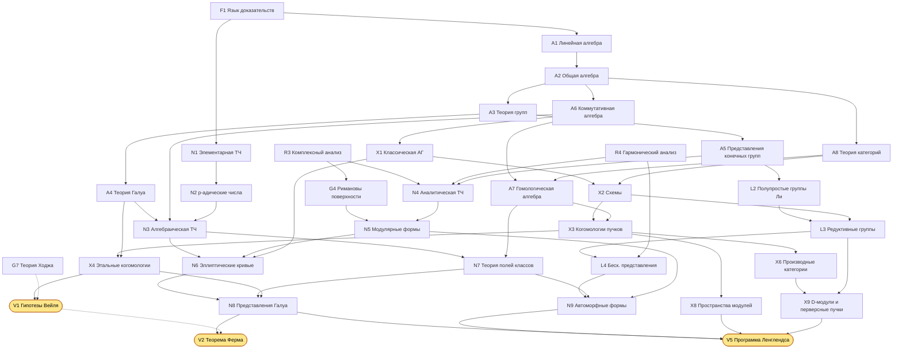
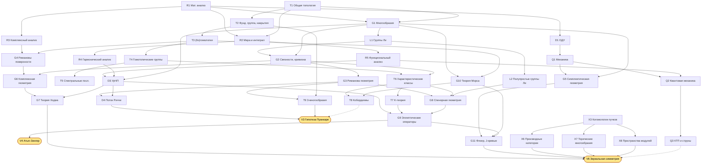

# Атлас современной математики: план изучения

От первых курсов до программы Ленглендса и зеркальной симметрии через четыре вершины прошлого: гипотезы Вейля, Великую теорему Ферма, гипотезу Пуанкаре и теорему Атьи–Зингера.

Документ вырос из `trajectory.txt`: все дисциплины оттуда сохранены, добавлены недостающие звенья, указаны зависимости и порядок изучения.

## Как пользоваться

| Часть | Что внутри | Когда открывать |
|---|---|---|
| [I. Краткий план](#part1) | Этапы с чекбоксами | Постоянно: здесь отмечается прогресс |
| [II. Карта связей](#part2) | Графы зависимостей, таблица «дисциплина → цель», сквозные идеи | Чтобы видеть, зачем изучается текущая тема |
| [III. Атлас](#part3) | Карточка на каждую дисциплину: что требует, для чего нужна, содержание, контрольная точка, литература | Перед началом и в конце каждой дисциплины |
| [IV. Маршруты к вершинам](#part4) | Шесть целей: суть, минимальный путь, вехи, ключевые тексты | С этапа 4 |
| [V. Боковые ветви](#part5) | Дисциплины вне критического пути и их точки соприкосновения с ним | По интересу |
| [VI. Как учиться](#part6) | Метод работы | Один раз прочитать, потом возвращаться |

**Правило отметки.** Дисциплина считается пройденной, когда выполнена её *контрольная точка* (см. карточку в Части III), а не когда дочитана книга. Для тем «в процессе» удобно дописывать после пункта пометку `— в процессе (книга, глава)`.

**Коды.** У каждой дисциплины есть код (`A4`, `G9`, `X4` …); по нему она ищется в атласе и на графах.

| Буква | Область | Буква | Область |
|---|---|---|---|
| F | Фундамент | T | Топология |
| A | Алгебра | G | Геометрия |
| N | Теория чисел | L | Группы и алгебры Ли |
| R | Анализ | X | Алгебраическая геометрия |
| D | Дифференциальные уравнения | P | Вероятность |
| Q | Физика для математиков | V | Вершины (цели) |

**Сроки** в плане ориентировочные: при 20–25 часах сосредоточенной работы в неделю. Весь путь до этапа 6 по объёму соответствует бакалавриату, магистратуре и аспирантуре сильного математического факультета, то есть 8–12 годам. Это ориентир, а не норма: важен не темп, а то, что каждая контрольная точка действительно пройдена.

---

## Часть I. Краткий план (трекер прогресса)

Главный принцип порядка: **внутри этапа вести 2–3 трека параллельно** (алгебра и теория чисел; геометрия и топология; анализ), а не проходить области целиком одну за другой. Дисциплины одного этапа примерно независимы друг от друга. Дисциплины следующего этапа опираются на предыдущий.

### Этап 0. Вход: язык доказательств (1–3 месяца)

- [ ] [F1](#f1) Логика, множества, техника доказательств
- [ ] [N1](#n1) Элементарная теория чисел: начало (делимость, сравнения, малая теорема Ферма)

**Итог этапа:** вы свободно читаете и записываете строгие доказательства.

### Этап 1. Базовый курс (≈ 1,5–2 года)

- **Анализ**
  - [ ] [R1](#r1) Математический анализ (одной и нескольких переменных)
  - [ ] [D1](#d1) Обыкновенные дифференциальные уравнения
- **Алгебра и теория чисел**
  - [ ] [A1](#a1) Линейная алгебра
  - [ ] [A2](#a2) Общая алгебра
  - [ ] [N1](#n1) Элементарная теория чисел: до квадратичного закона взаимности
- **Геометрия и топология**
  - [ ] [T1](#t1) Общая топология

**Итог этапа:** стандартный материал первых двух курсов: теорема о неявной функции, жорданова форма, классификация конечнопорождённых абелевых групп, компактность.

### Этап 2. Ядро (≈ 1,5–2 года)

- **Анализ**
  - [ ] [R2](#r2) Действительный анализ (мера и интеграл Лебега)
  - [ ] [R3](#r3) Комплексный анализ
  - [ ] [R4](#r4) Гармонический анализ
  - [ ] [R5](#r5) Функциональный анализ
- **Алгебра и теория чисел**
  - [ ] [A3](#a3) Теория групп
  - [ ] [A4](#a4) Теория Галуа (включая бесконечную)
  - [ ] [A5](#a5) Представления конечных групп
  - [ ] [A6](#a6) Коммутативная алгебра
  - [ ] [A8](#a8) Теория категорий (язык)
  - [ ] [N2](#n2) p-адические числа и локальные поля
- **Геометрия и топология**
  - [ ] [G1](#g1) Гладкие многообразия и анализ на многообразиях
  - [ ] [T2](#t2) Фундаментальная группа и накрытия
  - [ ] [T3](#t3) Гомологии и когомологии
  - [ ] [L1](#l1) Группы и алгебры Ли: основы
- **Физика** (нужна для V6, можно отложить)
  - [ ] [Q1](#q1) Классическая механика
- **Боковые ветви** (необязательно)
  - [ ] [P1](#p1) Теория вероятностей
  - [ ] [R7](#r7) Вариационное исчисление

**Итог этапа:** вы понимаете три главных языка математики: алгебраические структуры, топологические инварианты и анализ в бесконечномерных пространствах.

### Этап 3. Продвинутое ядро (≈ 2 года)

- **Алгебра и теория чисел**
  - [ ] [A7](#a7) Гомологическая алгебра
  - [ ] [N3](#n3) Алгебраическая теория чисел
  - [ ] [N4](#n4) Аналитическая теория чисел
  - [ ] [N5](#n5) Модулярные формы
- **Геометрия**
  - [ ] [G2](#g2) Дифференциальная геометрия: расслоения, связности, кривизна
  - [ ] [G3](#g3) Риманова геометрия
  - [ ] [G4](#g4) Римановы поверхности и алгебраические кривые
  - [ ] [G5](#g5) Симплектическая геометрия
  - [ ] [X1](#x1) Классическая алгебраическая геометрия
- **Топология**
  - [ ] [T4](#t4) Гомотопические группы и расслоения
  - [ ] [T5](#t5) Спектральные последовательности
  - [ ] [T6](#t6) Характеристические классы
- **Группы Ли**
  - [ ] [L2](#l2) Структура и представления полупростых групп и алгебр Ли
- **Анализ**
  - [ ] [D3](#d3) Уравнения в частных производных
- **Боковые ветви** (необязательно)
  - [ ] [D2](#d2) Динамические системы
  - [ ] [R8](#r8) Выпуклый анализ
  - [ ] [P3](#p3) Случайные процессы

**Итог этапа:** вы можете читать учебники уровня Hartshorne, Milnor–Stasheff, Neukirch и Diamond–Shurman.

### Этап 4. Языки современной математики (≈ 2 года)

- **Алгебраическая геометрия**
  - [ ] [X2](#x2) Пучки, схемы, морфизмы схем
  - [ ] [X3](#x3) Когомологии когерентных пучков, Риман–Рох, теория пересечений
  - [ ] [X4](#x4) Этальные когомологии
  - [ ] [X7](#x7) Торические многообразия
- **Теория чисел**
  - [ ] [N6](#n6) Эллиптические кривые
  - [ ] [N7](#n7) Теория полей классов
- **Геометрия**
  - [ ] [G6](#g6) Комплексная геометрия
  - [ ] [G7](#g7) Теория Ходжа
  - [ ] [G8](#g8) Спинорная геометрия и операторы Дирака
  - [ ] [G10](#g10) Теория Морса
- **Топология**
  - [ ] [T7](#t7) Топологическая K-теория
  - [ ] [T8](#t8) Кобордизмы
- **Группы Ли**
  - [ ] [L3](#l3) Алгебраические и редуктивные группы
- **Физика**
  - [ ] [Q2](#q2) Квантовая механика для математиков
- **Боковые ветви** (необязательно)
  - [ ] [X5](#x5) Бирациональная геометрия
  - [ ] [A9](#a9) Алгебраическая K-теория
  - [ ] [P4](#p4) Стохастические дифференциальные уравнения
  - [ ] [R9](#r9) Оптимальное управление
  - [ ] [P2](#p2) Математическая статистика

**Итог этапа:** вы владеете языком, на котором написаны доказательства всех четырёх «вершин прошлого».

### Этап 5. Вершины прошлого (≈ 2–3 года, частично параллельно)

Рекомендуемый порядок: **V4 → V1 → V2**, а **V3** можно вести параллельно в любой момент: это самая обособленная ветка. V4 закрепляет геометрию, топологию и анализ, V1 — алгебраическую геометрию, V2 опирается на V1 и даёт всю арифметику, нужную для Ленглендса.

- [ ] [V4](#v4) **Теорема Атьи–Зингера об индексе**. Новое: [G9](#g9) Эллиптические операторы и индекс
- [ ] [V1](#v1) **Гипотезы Вейля**. Новое: доказательство Делиня на базе [X4](#x4)
- [ ] [V2](#v2) **Великая теорема Ферма**. Новое: [N8](#n8) Представления Галуа и теория деформаций
- [ ] [V3](#v3) **Гипотеза Пуанкаре**. Новое: [T9](#t9) Топология 3-многообразий, [D4](#d4) Геометрический анализ и поток Риччи

Подробные вехи по каждой вершине см. в [Части IV](#part4).

### Этап 6. Современные направления (открытый этап)

- [ ] [V5](#v5) **Программа Ленглендса**
  - [ ] [L4](#l4) Бесконечномерные представления редуктивных групп
  - [ ] [N9](#n9) Автоморфные формы и представления
  - [ ] [X8](#x8) Пространства модулей и стеки
  - [ ] [X9](#x9) D-модули и перверсные пучки
  - [ ] [X6](#x6) Производные категории
- [ ] [V6](#v6) **Зеркальная симметрия**
  - [ ] [X6](#x6) Производные категории когерентных пучков
  - [ ] [X8](#x8) Пространства модулей и стеки
  - [ ] [G11](#g11) Теория Флоера и псевдоголоморфные кривые
  - [ ] [Q3](#q3) КТП, суперсимметрия и струны для математиков

**Итог этапа:** вы читаете свежие статьи на arXiv по выбранному направлению и понимаете, какие в нём открытые вопросы.

---

## Часть II. Карта связей

### Граф 1. Алгебро-арифметическая ветвь (к V1, V2, V5)

Стрелка `X → Y` означает «X нужен для Y». Пунктир означает «полезно, но не обязательно».

### Граф 2. Геометро-аналитическая ветвь (к V3, V4, V6)

### Таблица: какие дисциплины питают какие цели

● — необходимо, ○ — полезно или нужно частично, пусто — практически не используется.

| Дисциплина | V1 Вейль | V2 Ферма | V3 Пуанкаре | V4 Атья–Зингер | V5 Ленглендс | V6 Зеркальная |
|---|:-:|:-:|:-:|:-:|:-:|:-:|
| Теория Галуа (A4) | ● | ● | | | ● | |
| Представления конечных групп (A5) | ○ | ○ | | ○ | ● | |
| Коммутативная алгебра (A6) | ● | ● | | | ● | ● |
| Гомологическая алгебра (A7) | ● | ● | ○ | ○ | ● | ● |
| Теория категорий (A8) | ○ | ○ | | | ● | ● |
| p-адические числа (N2) | ○ | ● | | | ● | |
| Алгебраическая ТЧ (N3) | ○ | ● | | | ● | |
| Аналитическая ТЧ (N4) | ○ | ○ | | | ● | |
| Модулярные формы (N5) | ○ | ● | | | ● | ○ |
| Эллиптические кривые (N6) | ○ | ● | | | ● | ○ |
| Теория полей классов (N7) | | ● | | | ● | |
| Комплексный анализ (R3) | ○ | ● | | ○ | ● | ● |
| Гармонический анализ (R4) | | ○ | ○ | ○ | ● | |
| Функциональный анализ (R5) | | | ● | ● | ● | ○ |
| УрЧП (D3) | | | ● | ● | ○ | ○ |
| Многообразия, связности (G1–G2) | ○ | | ● | ● | ○ | ● |
| Риманова геометрия (G3) | | | ● | ● | | ○ |
| Римановы поверхности (G4) | ● | ● | | ○ | ● | ● |
| Симплектическая геометрия, Флоер (G5, G11) | | | | | | ● |
| Комплексная геометрия, Ходж (G6–G7) | ○ | ○ | | ○ | ○ | ● |
| Алгебраическая топология (T2–T5) | ● | ○ | ● | ● | ○ | ● |
| Характеристические классы, K-теория (T6–T7) | ○ | | | ● | ○ | ● |
| Группы Ли и представления (L1–L2) | | ○ | ○ | ● | ● | ○ |
| Редуктивные группы (L3–L4) | | ○ | | | ● | |
| Схемы, когомологии пучков (X2–X3) | ● | ● | | ○ | ● | ● |
| Этальные когомологии (X4) | ● | ● | | | ● | |
| Производные категории (X6) | ○ | | | | ● | ● |
| Пространства модулей (X8) | | ○ | | | ● | ● |
| Физика (Q1–Q3) | | | | ○ | ○ | ● |

Видно, что V1, V2 и V5 образуют одну большую арифметическую систему, V4 и V6 — геометрическую, а V3 стоит особняком: это геометрический анализ.

### Сквозные идеи: что связывает направления

Атлас удобнее держать в голове не как список предметов, а как несколько идей, которые повторяются в разных областях.

1. **Галуа ↔ накрытия ↔ фундаментальная группа.** Соответствие Галуа между подполями и подгруппами ([A4](#a4)) и соответствие между накрытиями и подгруппами π₁ ([T2](#t2)) — одна и та же теорема. Гротендик сделал это буквальным: этальная фундаментальная группа ([X4](#x4)) поля есть его абсолютная группа Галуа. Отсюда центральный объект V2 и V5: представления абсолютной группы Галуа.

2. **«Розеттский камень» Вейля.** Числовые поля, функциональные поля кривых над 𝔽_q и римановы поверхности — три версии одной теории. Арифметическая программа Ленглендса живёт в первой колонке, гипотезы Вейля и работы Дринфельда и Лафоргов — во второй, геометрическая программа Ленглендса — в третьей.

3. **Когомологии как универсальный язык.** Сингулярные, де Рама, Дольбо, когерентные, этальные, когомологии групп и Галуа — версии одной конструкции, связанные теоремами сравнения (де Рама, Ходжа, GAGA, теоремы сравнения Артина). Поэтому [A7](#a7) и [T3](#t3) надо проходить рано и основательно.

4. **Формулы следа и неподвижные точки.** Теорема Лефшеца о неподвижных точках ([T3](#t3)) → формула Атьи–Ботта ([G9](#g9)) → формула следа Гротендика–Лефшеца для Фробениуса ([V1](#v1)) → формула следа Сельберга–Артура ([V5](#v5)). Одна идея проходит через четыре вершины.

5. **Индекс: анализ = топология.** Гаусс–Бонне, Риман–Рох ([G4](#g4)), Риман–Рох–Хирцебрух ([X3](#x3)), сигнатурная теорема ([T8](#t8)) — частные случаи теоремы Атьи–Зингера ([V4](#v4)). Индекс же задаёт ожидаемую размерность пространств модулей в теориях Громова–Виттена и Флоера ([V6](#v6)).

6. **Двойственности.** Двойственность Пуанкаре, двойственность Понтрягина и преобразование Фурье ([R4](#r4)), преобразование Фурье–Мукаи ([X6](#x6)), дуальная группа Ленглендса ([L3](#l3)), зеркальная симметрия ([V6](#v6)). Геометрическая программа Ленглендса и зеркальная симметрия связаны напрямую: по Капустину–Виттену это два проявления одной S-дуальности.

7. **Локальное и глобальное.** p-адические числа и принцип Хассе ([N2](#n2)), аделы ([N7](#n7)), пучки ([X2](#x2)): глобальный объект собирается из локальных данных, а препятствия к склейке измеряются когомологиями.

8. **Вариационные принципы и потоки.** Геодезические как критические точки длины ([R7](#r7), [G3](#g3)) → теория Морса ([G10](#g10)) → гомологии Флоера как теория Морса функционала действия ([G11](#g11)). Градиентные потоки ведут к потоку Риччи и энтропии Перельмана ([D4](#d4)).

---

## Часть III. Атлас дисциплин

Формат карточки:
- **Требует** — что нужно знать заранее;
- **Нужна для** — куда ведёт;
- **Содержание** — минимальный список тем;
- **Контрольная точка (КТ)** — критерий, после которого ставится галочка;
- **Литература** — сначала основной учебник, затем альтернативы.

### F. Фундамент

#### F1. Язык математики: логика, множества, доказательства
- **Требует:** школьную математику.
- **Нужна для:** всего.
- **Содержание:** высказывания и кванторы; индукция; множества, отображения, отношения эквивалентности, фактор-множества; мощность, счётность; аксиома выбора и лемма Цорна (формулировки и типичные применения).
- **КТ:** доказать несчётность ℝ диагональным методом и существование базиса в любом векторном пространстве через лемму Цорна.
- **Литература:** Верещагин, Шень «Начала теории множеств»; Velleman «How to Prove It».

### A. Алгебра

#### A1. Линейная алгебра
- **Требует:** F1.
- **Нужна для:** почти всего; напрямую — A2, R1 (многомерный анализ), A5, G1, R5.
- **Содержание:** векторные пространства, линейные отображения, двойственность; определители; собственные значения, жорданова форма; билинейные и квадратичные формы; евклидовы и эрмитовы пространства, спектральная теорема; тензорное и внешнее произведения.
- **КТ:** доказать существование жордановой нормальной формы; вычислить exp(A) для жордановой клетки.
- **Литература:** Винберг «Курс алгебры»; Кострикин «Введение в алгебру» (ч. II); Axler «Linear Algebra Done Right».

#### A2. Общая алгебра
- **Требует:** F1, A1 (можно параллельно).
- **Нужна для:** A3–A8, N3, X1.
- **Содержание:** группы, подгруппы, факторгруппы, гомоморфизмы, действия; кольца и идеалы; евклидовы кольца, кольца главных идеалов, факториальные кольца; поля и их расширения (начало); модули над кольцами главных идеалов и их классификация.
- **КТ:** классифицировать конечнопорождённые модули над PID и вывести из этого и классификацию абелевых групп, и жорданову форму.
- **Литература:** Винберг «Курс алгебры»; Dummit, Foote «Abstract Algebra»; Aluffi «Algebra: Chapter 0».

#### A3. Теория групп
- **Требует:** A2.
- **Нужна для:** A4, A5, L1, T2.
- **Содержание:** теоремы Силова; разрешимые и нильпотентные группы; простые группы, Sₙ и Aₙ; полупрямые произведения; свободные группы и копредставления; расширения групп (начало).
- **КТ:** классифицировать группы порядка ≤ 15; доказать простоту Aₙ при n ≥ 5.
- **Литература:** Каргаполов, Мерзляков «Основы теории групп»; Rotman «An Introduction to the Theory of Groups».

#### A4. Теория Галуа
- **Требует:** A2, A3.
- **Нужна для:** N3, N7, X4 (этальная фундаментальная группа обобщает группу Галуа), V1, V2, V5.
- **Содержание:** конечные, нормальные и сепарабельные расширения; основная теорема; конечные поля; круговые поля; разрешимость в радикалах; **бесконечная теория Галуа**: проконечные группы, топология Крулля. Последнее обязательно: абсолютная группа Галуа Gal(ℚ̄/ℚ) — центральный объект V2 и V5.
- **КТ:** доказать неразрешимость в радикалах общего уравнения 5-й степени; описать Gal(ℚ(ζₙ)/ℚ); доказать, что Gal(𝔽̄ₚ/𝔽ₚ) ≅ ℤ̂.
- **Литература:** Постников «Основы теории Галуа»; Artin «Galois Theory»; Stewart «Galois Theory»; Milne «Fields and Galois Theory» (конспекты).

#### A5. Представления конечных групп
- **Требует:** A1, A3.
- **Нужна для:** L2, L4, N4 (характеры Дирихле), N9, V5.
- **Содержание:** теорема Машке, лемма Шура; характеры и соотношения ортогональности; индуцированные представления и взаимность Фробениуса; представления Sₙ и диаграммы Юнга; преобразование Фурье на конечной группе.
- **КТ:** построить таблицы характеров S₄ и A₅; доказать, что число неприводимых представлений равно числу классов сопряжённости.
- **Литература:** Серр «Линейные представления конечных групп»; Fulton, Harris «Representation Theory: A First Course» (ч. I).

#### A6. Коммутативная алгебра
- **Требует:** A2.
- **Нужна для:** X1, X2, N3, L3, N8 (полные пересечения в доказательстве Уайлса).
- **Содержание:** простые и максимальные идеалы; локализация; нётеровы кольца, теорема Гильберта о базисе; теорема Гильберта о нулях; целые расширения, нормализация Нётер; размерность Крулля; кольца дискретного нормирования и дедекиндовы кольца; пополнения и лемма Гензеля; плоские модули; регулярные кольца (начало).
- **КТ:** доказать Nullstellensatz; доказать, что кольцо целых числового поля дедекиндово.
- **Литература:** Atiyah, Macdonald «Introduction to Commutative Algebra»; Eisenbud «Commutative Algebra with a View Toward Algebraic Geometry»; Matsumura «Commutative Ring Theory».

#### A7. Гомологическая алгебра
- **Требует:** A6, A8; T3 желательно параллельно, как источник примеров.
- **Нужна для:** X3, X4, X6, N7 (когомологии групп), T5, V1, V2, V5, V6.
- **Содержание:** абелевы категории; комплексы и точные последовательности; производные функторы, Ext и Tor; когомологии групп; спектральные последовательности Гротендика и Лере; триангулированные и производные категории (начало).
- **КТ:** вычислить H*(ℤ/n, ℤ); объяснить, почему Ext¹ классифицирует расширения; вывести длинную точную последовательность из короткой.
- **Литература:** Weibel «An Introduction to Homological Algebra»; Гельфанд, Манин «Методы гомологической алгебры».

#### A8. Теория категорий
- **Требует:** A2; T1 — для примеров.
- **Нужна для:** A7, X2, X6, V5, V6 (весь современный язык).
- **Содержание:** категории, функторы, естественные преобразования; универсальные свойства; пределы и копределы; сопряжённые функторы; лемма Йонеды; абелевы категории. Позже: моноидальные категории, 2-категории, идея ∞-категорий.
- **КТ:** доказать лемму Йонеды и вывести из неё единственность объекта, заданного универсальным свойством; найти левый сопряжённый к забывающему функтору Grp → Set.
- **Литература:** Leinster «Basic Category Theory»; Riehl «Category Theory in Context»; Mac Lane «Categories for the Working Mathematician».

#### A9. Алгебраическая K-теория (боковая ветвь)
- **Требует:** A6, A7; T7 — для сравнения.
- **Связь с целями:** символы норменного вычета и K₂ (теория полей классов); регуляторы и специальные значения L-функций (гипотезы Бейлинсона); мотивы. Для шести вершин это фон, а не опора.
- **Содержание:** K₀ (проективные модули), K₁ (определители, группа Уайтхеда), K₂ Милнора и символы Стейнберга, теорема Мацумото; +-конструкция и Q-конструкция Квиллена.
- **КТ:** доказать, что K₀ дедекиндова кольца R изоморфна ℤ ⊕ Cl(R).
- **Литература:** Milnor «Introduction to Algebraic K-Theory»; Weibel «The K-book»; Rosenberg «Algebraic K-Theory and Its Applications».

### N. Теория чисел

#### N1. Элементарная теория чисел
- **Требует:** F1.
- **Нужна для:** A2 (примеры), N2, N3, N4.
- **Содержание:** делимость, основная теорема арифметики; сравнения, китайская теорема об остатках; первообразные корни; квадратичные вычеты и закон взаимности; суммы Гаусса; цепные дроби и уравнение Пелля; суммы двух и четырёх квадратов.
- **КТ:** доказать квадратичный закон взаимности двумя способами: через лемму Гаусса и через суммы Гаусса.
- **Литература:** Виноградов «Основы теории чисел»; Айерлэнд, Роузен «Классическое введение в современную теорию чисел» (гл. 1–9). Последняя книга понадобится ещё раз в V1.

#### N2. p-адические числа и локальные поля
- **Требует:** N1, R1; A6 частично.
- **Нужна для:** N3, N7, N8, L4, V1 (доказательство рациональности по Дворку), V5.
- **Содержание:** абсолютные значения, теорема Островского; ℚₚ и ℤₚ; лемма Гензеля; принцип Хассе–Минковского для квадратичных форм; локальные поля, ветвление; неархимедов анализ (начало).
- **КТ:** доказать теорему Островского; решить x² = 2 в ℤ₇; доказать теорему Хассе–Минковского для форм от трёх переменных.
- **Литература:** Серр «Курс арифметики» (ч. I); Gouvêa «p-adic Numbers: An Introduction»; Коблиц «p-адические числа, p-адический анализ и дзета-функции»; Боревич, Шафаревич «Теория чисел».

#### N3. Алгебраическая теория чисел
- **Требует:** A4, A6, N2.
- **Нужна для:** N6, N7, N8, V2, V5.
- **Содержание:** кольца целых, разложение простых идеалов, ветвление, дискриминант; группа классов и её конечность; теорема Дирихле о единицах (геометрия чисел Минковского); круговые поля; теорема Куммера о ВТФ для регулярных простых; дзета-функция Дедекинда (начало); аделы и иделы.
- **КТ:** вычислить группы классов ℚ(√−5) и ℚ(√−23); доказать первый случай ВТФ для регулярных простых.
- **Литература:** Neukirch «Algebraic Number Theory» (гл. I–II); Marcus «Number Fields»; Боревич, Шафаревич «Теория чисел»; Washington «Introduction to Cyclotomic Fields».

#### N4. Аналитическая теория чисел
- **Требует:** R3, R4, N1, A5 (характеры).
- **Нужна для:** N5, N9, V5 (L-функции).
- **Содержание:** дзета-функция Римана, аналитическое продолжение и функциональное уравнение через θ-функцию; асимптотический закон распределения простых; характеры Дирихле и простые в прогрессиях; L-функции Дирихле; явные формулы; решето (начало).
- **КТ:** доказать асимптотический закон распределения простых и теорему Дирихле о простых в арифметических прогрессиях.
- **Литература:** Davenport «Multiplicative Number Theory»; Карацуба «Основы аналитической теории чисел»; Apostol «Introduction to Analytic Number Theory»; Iwaniec, Kowalski «Analytic Number Theory» (дальше).

#### N5. Модулярные формы
- **Требует:** R3, N4; G4 частично; A3.
- **Нужна для:** N6, N8, N9, V2, V5; ○ V6 (квазимодулярные формы в инвариантах Громова–Виттена эллиптической кривой).
- **Содержание:** SL₂(ℤ) и фундаментальная область; ряды Эйзенштейна; Δ и τ-функция Рамануджана; размерности пространств форм; операторы Гекке, собственные формы и их L-функции; конгруэнц-подгруппы и модулярные кривые X₀(N); новые формы; соотношение Эйхлера–Шимуры (начало); тэта-функции.
- **КТ:** доказать, что кольцо модулярных форм уровня 1 порождается E₄ и E₆; вывести мультипликативность τ из теории Гекке.
- **Литература:** Серр «Курс арифметики» (гл. VII); Diamond, Shurman «A First Course in Modular Forms»; Koblitz «Introduction to Elliptic Curves and Modular Forms»; Zagier «Elliptic modular forms and their applications» (в сборнике «The 1-2-3 of Modular Forms»).

#### N6. Эллиптические кривые
- **Требует:** X1 (кривые), N3, N5, G4.
- **Нужна для:** V2, V5; ○ V1 (теорема Хассе — первый нетривиальный случай гипотезы Римана для кривых).
- **Содержание:** форма Вейерштрасса и групповой закон; изогении; модуль Тейта и спаривание Вейля; кривые над конечными полями; кривые над локальными полями (редукция, кондуктор, полустабильность); теорема Морделла–Вейля; кривые над ℂ (решётки, ℘-функция Вейерштрасса); комплексное умножение; гипотеза Бёрча–Свиннертон-Дайера (формулировка).
- **КТ:** доказать теорему Хассе |#E(𝔽_q) − q − 1| ≤ 2√q; доказать слабую теорему Морделла–Вейля.
- **Литература:** Silverman «The Arithmetic of Elliptic Curves»; Silverman, Tate «Rational Points on Elliptic Curves»; Husemöller «Elliptic Curves».

#### N7. Теория полей классов
- **Требует:** N3, N2, A7 (когомологии групп).
- **Нужна для:** N8, N9, V2, V5. Теория полей классов — это программа Ленглендса для GL₁.
- **Содержание:** локальная и глобальная теории полей классов; закон взаимности Артина и теорема существования; иделы; когомологии Галуа и когомологии Тейта; теорема Кронекера–Вебера; локальная теория по Любину–Тейту; **тезис Тейта**: Фурье-анализ на аделах и функциональное уравнение L-функций Гекке.
- **КТ:** вывести квадратичный закон взаимности из закона Артина; вывести теорему Кронекера–Вебера; самостоятельно воспроизвести тезис Тейта для ℚ.
- **Литература:** Касселс, Фрёлих (ред.) «Алгебраическая теория чисел» (содержит и тезис Тейта); Milne «Class Field Theory» (конспекты); Neukirch (гл. IV–VI); Artin, Tate «Class Field Theory».

#### N8. Представления Галуа и теория деформаций
- **Требует:** N5, N6, N7, X4, A6.
- **Нужна для:** V2, V5.
- **Содержание:** ℓ-адические представления; модуль Тейта эллиптической кривой; представления, ассоциированные с модулярными формами (Эйхлер–Шимура, Делинь); гипотеза Серра о модулярности mod p; теорема Рибета о понижении уровня; конечные плоские групповые схемы; деформации по Мазуру, теорема Шлессингера; алгебры Гекке; R = T и метод Тейлора–Уайлса; основы p-адической теории Ходжа (Фонтен).
- **КТ:** объяснить, почему модулярность кривой Фрея противоречит теореме Рибета; построить универсальное деформационное кольцо в простейшем случае.
- **Литература:** Cornell, Silverman, Stevens (ред.) «Modular Forms and Fermat's Last Theorem»; Darmon, Diamond, Taylor «Fermat's Last Theorem»; Brinon, Conrad «CMI Summer School Notes on p-adic Hodge Theory».

#### N9. Автоморфные формы и представления
- **Требует:** N5, N7, L4, R4.
- **Нужна для:** V5.
- **Содержание:** аделические группы; переход от модулярных форм к автоморфным представлениям GL₂(𝔸); тензорное разложение Флата; L-функции автоморфных представлений; обратные теоремы; изоморфизм Сатаке и неразветвлённые компоненты; L-группы и функториальность; формула следа Сельберга (начало); GLₙ.
- **КТ:** объяснить, как собственная форма Гекке задаёт автоморфное представление GL₂(𝔸_ℚ), и описать его локальные компоненты.
- **Литература:** Bump «Automorphic Forms and Representations»; Getz, Hahn «An Introduction to Automorphic Representations»; Gelbart «Automorphic Forms on Adele Groups»; Gelbart «An elementary introduction to the Langlands program» (Bull. AMS, 1984).

### R. Анализ

#### R1. Математический анализ
- **Требует:** F1.
- **Нужна для:** всего.
- **Содержание:** вещественные числа, пределы, непрерывность; дифференцирование, интеграл Римана; ряды, равномерная сходимость; многомерный анализ: дифференциал, теоремы об обратной и неявной функциях, кратные интегралы, дифференциальные формы, формула Стокса.
- **КТ:** доказать теорему о неявной функции и общую формулу Стокса для форм (на кубах или цепях).
- **Литература:** Зорич «Математический анализ» (т. 1–2); Фихтенгольц «Курс дифференциального и интегрального исчисления»; Rudin «Principles of Mathematical Analysis»; Spivak «Calculus on Manifolds».

#### R2. Действительный анализ (мера и интеграл)
- **Требует:** R1, T1.
- **Нужна для:** R4, R5, P1, D3.
- **Содержание:** σ-алгебры, мера и интеграл Лебега; теоремы о предельном переходе; теорема Фубини; пространства Lᵖ; теорема Радона–Никодима; меры на локально компактных пространствах (теорема Рисса); мера Хаара.
- **КТ:** доказать теорему о мажорированной сходимости и полноту Lᵖ; построить меру Хаара на ℚₚ.
- **Литература:** Колмогоров, Фомин «Элементы теории функций и функционального анализа»; Folland «Real Analysis»; Stein, Shakarchi «Real Analysis»; Богачёв «Основы теории меры».

#### R3. Комплексный анализ
- **Требует:** R1.
- **Нужна для:** N4, N5, G4, G6, V2, V5, V6.
- **Содержание:** голоморфные функции, теорема и формула Коши, вычеты, принцип аргумента; конформные отображения и теорема Римана; аналитическое продолжение; целые и мероморфные функции (Вейерштрасс, Адамар); эллиптические функции; Γ- и ζ-функции.
- **КТ:** доказать теорему Римана об отображении; аналитически продолжить Γ(s) и доказать формулу дополнения.
- **Литература:** Шабат «Введение в комплексный анализ»; Ahlfors «Complex Analysis»; Stein, Shakarchi «Complex Analysis».

#### R4. Гармонический анализ
- **Требует:** R2, R3.
- **Нужна для:** N4, N7 (тезис Тейта), N9, L4, D3.
- **Содержание:** ряды и интеграл Фурье; формула суммирования Пуассона; теорема Планшереля; распределения (начало); анализ на локально компактных абелевых группах, двойственность Понтрягина; представления компактных групп, теорема Петера–Вейля.
- **КТ:** вывести функциональное уравнение θ-функции из формулы Пуассона; доказать самодвойственность ℚₚ.
- **Литература:** Stein, Shakarchi «Fourier Analysis»; Katznelson «An Introduction to Harmonic Analysis»; Deitmar «A First Course in Harmonic Analysis».

#### R5. Функциональный анализ
- **Требует:** R2, A1, T1.
- **Нужна для:** D3, G9, L4, D4, Q2.
- **Содержание:** банаховы и гильбертовы пространства; теоремы Хана–Банаха, Банаха–Штейнгауза, об открытом отображении; слабые топологии; компактные операторы; теория Фредгольма и индекс; спектральная теорема для самосопряжённых операторов, ограниченных и неограниченных; C*-алгебры (начало).
- **КТ:** доказать, что индекс фредгольмова оператора локально постоянен и не меняется при компактных возмущениях; доказать спектральную теорему для компактных самосопряжённых операторов.
- **Литература:** Колмогоров, Фомин; Рид, Саймон «Методы современной математической физики» (т. 1); Brezis «Functional Analysis, Sobolev Spaces and Partial Differential Equations»; Хелемский «Лекции по функциональному анализу».

#### R7. Вариационное исчисление (боковая ветвь с выходом в геометрию)
- **Требует:** R1, D1; R5 желательно.
- **Связь с целями:** геодезические и поля Якоби ([G3](#g3)), теория Морса ([G10](#g10)), функционалы Дирихле и Янга–Миллса, энтропия Перельмана ([V3](#v3)), функционал действия в гомологиях Флоера ([G11](#g11)).
- **Содержание:** уравнения Эйлера–Лагранжа; вторая вариация; условия Лежандра и Якоби; задачи со связями; прямые методы и полунепрерывность; теорема Нётер.
- **КТ:** вывести уравнение геодезических и формулу второй вариации длины (это приводит к полям Якоби).
- **Литература:** Гельфанд, Фомин «Вариационное исчисление»; Jost, Li-Jost «Calculus of Variations»; Struwe «Variational Methods».

#### R8. Выпуклый анализ (боковая ветвь)
- **Требует:** R1, A1.
- **Связь с целями:** многогранники в торической геометрии ([X7](#x7)); преобразование Лежандра в механике ([Q1](#q1)) и в зеркальной симметрии торических многообразий; оптимальный транспорт и синтетическая кривизна Риччи (Лотт–Вилани–Штурм).
- **Содержание:** выпуклые множества и функции; отделимость; сопряжённые функции и преобразование Лежандра–Фенхеля; субдифференциалы; двойственность в выпуклой оптимизации; многогранники.
- **КТ:** доказать теорему Фенхеля–Моро.
- **Литература:** Rockafellar «Convex Analysis»; Магарил-Ильяев, Тихомиров «Выпуклый анализ и его приложения»; Boyd, Vandenberghe «Convex Optimization».

#### R9. Оптимальное управление (боковая ветвь)
- **Требует:** R7, R8, D1.
- **Связь с целями:** принцип максимума Понтрягина формулируется на языке симплектической геометрии ([G5](#g5)); субриманова геометрия.
- **Содержание:** постановки задач, управляемость; принцип максимума Понтрягина; динамическое программирование и уравнение Беллмана; линейно-квадратичная задача; геометрическая теория управления.
- **КТ:** решить задачу быстродействия для линейной системы с помощью принципа максимума.
- **Литература:** Понтрягин, Болтянский, Гамкрелидзе, Мищенко «Математическая теория оптимальных процессов»; Алексеев, Тихомиров, Фомин «Оптимальное управление»; Аграчёв, Сачков «Геометрическая теория управления».

### D. Дифференциальные уравнения

#### D1. Обыкновенные дифференциальные уравнения
- **Требует:** R1, A1.
- **Нужна для:** D2, G1 (потоки векторных полей), Q1, R7.
- **Содержание:** существование, единственность, зависимость от параметров; линейные системы; устойчивость по Ляпунову; фазовые портреты; первые интегралы; векторные поля на многообразиях.
- **КТ:** доказать теорему существования и единственности; полностью исследовать фазовый портрет маятника.
- **Литература:** Арнольд «Обыкновенные дифференциальные уравнения»; Понтрягин «Обыкновенные дифференциальные уравнения»; Hirsch, Smale, Devaney «Differential Equations, Dynamical Systems, and an Introduction to Chaos».

#### D2. Динамические системы (боковая ветвь)
- **Требует:** D1, G1.
- **Связь с целями:** гамильтонова динамика → [G5](#g5); гипотеза Арнольда о неподвижных точках симплектоморфизмов мотивировала гомологии Флоера ([G11](#g11)); эргодические методы в теории чисел (теорема Маргулиса о гипотезе Оппенгейма, равнораспределение).
- **Содержание:** гиперболичность, устойчивые многообразия; структурная устойчивость; символическая динамика, подкова Смейла; эргодическая теория и энтропия; КАМ-теория (обзор).
- **КТ:** доказать эргодичность иррационального поворота окружности; построить подкову Смейла и её символическую модель.
- **Литература:** Katok, Hasselblatt «Introduction to the Modern Theory of Dynamical Systems»; Арнольд «Геометрические методы в теории обыкновенных дифференциальных уравнений».

#### D3. Уравнения в частных производных
- **Требует:** R5, R4, G1.
- **Нужна для:** G7 (теорема Ходжа), G9, G11, D4, V3, V4.
- **Содержание:** уравнения Лапласа, теплопроводности, волновое; распределения; пространства Соболева и теоремы вложения; эллиптическая регулярность, оценки Шаудера; принцип максимума; параболические уравнения; псевдодифференциальные операторы (начало).
- **КТ:** доказать эллиптическую регулярность для лапласиана на торе с помощью рядов Фурье; доказать сильный принцип максимума для уравнения теплопроводности.
- **Литература:** Evans «Partial Differential Equations»; Владимиров «Уравнения математической физики»; Taylor «Partial Differential Equations I–III»; Gilbarg, Trudinger «Elliptic Partial Differential Equations of Second Order» (продвинуто).

#### D4. Геометрический анализ и поток Риччи
- **Требует:** D3, G3.
- **Нужна для:** V3.
- **Содержание:** геометрические эволюционные уравнения, поток средней кривизны; поток Риччи: кратковременное существование и трюк ДеТурка; принцип максимума для тензоров; оценки Ши; солитоны Риччи; теорема Гамильтона о 3-многообразиях с положительной кривизной Риччи.
- **КТ:** разобрать доказательство теоремы Гамильтона (1982).
- **Литература:** Chow, Knopf «The Ricci Flow: An Introduction»; Topping «Lectures on the Ricci Flow»; Morgan, Tian «Ricci Flow and the Poincaré Conjecture».

### T. Топология

#### T1. Общая топология
- **Требует:** F1, R1.
- **Нужна для:** R2, R5, G1, T2.
- **Содержание:** топологические и метрические пространства; непрерывность; компактность и теорема Тихонова; связность; аксиомы отделимости, лемма Урысона; фактор-пространства; полнота и теорема Бэра.
- **КТ:** доказать теорему Тихонова; доказать, что ℝP² хаусдорфово и компактно как фактор S².
- **Литература:** Виро, Иванов, Нецветаев, Харламов «Элементарная топология»; Munkres «Topology»; Энгелькинг «Общая топология» (как справочник).

#### T2. Фундаментальная группа и накрытия
- **Требует:** T1, A3.
- **Нужна для:** T3, G4, T9, X4 (этальная фундаментальная группа).
- **Содержание:** гомотопии; π₁; теорема Зейферта–ван Кампена; накрытия и их классификация (соответствие Галуа!); действия групп; графы и свободные группы.
- **КТ:** вычислить π₁ замкнутых поверхностей и дополнения трилистника; доказать теорему Нильсена–Шрайера через накрытия графов.
- **Литература:** Hatcher «Algebraic Topology» (гл. 1); Виро и др. «Элементарная топология»; Прасолов «Элементы комбинаторной и дифференциальной топологии».

#### T3. Гомологии и когомологии
- **Требует:** T2, A2.
- **Нужна для:** T4–T8, G4, G7, G10, A7, X3, X4 (как образец).
- **Содержание:** симплициальные, сингулярные и клеточные гомологии; аксиомы Эйленберга–Стинрода; Майер–Вьеторис; кольцо когомологий; формула универсальных коэффициентов, Кюннет; двойственность Пуанкаре; теорема Лефшеца о неподвижных точках; когомологии де Рама и теорема де Рама.
- **КТ:** вычислить кольцо H*(ℂPⁿ); доказать теорему Лефшеца о неподвижных точках (это прообраз формулы следа в V1).
- **Литература:** Hatcher (гл. 2–3); Bott, Tu «Differential Forms in Algebraic Topology»; Прасолов «Элементы теории гомологий».

#### T4. Гомотопические группы и расслоения
- **Требует:** T3.
- **Нужна для:** T5, T6, T7, T8.
- **Содержание:** высшие гомотопические группы; точная последовательность расслоения; CW-комплексы; теоремы Уайтхеда и Гуревича; пространства Эйленберга–Маклейна; расслоение Хопфа; главные расслоения и классифицирующие пространства BG.
- **КТ:** вычислить π₃(S²) с помощью расслоения Хопфа; доказать, что πₙ(Sⁿ) ≅ ℤ.
- **Литература:** Hatcher (гл. 4); Фоменко, Фукс «Гомотопическая топология»; May «A Concise Course in Algebraic Topology».

#### T5. Спектральные последовательности
- **Требует:** T4, A7.
- **Нужна для:** T6, T7, X3, X4, N7 (спектральная последовательность Хохшильда–Серра).
- **Содержание:** спектральная последовательность фильтрованного комплекса; спектральные последовательности Серра, Лере, Гротендика, Атьи–Хирцебруха; Адамса (обзор).
- **КТ:** вычислить H*(ΩSⁿ) и H*(K(ℤ,2)) по спектральной последовательности Серра.
- **Литература:** McCleary «A User's Guide to Spectral Sequences»; Bott, Tu (гл. III); Фоменко, Фукс.

#### T6. Характеристические классы
- **Требует:** T4; G2 (для подхода Черна–Вейля); T5 желательно.
- **Нужна для:** G6, G8, G9, T7, T8, X3 (Риман–Рох–Хирцебрух), V4, V6.
- **Содержание:** векторные расслоения; классы Штифеля–Уитни, Черна, Понтрягина, класс Эйлера; изоморфизм Тома; грассманианы как классифицирующие пространства; теория Черна–Вейля; род Тодда, Â-род, L-род; сигнатурная теорема Хирцебруха (формулировка).
- **КТ:** вычислить полный класс Черна касательного расслоения ℂPⁿ; проверить сигнатурную формулу для ℂP².
- **Литература:** Milnor, Stasheff «Characteristic Classes»; Bott, Tu; Дубровин, Новиков, Фоменко «Современная геометрия» (т. 2–3).

#### T7. Топологическая K-теория
- **Требует:** T6, T4; R5 — для связи с фредгольмовыми операторами.
- **Нужна для:** G9, V4; ○ V6 (заряды D-бран), A9.
- **Содержание:** K⁰ через векторные расслоения; периодичность Ботта; K-теория как обобщённая теория когомологий; изоморфизм Тома в K-теории; характер Черна; операции Адамса и задача об инварианте Хопфа (обзор); теорема Атьи–Яниха.
- **КТ:** доказать комплексную периодичность Ботта (по Атье–Ботту); вычислить K(S²ⁿ).
- **Литература:** Atiyah «K-Theory»; Hatcher «Vector Bundles and K-Theory» (рукопись в открытом доступе); Karoubi «K-Theory: An Introduction».

#### T8. Кобордизмы
- **Требует:** T6, G1; G10 желательно.
- **Нужна для:** V3 (h-кобордизм и многомерная гипотеза Пуанкаре), V4 (кобордизмное доказательство теоремы об индексе), Q3 (TQFT).
- **Содержание:** трансверсальность; конструкция Понтрягина–Тома; кольца ориентированных и комплексных кобордизмов, теорема Тома; характеристические числа; мультипликативные роды; сигнатурная теорема Хирцебруха; теорема об h-кобордизме (Смейл); экзотические сферы (Милнор, Кервер–Милнор); аксиомы TQFT по Атье (обзор).
- **КТ:** вычислить Ω^SO_* ⊗ ℚ в размерностях до 8; провести доказательство сигнатурной теоремы через кобордизмы.
- **Литература:** Milnor «Lectures on the h-cobordism theorem»; Stong «Notes on Cobordism Theory»; Hirzebruch «Topological Methods in Algebraic Geometry».

#### T9. Топология трёхмерных многообразий
- **Требует:** T2, T3, G3.
- **Нужна для:** V3.
- **Содержание:** разбиения Хегора; разложение на простые множители (Кнезер–Милнор); несжимаемые поверхности, JSJ-разложение; расслоения Зейферта; гиперболическая геометрия; восемь геометрий Тёрстона и гипотеза геометризации.
- **КТ:** описать восемь геометрий и привести пример многообразия каждого типа; вычислить π₁ линзовых пространств L(p,q).
- **Литература:** Thurston «Three-Dimensional Geometry and Topology»; Hatcher «Notes on Basic 3-Manifold Topology»; Hempel «3-Manifolds»; Scott «The geometries of 3-manifolds» (обзор, Bull. LMS, 1983).

### G. Геометрия

#### G1. Гладкие многообразия и анализ на многообразиях
- **Требует:** R1, T1, A1.
- **Нужна для:** всей геометрии; L1, D3, T6, T8, G10.
- **Содержание:** многообразия и гладкие отображения; касательное расслоение; векторные поля и потоки; теорема Сарда; вложения Уитни; трансверсальность; дифференциальные формы и интегрирование; теорема Стокса; когомологии де Рама; производная Ли; теорема Фробениуса.
- **КТ:** доказать теорему Стокса на многообразиях; вычислить когомологии де Рама Tⁿ и Sⁿ.
- **Литература:** Lee «Introduction to Smooth Manifolds»; Мищенко, Фоменко «Курс дифференциальной геометрии и топологии»; Milnor «Topology from the Differentiable Viewpoint».

#### G2. Дифференциальная геометрия: расслоения, связности, кривизна
- **Требует:** G1, L1.
- **Нужна для:** G3, G6, G8, T6 (Черн–Вейль), Q3 (калибровочные теории), X9.
- **Содержание:** кривые и поверхности (классика); векторные и главные расслоения; связности, параллельный перенос, кривизна, голономия; теорема Гаусса–Бонне; уравнения Янга–Миллса (обзор).
- **КТ:** доказать теорему Гаусса–Бонне для поверхностей; вычислить кривизну связности Леви-Чивиты на S².
- **Литература:** Дубровин, Новиков, Фоменко «Современная геометрия» (т. 1–2); do Carmo «Differential Geometry of Curves and Surfaces»; Morita «Geometry of Differential Forms»; Kobayashi, Nomizu «Foundations of Differential Geometry» (справочник).

#### G3. Риманова геометрия
- **Требует:** G2.
- **Нужна для:** D4, T9, G8, G9, V3.
- **Содержание:** метрики, геодезические, экспоненциальное отображение; теорема Хопфа–Ринова; секционная, риччиева и скалярная кривизны; поля Якоби; теоремы сравнения (Раух, Бишоп–Громов, Майерс); теорема Картана–Адамара; сходимость Громова–Хаусдорфа (начало); лапласиан Ходжа.
- **КТ:** доказать теоремы Майерса и Картана–Адамара.
- **Литература:** do Carmo «Riemannian Geometry»; Petersen «Riemannian Geometry»; Lee «Introduction to Riemannian Manifolds».

#### G4. Римановы поверхности и алгебраические кривые
- **Требует:** R3, T2, T3.
- **Нужна для:** G6, X1, N5, N6, X8, V5 (геометрическая программа Ленглендса живёт на кривой), V6.
- **Содержание:** римановы поверхности; мероморфные функции и формы; формула Римана–Гурвица; дивизоры; теорема Римана–Роха; якобиан и теорема Абеля–Якоби; униформизация (формулировка); эквивалентность компактных римановых поверхностей и гладких проективных кривых над ℂ.
- **КТ:** доказать теорему Римана–Роха (через когомологии пучков, как у Форстера); вычислить род гладкой плоской кривой степени d.
- **Литература:** Forster «Lectures on Riemann Surfaces»; Miranda «Algebraic Curves and Riemann Surfaces»; Donaldson «Riemann Surfaces»; Спрингер «Введение в теорию римановых поверхностей».

#### G5. Симплектическая геометрия
- **Требует:** G1, D1; Q1 как мотивация.
- **Нужна для:** G11, V6, L4 (метод орбит).
- **Содержание:** симплектические пространства и многообразия; теорема Дарбу; гамильтоновы векторные поля, скобка Пуассона; лагранжевы подмногообразия; отображение моментов и симплектическая редукция; теорема о выпуклости Атьи–Гийемина–Стернберга; кэлеровы многообразия; теорема Громова о несжимаемости (формулировка).
- **КТ:** доказать теорему Дарбу методом Мозера; получить ℂPⁿ симплектической редукцией ℂⁿ⁺¹.
- **Литература:** Арнольд «Математические методы классической механики»; Cannas da Silva «Lectures on Symplectic Geometry»; McDuff, Salamon «Introduction to Symplectic Topology».

#### G6. Комплексная геометрия
- **Требует:** G2, G4, R3.
- **Нужна для:** G7, X6, V6.
- **Содержание:** функции многих комплексных переменных (начало); комплексные многообразия, голоморфные расслоения; когомологии Дольбо; кэлеровы многообразия; линейные расслоения и дивизоры; теоремы Кодаиры об исчезновении и о вложении; многообразия Калаби–Яу и теорема Яу (формулировка); деформации комплексных структур (Кодаира–Спенсер).
- **КТ:** доказать, что проективные многообразия кэлеровы; разобрать доказательство теоремы Кодаиры о вложении.
- **Литература:** Huybrechts «Complex Geometry: An Introduction»; Griffiths, Harris «Principles of Algebraic Geometry»; Wells «Differential Analysis on Complex Manifolds».

#### G7. Теория Ходжа
- **Требует:** G6, D3, T3.
- **Нужна для:** ○ V1 (мотивация: жёсткая теорема Лефшеца, индексная теорема Ходжа, веса Делиня), V6 (вариации структур Ходжа, B-модель).
- **Содержание:** гармонические формы и теорема Ходжа; разложение Ходжа на кэлеровых многообразиях; жёсткая теорема Лефшеца, соотношения Ходжа–Римана; структуры Ходжа; вариации структур Ходжа, отображение периодов, уравнения Пикара–Фукса; смешанные структуры Ходжа (обзор); гипотеза Ходжа (формулировка).
- **КТ:** вывести из разложения Ходжа чётность нечётных чисел Бетти кэлерова многообразия; найти уравнение Пикара–Фукса для семейства Лежандра y² = x(x−1)(x−λ).
- **Литература:** Voisin «Hodge Theory and Complex Algebraic Geometry I, II»; Huybrechts; Carlson, Müller-Stach, Peters «Period Mappings and Period Domains».

#### G8. Спинорная геометрия и операторы Дирака
- **Требует:** G3, T6, L2.
- **Нужна для:** G9, V4.
- **Содержание:** алгебры Клиффорда и их классификация (периодичность 8); группы Spin и Spinᶜ; спинорные расслоения; оператор Дирака; формула Вайценбёка–Лихнеровича; теорема Лихнеровича о скалярной кривизне; Â-род.
- **КТ:** построить двулистное накрытие Spin(n) → SO(n); доказать формулу Лихнеровича D² = ∇*∇ + R/4.
- **Литература:** Lawson, Michelsohn «Spin Geometry»; Friedrich «Dirac Operators in Riemannian Geometry»; Roe «Elliptic Operators, Topology and Asymptotic Methods».

#### G9. Эллиптические операторы и теорема об индексе
- **Требует:** D3, R5, T6, T7, G8.
- **Нужна для:** V4; дальше G11, X8, Q3 (индекс задаёт ожидаемую размерность пространств модулей).
- **Содержание:** псевдодифференциальные операторы, символ, эллиптичность; фредгольмовость на компактных многообразиях; классические эллиптические комплексы (де Рама, Дольбо, сигнатурный, Дирака); формула Атьи–Зингера; K-теоретическое доказательство; доказательство через тепловое ядро (Патоди, Гетцлер); формула Атьи–Ботта о неподвижных точках.
- **КТ:** вывести из формулы индекса теорему Гаусса–Бонне–Черна, сигнатурную теорему Хирцебруха и теорему Римана–Роха–Хирцебруха.
- **Литература:** Roe «Elliptic Operators, Topology and Asymptotic Methods»; Lawson, Michelsohn (гл. III); Berline, Getzler, Vergne «Heat Kernels and Dirac Operators»; Palais (ред.) «Seminar on the Atiyah–Singer Index Theorem».

#### G10. Теория Морса
- **Требует:** G1, T3.
- **Нужна для:** G11, T8 (h-кобордизм), L2 (топология групп Ли), V3 (многомерная гипотеза Пуанкаре), V6.
- **Содержание:** невырожденные критические точки, лемма Морса; клеточное разбиение по функции Морса; неравенства Морса; комплекс Морса–Смейла–Виттена; теория Морса на пространстве путей; периодичность Ботта через теорию Морса.
- **КТ:** вычислить гомологии ℂPⁿ через функцию Морса; доказать неравенства Морса.
- **Литература:** Milnor «Morse Theory»; Milnor «Lectures on the h-cobordism theorem»; Audin, Damian «Morse Theory and Floer Homology».

#### G11. Теория Флоера и псевдоголоморфные кривые
- **Требует:** G5, G10, D3, G9, A7.
- **Нужна для:** V6 (категория Фукаи — A-сторона гомологической зеркальной симметрии).
- **Содержание:** J-голоморфные кривые Громова, компактность; гамильтоновы гомологии Флоера и гипотеза Арнольда; лагранжевы гомологии Флоера; A∞-структуры; категория Фукаи (определение и примеры); гомологии Хегора–Флоера (обзор).
- **КТ:** разобрать доказательство теоремы Громова о несжимаемости; вычислить гомологии Флоера пары кривых на торе.
- **Литература:** McDuff, Salamon «J-holomorphic Curves and Symplectic Topology»; Audin, Damian; Auroux «A beginner's introduction to Fukaya categories»; Seidel «Fukaya Categories and Picard–Lefschetz Theory».

### L. Группы и алгебры Ли

#### L1. Группы и алгебры Ли: основы
- **Требует:** G1, A2, A1.
- **Нужна для:** L2, G2, T4 (примеры).
- **Содержание:** матричные группы; экспоненциальное отображение; соответствие между группами и алгебрами Ли; формула Бейкера–Кэмпбелла–Хаусдорфа; накрытия, однородные пространства; разрешимые и нильпотентные алгебры, теоремы Ли и Энгеля; форма Киллинга, критерии Картана.
- **КТ:** доказать, что SU(2) ≅ S³ и SU(2) → SO(3) — двулистное накрытие; вычислить алгебры Ли классических групп.
- **Литература:** Винберг, Онищик «Семинар по группам Ли и алгебраическим группам»; Hall «Lie Groups, Lie Algebras, and Representations»; Кириллов «Элементы теории представлений».

#### L2. Структура и представления полупростых групп и алгебр Ли
- **Требует:** L1, A5.
- **Нужна для:** L3, L4, G8, V4, V5.
- **Содержание:** корневые системы и диаграммы Дынкина; классификация полупростых алгебр Ли над ℂ; теория старшего веса; формула характеров Вейля; компактные группы Ли: максимальные торы, группа Вейля; теорема Бореля–Вейля–Ботта; двойственные корневые системы — прообраз дуальной группы Ленглендса.
- **КТ:** классифицировать неприводимые представления sl₂(ℂ) и sl₃(ℂ); вывести формулу размерностей Вейля.
- **Литература:** Humphreys «Introduction to Lie Algebras and Representation Theory»; Fulton, Harris; Serre «Complex Semisimple Lie Algebras»; Bump «Lie Groups».

#### L3. Алгебраические и редуктивные группы
- **Требует:** L2, A6; X2 желательно.
- **Нужна для:** L4, N9, X9, V5.
- **Содержание:** аффинные алгебраические группы; борелевские и параболические подгруппы, флаговые многообразия; классификация редуктивных групп через корневые данные; группы над незамкнутыми полями: формы, ранг; дуальная группа Ленглендса и L-группа ᴸG; здания Брюа–Титса (обзор).
- **КТ:** выписать корневые данные GLₙ, SLₙ, PGLₙ и проверить, что SLₙ и PGLₙ дуальны.
- **Литература:** Springer «Linear Algebraic Groups»; Milne «Algebraic Groups»; Humphreys «Linear Algebraic Groups».

#### L4. Бесконечномерные представления редуктивных групп
- **Требует:** L3, R5, R4, N2.
- **Нужна для:** N9, V5.
- **Содержание:** унитарные представления; (𝔤,K)-модули; представления SL₂(ℝ) (Баргманн); гладкие представления p-адических групп; индуцированные и суперкаспидальные представления; представления GL₂(ℚₚ); алгебры Гекке и изоморфизм Сатаке; метод орбит Кириллова (обзор).
- **КТ:** классифицировать неприводимые унитарные представления SL₂(ℝ); описать неразветвлённые представления GL₂(ℚₚ) через параметры Сатаке.
- **Литература:** Bump «Automorphic Forms and Representations» (гл. 2, 4); Bushnell, Henniart «The Local Langlands Conjecture for GL(2)»; Knapp «Representation Theory of Semisimple Groups: An Overview Based on Examples»; Кириллов «Лекции по методу орбит».

### X. Алгебраическая геометрия

#### X1. Классическая алгебраическая геометрия
- **Требует:** A6, T1; G4 желательно.
- **Нужна для:** X2, N6, X7.
- **Содержание:** аффинные и проективные многообразия; Nullstellensatz; морфизмы и рациональные отображения; размерность; гладкость; плоские кривые и теорема Безу; раздутия; кубические поверхности и 27 прямых; грассманианы.
- **КТ:** доказать теорему Безу; найти все 27 прямых на поверхности Ферма x³ + y³ + z³ + w³ = 0.
- **Литература:** Шафаревич «Основы алгебраической геометрии» (т. 1); Reid «Undergraduate Algebraic Geometry»; Fulton «Algebraic Curves»; Harris «Algebraic Geometry: A First Course».

#### X2. Пучки, схемы, морфизмы схем
- **Требует:** X1, A6, A8.
- **Нужна для:** X3–X9, L3, N6–N8, V1, V2, V5, V6.
- **Содержание:** пучки, окольцованные пространства; Spec, схемы, склейка; функтор точек; отделимые, собственные, плоские, гладкие и этальные морфизмы; проективные схемы; квазикогерентные пучки; расслоённые произведения; Spec ℤ как «кривая»; групповые схемы.
- **КТ:** доказать антиэквивалентность категорий аффинных схем и колец; описать Spec ℤ[x] и его слои над простыми p.
- **Литература:** Vakil «The Rising Sea: Foundations of Algebraic Geometry»; Hartshorne «Algebraic Geometry» (гл. II); Görtz, Wedhorn «Algebraic Geometry I»; Eisenbud, Harris «The Geometry of Schemes»; Шафаревич (т. 2).

#### X3. Когомологии когерентных пучков, Риман–Рох, теория пересечений
- **Требует:** X2, A7.
- **Нужна для:** X4–X8, G6, V1, V6.
- **Содержание:** когомологии Чеха и производные функторы; когомологии проективного пространства; двойственность Серра; Риман–Рох для кривых и поверхностей; индексная теорема Ходжа на поверхности; теорема Гротендика–Римана–Роха (формулировка); кольцо Чжоу и теория пересечений; GAGA.
- **КТ:** вычислить Hⁱ(ℙⁿ, 𝒪(d)); решить упражнение Hartshorne V.1.10: вывести гипотезу Римана для кривых над 𝔽_q из индексной теоремы Ходжа на C × C.
- **Литература:** Hartshorne (гл. III, V); Vakil; Fulton «Intersection Theory»; Eisenbud, Harris «3264 and All That».

#### X4. Этальные когомологии
- **Требует:** X3, A7, A4, T5.
- **Нужна для:** V1, N8, V2, V5.
- **Содержание:** этальные морфизмы; этальная фундаментальная группа (общий предок теории Галуа и теории накрытий); сайты и топосы; этальные пучки; когомологии кривых; теоремы сравнения с сингулярными когомологиями; теоремы о собственной и гладкой замене базы; двойственность Пуанкаре; ℓ-адические когомологии; морфизм Фробениуса и формула следа Гротендика–Лефшеца.
- **КТ:** вычислить π₁ᵉᵗ(Spec 𝔽_q) ≅ ℤ̂; вывести рациональность и функциональное уравнение дзета-функции из формулы следа и двойственности Пуанкаре.
- **Литература:** Milne «Lectures on Étale Cohomology» (конспекты) и «Étale Cohomology»; Freitag, Kiehl «Etale Cohomology and the Weil Conjecture»; Fu «Etale Cohomology Theory»; Deligne «SGA 4½».

#### X5. Бирациональная геометрия (боковая ветвь, выход в V6)
- **Требует:** X3.
- **Связь с целями:** флопы и производные эквивалентности (Бондал–Орлов, Бриджленд) → [X6](#x6), [V6](#v6).
- **Содержание:** раздутия и рациональные отображения; классификация поверхностей Энриквеса–Кодаиры; конус кривых и теорема о конусе; программа минимальных моделей; флипы и флопы; канонические и терминальные особенности.
- **КТ:** найти все (−1)-кривые на раздутии ℙ² в 6 точках общего положения; разобрать теорему Кастельнуово о стягивании.
- **Литература:** Kollár, Mori «Birational Geometry of Algebraic Varieties»; Beauville «Complex Algebraic Surfaces»; Debarre «Higher-Dimensional Algebraic Geometry».

#### X6. Производные категории когерентных пучков
- **Требует:** X3, A7, A8.
- **Нужна для:** V6 (B-сторона гомологической зеркальной симметрии), V5 (геометрическая программа Ленглендса как эквивалентность категорий).
- **Содержание:** триангулированные категории; производные функторы; преобразования Фурье–Мукаи; исключительные наборы и теорема Бейлинсона для ℙⁿ; теорема восстановления Бондала–Орлова; эквивалентность Мукаи для абелевых многообразий; K3-поверхности; условия стабильности Бриджленда; dg-категории (обзор).
- **КТ:** доказать, что 𝒪, 𝒪(1), …, 𝒪(n) — полный исключительный набор на ℙⁿ; разобрать эквивалентность Мукаи для эллиптической кривой.
- **Литература:** Huybrechts «Fourier–Mukai Transforms in Algebraic Geometry»; Гельфанд, Манин «Методы гомологической алгебры»; Bridgeland «Stability conditions on triangulated categories» (Annals of Math., 2007).

#### X7. Торические многообразия
- **Требует:** X2 (или X1 и G6); R8 полезен.
- **Нужна для:** V6 (конструкция Батырева, модели Ландау–Гинзбурга), X5 (примеры).
- **Содержание:** веера и многогранники; торические многообразия; дивизоры и линейные расслоения; когомологии; отображение моментов (связь с G5); гладкость и полнота; рефлексивные многогранники.
- **КТ:** вычислить кольцо когомологий торического многообразия по вееру; найти двойственный многогранник к многограннику ℙ⁴ с антиканонической поляризацией (основа зеркала квинтики по Батыреву).
- **Литература:** Fulton «Introduction to Toric Varieties»; Cox, Little, Schenck «Toric Varieties».

#### X8. Пространства модулей и стеки
- **Требует:** X3, L3; X6 частично.
- **Нужна для:** V5 (Bun_G, система Хитчина), V6 (стабильные отображения, M̄_{g,n}).
- **Содержание:** функторы модулей; тонкие и грубые пространства модулей; M_g и M̄_{g,n}; теория геометрических инвариантов (GIT); стабильные векторные расслоения; алгебраические стеки (основы); Bun_G; система Хитчина; виртуальный фундаментальный класс (обзор).
- **КТ:** объяснить, почему M₁,₁ — стек, а не схема, и найти грубое пространство модулей; описать Bun_{GL₁} через многообразие Пикара.
- **Литература:** Harris, Morrison «Moduli of Curves»; Mumford, Fogarty, Kirwan «Geometric Invariant Theory»; Olsson «Algebraic Spaces and Stacks»; Huybrechts, Lehn «The Geometry of Moduli Spaces of Sheaves».

#### X9. D-модули и перверсные пучки
- **Требует:** X3, X6, L3; G7 желательно.
- **Нужна для:** V5 (геометрическая программа Ленглендса, геометрическая теорема Сатаке).
- **Содержание:** D-модули, голономность, регулярность; соответствие Римана–Гильберта; конструктивные и перверсные пучки; когомологии пересечений; теорема о разложении (Бейлинсон–Бернштейн–Делинь–Габбер); локализация Бейлинсона–Бернштейна; аффинный грассманиан; геометрическая теорема Сатаке.
- **КТ:** разобрать локализацию Бейлинсона–Бернштейна для sl₂ (D-модули на ℙ¹); вычислить IC-комплекс конуса над гладкой кривой.
- **Литература:** Hotta, Takeuchi, Tanisaki «D-Modules, Perverse Sheaves, and Representation Theory»; Achar «Perverse Sheaves and Applications to Representation Theory»; Kirwan, Woolf «An Introduction to Intersection Homology Theory»; Mirković, Vilonen «Geometric Langlands duality and representations of algebraic groups over commutative rings» (Annals of Math., 2007).

### P. Вероятность (боковые ветви)

#### P1. Теория вероятностей
- **Требует:** R2.
- **Связь с целями:** случайные блуждания и тепловое ядро ([D3](#d3), [G9](#g9)); вероятностная теория чисел (теорема Эрдёша–Каца); случайные матрицы и нули ζ-функции (Монтгомери–Дайсон).
- **Содержание:** вероятностные пространства; независимость; условное математическое ожидание; законы больших чисел; характеристические функции; центральная предельная теорема; закон 0–1.
- **КТ:** доказать усиленный закон больших чисел и ЦПТ через характеристические функции.
- **Литература:** Ширяев «Вероятность»; Durrett «Probability: Theory and Examples».

#### P2. Математическая статистика
- **Требует:** P1.
- **Связь с целями:** на шесть вершин почти не работает; ценна сама по себе и для приложений (анализ данных, машинное обучение).
- **Содержание:** оценки и их свойства; метод максимального правдоподобия; неравенство Рао–Крамера; доверительные интервалы; проверка гипотез, лемма Неймана–Пирсона; байесовский подход; линейная регрессия.
- **КТ:** доказать неравенство Рао–Крамера и асимптотическую нормальность оценки максимального правдоподобия.
- **Литература:** Боровков «Математическая статистика»; Wasserman «All of Statistics».

#### P3. Случайные процессы
- **Требует:** P1, R5.
- **Связь с целями:** подготовка к [P4](#p4); марковские полугруппы и УрЧП.
- **Содержание:** марковские цепи; мартингалы; броуновское движение; пуассоновские процессы; стационарные процессы; марковские процессы и их генераторы.
- **КТ:** построить броуновское движение (конструкция Леви–Чисельского); доказать теорему Дуба о сходимости мартингалов.
- **Литература:** Ширяев «Вероятность» (т. 2); Булинский, Ширяев «Теория случайных процессов»; Le Gall «Brownian Motion, Martingales, and Stochastic Calculus».

#### P4. Стохастические дифференциальные уравнения
- **Требует:** P3, D3.
- **Связь с целями:** формула Фейнмана–Каца связывает их с УрЧП; вероятностное доказательство теоремы об индексе (Бисмут, исчисление Маллявэна) → [V4](#v4); броуновское движение на многообразиях и тепловое ядро.
- **Содержание:** стохастический интеграл Ито; формула Ито; существование и единственность решений СДУ; теорема Гирсанова; формула Фейнмана–Каца; диффузии на многообразиях (обзор).
- **КТ:** вывести формулу Ито; доказать формулу Фейнмана–Каца для уравнения теплопроводности с потенциалом.
- **Литература:** Øksendal «Stochastic Differential Equations»; Karatzas, Shreve «Brownian Motion and Stochastic Calculus»; Hsu «Stochastic Analysis on Manifolds».

### Q. Физика для математиков

#### Q1. Классическая механика
- **Требует:** D1, G1.
- **Нужна для:** G5, Q2.
- **Содержание:** лагранжев и гамильтонов формализмы; вариационный принцип; теорема Нётер; канонические преобразования; интегрируемые системы и переменные действие–угол.
- **КТ:** проинтегрировать задачу Кеплера, используя вектор Лапласа–Рунге–Ленца.
- **Литература:** Арнольд «Математические методы классической механики»; Ландау, Лифшиц «Механика» (т. 1).

#### Q2. Квантовая механика для математиков
- **Требует:** Q1, R5; L2 желательно.
- **Нужна для:** Q3, V6.
- **Содержание:** гильбертово пространство состояний, наблюдаемые; квантование; гармонический осциллятор; атом водорода и представления SO(3), SO(4); спин; интеграл по траекториям (эвристически).
- **КТ:** вычислить спектр атома водорода через скрытую симметрию SO(4).
- **Литература:** Фаддеев, Якубовский «Лекции по квантовой механике для студентов-математиков»; Takhtajan «Quantum Mechanics for Mathematicians»; Hall «Quantum Theory for Mathematicians».

#### Q3. КТП, суперсимметрия и струны для математиков
- **Требует:** Q2, G2, G9.
- **Нужна для:** V6; ○ V5 (Капустин–Виттен).
- **Содержание:** лагранжева теория поля; суперсимметричная квантовая механика и физическое доказательство теоремы об индексе; Виттен «Суперсимметрия и теория Морса»; сигма-модели; A- и B-модели; топологические струны; D-браны; TQFT.
- **КТ:** воспроизвести вывод комплекса Морса–Смейла–Виттена из суперсимметричной квантовой механики.
- **Литература:** Hori et al. «Mirror Symmetry» (ч. 2); Deligne et al. (ред.) «Quantum Fields and Strings: A Course for Mathematicians»; Witten «Supersymmetry and Morse theory» (J. Diff. Geom., 1982).

---

## Часть IV. Маршруты к вершинам

Для каждой вершины указаны суть, минимальный путь по кодам, вехи для отметки прогресса и ключевые тексты. Вехи идут в рекомендуемом порядке: от доступного к центральному.

### V1. Гипотезы Вейля

**Суть.** Для гладкого проективного многообразия X размерности n над 𝔽_q дзета-функция Z(X, t), собирающая числа точек над 𝔽_{qᵐ}:
1. рациональна;
2. удовлетворяет функциональному уравнению;
3. раскладывается на множители, степени которых — числа Бетти «комплексного подъёма» X;
4. все корни множителя степени i имеют абсолютную величину q^{−i/2}. Это аналог гипотезы Римана.

**История.** Вейль доказал гипотезы для кривых и абелевых многообразий (1948) и сформулировал их в общем виде (1949). Дворк доказал рациональность p-адическими методами (1960). Гротендик и его школа построили этальные когомологии и получили рациональность и функциональное уравнение (1960-е). Делинь доказал аналог гипотезы Римана (1974).

**Минимальный путь:** N1 → A4 → N2 → X1 → X2 → X3 → (T3, T5, A7) → X4 → V1. G7 ○ — для понимания мотивации.

**Вехи:**
- [ ] Подсчитать точки на диагональных гиперповерхностях через суммы Гаусса и Якоби и проверить для них гипотезы Вейля (Айерлэнд–Роузен, гл. 8 и 11). Именно на этих примерах Вейль пришёл к своим гипотезам.
- [ ] Теорема Хассе для эллиптических кривых ([N6](#n6)).
- [ ] Гипотеза Римана для кривых: элементарное доказательство Степанова–Бомбьери или доказательство через индексную теорему Ходжа ([X3](#x3)).
- [ ] Рациональность по Дворку: p-адический анализ (Коблиц, гл. V).
- [ ] Формула следа Гротендика–Лефшеца ⇒ рациональность; двойственность Пуанкаре ⇒ функциональное уравнение.
- [ ] Доказательство Делиня («Weil I»): пучки Лефшеца, монодромия, трюк Рэнкина.
- [ ] Следствие: гипотеза Рамануджана–Петерссона |τ(p)| ≤ 2p^{11/2}. Это мост к V2 и V5. Обзор «Weil II» и теории весов.

**Ключевые тексты:** Weil «Numbers of solutions of equations in finite fields» (Bull. AMS, 1949); Deligne «La conjecture de Weil. I» (Publ. Math. IHÉS, 1974); Katz «An overview of Deligne's proof of the Riemann hypothesis for varieties over finite fields» (Proc. Symp. Pure Math. 28, 1976); Freitag, Kiehl; Milne «Lectures on Étale Cohomology».

### V2. Великая теорема Ферма

**Суть.** Уравнение xⁿ + yⁿ = zⁿ не имеет решений в натуральных числах при n ≥ 3.

**Логика доказательства.**
- Фрей (1984): решению aᵖ + bᵖ = cᵖ отвечает эллиптическая кривая y² = x(x − aᵖ)(x + bᵖ).
- Серр сформулировал гипотезу ε, Рибет (1986) доказал её: модулярность этой кривой противоречила бы понижению уровня.
- Уайлс и Тейлор–Уайлс (1995): полустабильные эллиптические кривые над ℚ модулярны. Значит, кривой Фрея не существует.
- Брёй, Конрад, Даймонд и Тейлор (2001) доказали модулярность всех эллиптических кривых над ℚ.

**Минимальный путь:** N1 → A4 → N3 → N5 → X2 → N6 → N7 → X4 → N8 → V2.

**Вехи:**
- [ ] n = 4 бесконечным спуском и n = 3 через кольцо ℤ[ω].
- [ ] Теорема Куммера для регулярных простых: круговые поля и группы классов ([N3](#n3)).
- [ ] Эллиптические кривые: теорема Морделла–Вейля, редукция, кондуктор, полустабильность ([N6](#n6)).
- [ ] Модулярные формы, операторы Гекке, модулярные кривые X₀(N); конструкция Эйхлера–Шимуры: ℓ-адическое представление, ассоциированное с собственной формой веса 2.
- [ ] Кривая Фрея: вычислить её дискриминант и кондуктор; понять, почему её представление mod p «слишком мало разветвлено».
- [ ] Теорема Рибета: формулировка и идея доказательства.
- [ ] Деформации Мазура, R = T, критерий полного пересечения, метод Тейлора–Уайлса, переключение 3–5.

**Ключевые тексты:** Cornell, Silverman, Stevens (ред.) «Modular Forms and Fermat's Last Theorem»; Darmon, Diamond, Taylor «Fermat's Last Theorem»; Wiles «Modular elliptic curves and Fermat's Last Theorem» (Annals of Math., 1995); Taylor, Wiles «Ring-theoretic properties of certain Hecke algebras» (Annals of Math., 1995).

### V3. Гипотеза Пуанкаре

**Суть.** Всякое односвязное замкнутое 3-многообразие гомеоморфно S³.

**История.**
- Смейл (1961) доказал многомерный аналог для n ≥ 5 через теорему об h-кобордизме.
- Фридман (1982) доказал случай n = 4.
- Перельман (2002–2003) доказал случай n = 3 потоком Риччи с хирургиями. Тем же методом доказана и гипотеза геометризации Тёрстона.

**Минимальный путь:** T1 → T2 → T3 → G1 → G2 → G3 → T9 и (R5 → D3) → D4 → V3. Отдельная ветка G10 → T8 ведёт к многомерному случаю.

**Вехи:**
- [ ] Многомерный случай: теорема об h-кобордизме по книге Милнора.
- [ ] Топология 3-многообразий и программа геометризации Тёрстона ([T9](#t9)).
- [ ] Теоремы сравнения, сходимость Громова–Хаусдорфа, пространства Александрова (обзор).
- [ ] Поток Риччи: существование, принцип максимума, теорема Гамильтона 1982 года, оценка Гамильтона–Айви ([D4](#d4)).
- [ ] Перельман, статья I: W-энтропия и её монотонность, отсутствие локального коллапса, κ-решения.
- [ ] Перельман, статья II: канонические окрестности, хирургия.
- [ ] Перельман, статья III (или Колдинг–Миникоцци): конечное время вымирания для односвязных многообразий.

**Ключевые тексты:** Perelman, arXiv: math/0211159, math/0303109, math/0307245; Kleiner, Lott «Notes on Perelman's papers» (Geom. Topol., 2008); Morgan, Tian «Ricci Flow and the Poincaré Conjecture»; Hamilton «Three-manifolds with positive Ricci curvature» (J. Diff. Geom., 1982).

### V4. Теорема Атьи–Зингера об индексе

**Суть.** Аналитический индекс эллиптического оператора на компактном многообразии (dim ker − dim coker) равен топологическому индексу, который выражается через характеристические классы. Теорема обобщает формулу Гаусса–Бонне–Черна, теорему Римана–Роха–Хирцебруха и сигнатурную теорему.

**Минимальный путь:** (R5, D3) → псевдодифференциальные операторы; T4 → T6 → T7; G3 → G8 → G9 → V4.

**Вехи:**
- [ ] Частные случаи «вручную»: Гаусс–Бонне для поверхностей ([G2](#g2)), Риман–Рох для кривых ([G4](#g4)), сигнатурная теорема Хирцебруха ([T8](#t8)).
- [ ] Теория Фредгольма, индекс, теорема Атьи–Яниха ([R5](#r5), [T7](#t7)).
- [ ] Периодичность Ботта и изоморфизм Тома в K-теории.
- [ ] Псевдодифференциальные операторы и эллиптическая регулярность.
- [ ] K-теоретическое доказательство (Atiyah–Singer I, 1968).
- [ ] Доказательство через тепловое ядро и масштабирование Гетцлера (Berline–Getzler–Vergne, Roe).
- [ ] Формула Атьи–Ботта о неподвижных точках, аналог формулы следа из V1.
- [ ] Дальше: индекс семейств; η-инвариант и теорема Атьи–Патоди–Зингера; суперсимметричное доказательство ([Q3](#q3)); вероятностное доказательство Бисмута ([P4](#p4)).

**Ключевые тексты:** Atiyah, Singer «The index of elliptic operators I» (Annals of Math., 1968); Roe; Berline, Getzler, Vergne; Lawson, Michelsohn; Palais (ред.).

### V5. Программа Ленглендса

**Суть.** Гипотетическое соответствие между автоморфными представлениями редуктивной группы G и представлениями группы Галуа (или её аналогов) со значениями в дуальной группе ᴸG, а также принцип функториальности. Частные случаи:
- теория полей классов (G = GL₁);
- модулярность эллиптических кривых (V2);
- гипотеза Сато–Тейта.

**Разделы:**
1. глобальная арифметическая программа;
2. локальная программа;
3. программа над функциональными полями;
4. геометрическая программа;
5. p-адическая программа и геометризация локального соответствия (Фаргу–Шольце);
6. относительная программа.

**Минимальный путь.** Арифметика: (N5, N8) → N7 → L3 → L4 → N9 → V5. Геометрия: G4 → X8 → (X6, X9) → V5.

**Вехи: арифметическая часть**
- [ ] Теория полей классов как Ленглендс для GL₁; тезис Тейта ([N7](#n7)).
- [ ] От модулярных форм к автоморфным представлениям GL₂(𝔸_ℚ); L-функции и обратные теоремы ([N9](#n9)).
- [ ] Представления GL₂(ℚₚ) и локальное соответствие для GL₂ (Bushnell–Henniart).
- [ ] L-группа, изоморфизм Сатаке, формулировка функториальности.
- [ ] Формула следа Сельберга, затем обзор формулы следа Артура.
- [ ] Многообразия Шимуры: модулярная кривая как простейший пример; их когомологии реализуют соответствие.
- [ ] Локальное соответствие для GLₙ (Харрис–Тейлор, Энньяр, 2000–2001), обзорно.
- [ ] p-адическая теория Ходжа, перфектоидные пространства, работа Фаргу–Шольце (обзор).

**Вехи: функциональные поля и геометрия**
- [ ] «Розеттский камень» Вейля (см. [сквозные идеи](#ideas)).
- [ ] Геометрическая теория полей классов: отображение Абеля–Якоби, якобиан, обобщённые якобианы Розенлихта (Серр «Алгебраические группы и поля классов»).
- [ ] Дринфельд (GL₂), Л. Лафорг (GLₙ, 2002), В. Лафорг (общее G): обзор.
- [ ] Bun_G, операторы Гекке, собственные пучки Гекке; геометрическая теорема Сатаке ([X9](#x9)).
- [ ] Бейлинсон–Дринфельд: система Хитчина и оперы (обзор).
- [ ] Капустин–Виттен: S-дуальность и связь с зеркальной симметрией (обзор).
- [ ] Доказательство геометрической гипотезы Ленглендса Гайцгори, Раскиным и соавторами (2024): обзорно.

**Ключевые тексты:** Gelbart «An elementary introduction to the Langlands program» (Bull. AMS, 1984); Bump «Automorphic Forms and Representations»; Frenkel «Lectures on the Langlands Program and Conformal Field Theory» (arXiv: hep-th/0512172); Френкель «Любовь и математика» (популярно, для мотивации); Fargues, Scholze «Geometrization of the local Langlands correspondence» (arXiv: 2102.13459); Scholze, Weinstein «Berkeley Lectures on p-adic Geometry»; Serre «Algebraic Groups and Class Fields».

### V6. Зеркальная симметрия

**Суть.** Многообразия Калаби–Яу разбиваются на пары (X, X̌): комплексная геометрия одного многообразия отвечает симплектической геометрии другого, а числа Ходжа меняются местами, h^{1,1}(X) = h^{2,1}(X̌). Основные этапы:
- Канделас, де ла Осса, Грин и Паркс (1991) предсказали числа рациональных кривых на квинтике;
- Гивенталь и Лиан–Лю–Яу (1996–1997) доказали эти предсказания;
- Концевич (ICM 1994) предложил гомологическую зеркальную симметрию: D^b Coh(X) ≃ D^π Fuk(X̌);
- Строминджер, Яу и Заслов (1996): зеркальные пары — двойственные лагранжевы расслоения на торы.

**Минимальный путь:** G6 → G7; X3 → (X6, X7, X8); G5 → G10 → G11; Q1 → Q2 → Q3; всё вместе → V6.

**Вехи:**
- [ ] Многообразия Калаби–Яу: определения, теорема Яу (формулировка); ромб Ходжа квинтики (h^{1,1} = 1, h^{2,1} = 101) и его зеркальное отражение.
- [ ] Вариации структур Ходжа, уравнение Пикара–Фукса для зеркальной квинтики, B-модель ([G7](#g7)).
- [ ] Конструкция Батырева через рефлексивные многогранники ([X7](#x7)).
- [ ] Классический подсчёт 2875 прямых на квинтике через классы Черна ([T6](#t6), [X3](#x3)).
- [ ] M̄_{g,n}, стабильные отображения, инварианты Громова–Виттена, квантовые когомологии, уравнения WDVV ([X8](#x8)).
- [ ] Теорема Гивенталя / Лиана–Лю–Яу (обзор): 609 250 коник и далее.
- [ ] Гомологическая зеркальная симметрия для эллиптической кривой (Полищук–Заслов, 1998).
- [ ] A∞-категории и категория Фукаи ([G11](#g11)); гомологическая зеркальная симметрия для квартики (Зейдель) и для гиперповерхностей Калаби–Яу в проективном пространстве (Шеридан, 2015): обзор.
- [ ] SYZ, тропическая геометрия, программа Гросса–Зиберта (обзор).
- [ ] Условия стабильности Бриджленда ([X6](#x6)).
- [ ] Модели Ландау–Гинзбурга: зеркала многообразий Фано, например ℙⁿ ↔ W = x₁ + … + xₙ + 1/(x₁⋯xₙ).

**Ключевые тексты:** Hori et al. «Mirror Symmetry» (Clay Mathematics Monographs, vol. 1, 2003); Cox, Katz «Mirror Symmetry and Algebraic Geometry»; Kontsevich «Homological algebra of mirror symmetry» (ICM 1994, arXiv: alg-geom/9411018); Strominger, Yau, Zaslow «Mirror symmetry is T-duality» (Nucl. Phys. B, 1996); Candelas, de la Ossa, Green, Parkes «A pair of Calabi–Yau manifolds as an exactly soluble superconformal theory» (Nucl. Phys. B, 1991); Gross «Tropical Geometry and Mirror Symmetry»; Aspinwall et al. «Dirichlet Branes and Mirror Symmetry».

---

## Часть V. Боковые ветви

Эти дисциплины из исходного списка не лежат на критическом пути к шести вершинам, но у каждой есть точки соприкосновения с основным атласом. Их стоит изучать по интересу, обычно параллельно основному треку в «лёгкие» периоды.

| Дисциплина | Когда | Где пересекается с основным путём |
|---|---|---|
| [R7](#r7) Вариационное исчисление | Этап 2–3 | Геодезические, теория Морса, Флоер, энтропия Перельмана. Это самая полезная из боковых ветвей. |
| [D2](#d2) Динамические системы | Этап 3 | Гамильтонова динамика, гипотеза Арнольда, эргодические методы в теории чисел |
| [R8](#r8) Выпуклый анализ | Этап 3 | Торические многообразия и многогранники, преобразование Лежандра, оптимальный транспорт |
| [R9](#r9) Оптимальное управление | Этап 4 | Принцип максимума как симплектическая геометрия |
| [P1](#p1) Теория вероятностей | Этап 2 | Тепловое ядро, случайные матрицы и ζ-функция |
| [P3](#p3) Случайные процессы | Этап 3 | Подготовка к P4 |
| [P4](#p4) СДУ | Этап 4 | Фейнман–Кац, доказательство теоремы об индексе по Бисмуту |
| [P2](#p2) Математическая статистика | Любой после P1 | Для приложений; с вершинами почти не пересекается |
| [A9](#a9) Алгебраическая K-теория | Этап 4–5 | Символы норменного вычета, регуляторы, мотивы |
| [X5](#x5) Бирациональная геометрия | Этап 4–6 | Флопы и производные эквивалентности в зеркальной симметрии |

---

## Часть VI. Как учиться

1. **Параллельные треки.** Держать 2–3 дисциплины из разных областей одновременно. Пока одна «не идёт», другая продвигается, а связи между областями становятся видны сами.
2. **Спираль, а не прямая.** Ключевые теоремы встречаются по несколько раз на разных уровнях. Например, Риман–Рох появляется в [G4](#g4), затем в [X3](#x3), затем в [G9](#g9), а формула следа — в [T3](#t3), [G9](#g9), [V1](#v1) и [V5](#v5). При втором и третьем прохождении полезно сознательно сравнивать версии.
3. **Задачи важнее чтения.** Галочка ставится по контрольной точке, а не по прочитанным страницам. Для каждой книги стоит решать заметную часть упражнений.
4. **Письменные разборы.** Для каждой дисциплины стоит завести папку в репозитории и писать разборы ключевых теорем и примеров своими словами, как уже сделано в папке `Galois Theory`. Это лучший способ проверить понимание.
5. **Считать руками и на компьютере.** Группы Галуа, когомологии конкретных пространств, числа точек кривых над 𝔽ₚ, коэффициенты модулярных форм. Помогают Sage, PARI/GP, Macaulay2 и база данных LMFDB (lmfdb.org).
6. **Обзоры перед монографиями.** Перед большой темой прочитать обзор: Bull. AMS, колонку «What is…?» в Notices of the AMS, доклады семинара Бурбаки, популярные лекции авторов.
7. **Формализация (по желанию).** Lean и Mathlib хорошо дисциплинируют на этапах 1–2 и дают точное понимание определений.
8. **Не застревать.** Если книга не идёт неделю, стоит сменить её на альтернативу из карточки. Тему можно временно оставить на уровне формулировок и вернуться к ней позже: так устроена реальная математическая работа.
9. **Оригинальные статьи.** С этапа 5 читать первоисточники (Вейль, Гротендик, Делинь, Атья–Зингер, Уайлс, Перельман, Концевич) параллельно учебникам: в них видно, *почему* теория устроена именно так.
10. **Общение.** Семинары, спецкурсы, летние школы (например, школы Clay, PCMI, Arizona Winter School), MathOverflow и Math StackExchange. Объяснить тему другому — лучшая контрольная точка.
